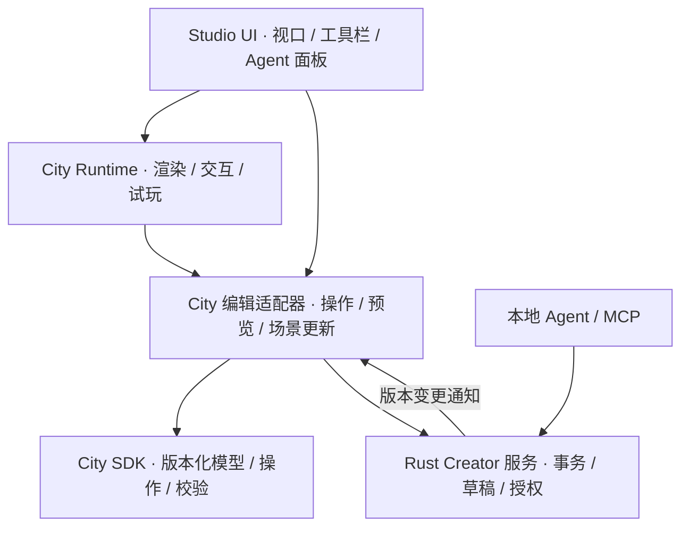

# Agent City Creator Studio 代码架构方案

状态：待评审
日期：2026-11-11
产品需求：[Creator Studio PRD](AGENT_CITY_CREATOR_STUDIO_PRD_2026_11_11.md)

## 1. 范围与现状

本方案让官方 Studio 在一个 WebView 中承载实时 City 视口、编辑工具和 Agent 对话。它复用 City 的渲染、输入与现有修复功能，统一玩家和 Agent 对项目的编辑。

主工作区 `dev` 的 `apps/agent-city/ui/src/CityApp.tsx` 创建 `CityEngine` 并装配 `usePlanRepair`。`planRepair/controller.ts` 提供交互状态机，`session.ts` 通过 `cityPlanPatchStore` 按 seed 读取、保存 `PlanPatchV1`，包含撤销、重做和延迟保存。Hook 连接引擎、预览覆盖层和键盘输入，试玩与修复目前互斥。

SDK 迁移切片 `codex/city-sdk-migration-slice` 已于 `e37ffe3b` 合入 `dev`。其 `packages/agent-vitals-city-sdk` 定义场景、世界、皮肤、挂载和规则，`apps/desktop/src-tauri/src/creator_projects.rs` 提供项目预览与 revision 提交，`crates/agent-vitals-mcp/src/mcp/creator_studio.rs` 的 Studio MCP 路由要求活动 Studio。City 当前消费已发布内容与固定试玩交接。以上能力已可用，但尚未形成共享实时草稿。

官方宿主一次运行一个活动插件。普通宿主 Tab 切换可暂停和恢复当前插件，切到另一个插件会替换原 WebView。因此 Studio 的对话侧栏和 City 视口需要在同一个 Studio WebView 内组合。

## 2. 目标边界



Rust 项目服务拥有已提交的项目 revision 与持久化事务。City Runtime 是当前草稿的可恢复视图，负责 3D 场景和输入。官方 TS 适配器保留城市规划、几何和业务语义校验，宿主执行结构、预算、授权和事务检查。运行时提示或几何预览无法替代提交时的权威版本检查。

MCP 在现有实现中经活动 Studio 路由，这是 MVP 对话侧栏的默认接入方式；图中 MCP 到服务为逻辑请求路径。是否改成宿主直接路由作为备选在实现时评估，需保留会话身份、授权与单次请求边界。

## 3. 代码职责

| 职责 | 可复用来源 | 调整 |
|---|---|---|
| City 视口 | `CityApp.tsx`、`CityEngine.ts` | 提取明确的创建、载入、暂停、恢复、销毁入口。City 与 Studio 分别组合自己的页面 |
| 编辑交互 | `planRepair/controller.ts`、`overlay.ts`、`usePlanRepair.ts` | 保留工具与校验，拆出与 React 和宿主无关的操作调用边界 |
| 城市补丁 | `planRepair/session.ts`、`engine/planPatch.ts` | 为既有 patch 提供可版本化的项目适配与迁移，保留旧数据 |
| SDK 契约 | `packages/agent-vitals-city-sdk` | 扩充建筑移动、道路及选区所需的版本化操作，复用已有场景和挂载类型 |
| 项目服务 | `apps/desktop/src-tauri/src/creator_projects.rs` | 事务化管理项目与编辑结果，提供活动视口使用的有界接口 |
| Agent 调用 | `crates/agent-vitals-mcp/src/mcp/creator_studio.rs` | 扩充选区查询及相同编辑操作，保持现有预览、revision 与幂等语义 |

拆分应以依赖和实际调用为界，先抽取最小视口和一次建筑移动。目录及模块名在实现时按现有仓库结构确定。

## 4. 对象与操作契约

每个项目记录稳定的 `projectId`、单调递增的 `revision`、世界来源、种子和生成器版本、城市补丁、场景对象、游戏挂载及引用资产。`cityId` 标识玩家的城市实例，与插件 WebView 实例 ID 分开。既有城市迁移时记录来源与导入状态。

以下是目标接口示意，字段与错误码需结合现有 SDK 类型定稿。

```ts
type EditRequest = {
  projectId: string;
  baseRevision: number;
  operations: CityEditOperation[];
};

type EditPreview = {
  previewId: string;
  baseRevision: number;
  changes: CityChange[];
  diagnostics: Diagnostic[];
  expiresAt: string;
};

type CommitRequest = {
  projectId: string;
  expectedRevision: number;
  previewId: string;
  operationId: string;
};
```

操作首批覆盖建筑移动、场景对象与锚点变更、游戏挂载。道路操作逐项映射现有 `PlanPatchV1` 语义，包含坐标、图节点和生成器版本等必要信息。操作必须有稳定对象引用和数量、大小上限。预览绑定项目、基础 revision、规范化操作与发起会话（默认路由下即活动 Studio 的 MCP 会话），过期或 revision 变化后重新预览。提交在同一事务内校验 revision、写草稿、记录 `operationId` 和结果，原子生效：进程崩溃或强杀后项目恢复到最后一个完整 revision，不出现半写状态。重复提交返回同一结果，超时可查询操作状态。

## 5. 实时编辑与一致性

1. 玩家或 Agent 读取项目 revision 和所需的选区上下文，产生有界操作。
2. 适配器基于固定基础版本生成临时预览，复用现有 `RepairController`、几何校验与 overlay。预览内容和诊断一起显示。
3. 提交前再次校验。服务成功提交后发布项目与新 revision 的变更通知。运行时按序应用变更或重新读取草稿。
4. 提交失败时移除或标记预览，保留已提交场景。版本冲突要求重新读取并重新预览。通知丢失、乱序或重连时按 revision 重新读取完整项目。
5. 撤销和重做通过项目服务提交逆操作或恢复受控快照，形成新 revision。MVP 撤销栈仅覆盖本次 Studio 会话内已提交的操作：从旧修复会话进入 Studio 时不继承内存历史，这是预期降级而非缺陷。

现有道路和建筑编辑直接更新内存引擎并异步保存。迁移时需要处理保存失败、快速连续操作、旧版本覆盖、关闭窗口以及进程崩溃或强杀。方案应让内存预览与已提交 revision 可区分，保证失败后能从服务恢复。不要让旧 patch store 和项目服务长期分别成为同一编辑内容的写入权威。

## 6. 旧城市和资产迁移

首次把旧 City 引入项目时，读取原 seed、生成器版本和原始 patch，建立新项目并记录导入结果。验证可映射的建筑、道路与资源引用。发现失效对象或生成器变化时使用现有重定位能力并显示未解决项。事务成功前保留旧存档，导入重试使用稳定操作 ID，确保不会创建重复项目。导入后的原 City 行为和新项目在对应版本下应一致。

项目通过稳定资产 ID 和内容摘要引用模型。安装、升级与清理按引用关系管理，读取资产由宿主限定在已授权的项目或已安装内容范围内。开发中的手动导入与未来 GitHub 下载、正式安装各有独立状态。

## 7. 试玩与生命周期

试玩前保存草稿，按 `projectId + revision` 固定世界、补丁、玩法、挂载、资产及规则版本，生成不可变快照和 `runId`。活动协调器负责准入，场景资源租约属于该活动。获取失败、完成、取消、WebView 销毁或启动异常均释放资源，记录终态。返回时恢复项目、镜头和选中对象。运行中的试玩使用固定快照，编辑产生的新 revision 供下次试玩。

Studio 的视口在卸载时清理 renderer、事件监听、网络和资产引用。宿主仍按活动插件实例检查每个请求与响应。官方 TS 通过描述符授权的 typed DTO 读取本地数据，业务投影留在可信 TS。MCP、远端与浏览器预览遵循仓库现有数据政策。

## 8. 交付切片和验证

| 顺序 | 交付 | 验收 |
|---|---|---|
| 1 | 基于已合入 `dev` 的 SDK 切片，抽出 Studio 可承载的 City 视口 | City 与 Studio 都能加载同一座城市，销毁重开无资源泄漏和权限越界 |
| 2 | 旧 patch 导入、共享项目 revision、玩家建筑移动 | 原城市修复保留，导入可重试，编辑后重启恢复，保存失败不覆盖旧数据 |
| 3 | Agent 选区、预览、确认、提交及场景同步 | 同一建筑由玩家和 Agent 连续修改，过期预览、重复请求和并发冲突结果正确 |
| 4 | 检查点编辑与原地试玩 | 根据固定版本真实输入完成竞速结算，取消、失败和重开恢复上下文 |
| 5 | 内容打包、第二种城市与 GitHub 分发 | 干净客户端导入后可试玩，同一游戏分别绑定双岛和沙漠城市 |

自动化重点覆盖旧 patch 导入、跨语言契约样例、版本冲突与幂等、失败恢复、活动与资源释放。桌面验收使用 Tauri app bundle，覆盖地图交互、实际输入与重启。现有纯数据测试可验证规则重放，3D 显示和输入仍需运行时验收。
