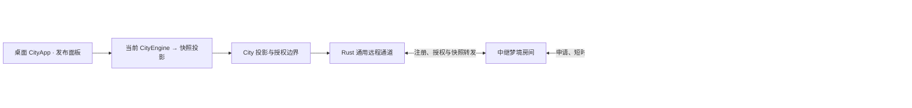

# Agent City 梦境城市实施 SPEC 与工作量评估

- **日期** 2026-11-08
- **状态** 部分实施，未达到发布条件（截至 2026-11-10）。本文件开头的现状与第 5 节“当前实施状态”是权威快照；按切片追加的历史记录仅代表其记录时状态。通用 Rust relay、typed data、TS Dream adapter 及 UI `remote.html` 构建已接线；City 主投影由 TS adapter 组合 typed DTO 提供。旧 `city:v3` data projection grant、宿主分派与 UI crosswalk 调用已退役；迁移期通过固定 `city-asset-crosswalk:v1` typed source 在本机把旧 `ca_*` 映射至稳定 `srp_*`，不回传 session key/HMAC。建筑业务调用和小队发布已迁到 TS adapter + 通用 host-call/state/object 端口；session detail/excerpts/cost 已改为通用 typed API 唯一路径。`game-links:v1` 写入特判已退役，旧收藏只读迁入通用 scope；迁移未完成的收藏暂时不可编辑，直到通用 scope 完成校验。旧资产读取与迁移仍依赖 City 专用 SQLite 导出和最多 4,000 个旧资产对象。Relay Worker 已部署并通过匿名 HTTP 静态资源 smoke check；真实桌面 Tauri → Worker → 访客控制 E2E 仍未验证，因此整体未达到发布验收条件。
- **2026-11-10 beta.4 City 首屏授权修复：** 真机打开打包版后，City 载入失败并显示 `typed_object_denied`。根因是 `city.asset:v1` 的 descriptor 未授权 `list`，而 City projection 会通过通用对象 `list` 对拍稳定资产引用；宿主正确拒绝后使整体投影失败。现已为该对象类型补充最小 `list` 操作授权，并在 descriptor 回归断言中锁定。`cargo tauri build --bundles app` 与 `cargo check --manifest-path apps/desktop/src-tauri/Cargo.toml --tests` 成功，`git diff --check` 无输出；重启构建产物后真实桌面 City 完成载入，界面明确显示“本机真实数据”和“本机只读投影”。这只验证了本机 City 主投影启动，不代表 legacy 数据 authority cutover、访客远程 E2E 或发布验收已完成。
- **2026-11-10 squad mailbox 迁移入口收敛：** City 主界面不再在每次建筑覆盖刷新时另读旧 mailbox 并重复导入；一次性 claims/mailbox copy-forward 后，界面从通用 `city-squad:v1` state 恢复有界事件列表。建筑 MCP read handler 不再隐式触发 squad SQLite 导入副作用，删除旧 mailbox-only typed export helper。Agent City `npm run typecheck`、`npm run build` 与 `git diff --check` 通过。旧 SQLite 首次 copy-forward 及 legacy building/bookmark/source crosswalk 仍存在，不能移除 legacy adapter 或 grants。
- **2026-11-10 Relay Worker 部署：** 按用户已授权的现有服务更新，运行 Agent City UI `npm run typecheck`、Relay `npm test`（26/26）、Relay `npm run typecheck`、UI `npm run build` 和 Wrangler `--dry-run` 均通过后，部署 `agent-city-mecha-relay` 至 `relay.ohagent.ai`。Cloudflare 返回 Version ID `60db2a5c-149f-4c1a-a475-b711a7bffb14`，上传 17 个新/变更静态资源，绑定 `MATCH_ROOM` 与 `ASSETS`。线上 smoke check 使用浏览器 User-Agent 访问 `/`、`/remote`、`/remote.html` 均为 200；Remote HTML 引用的 5 个核心 JS/CSS 资源均为 200。没有创建带真实桌面会话的邀请或执行远端控制，因此这不证明完整发布链路已可用。裸 Python 请求曾被边缘返回 403；带浏览器 User-Agent 的只读请求成功，需在真实浏览器 E2E 中继续确认。
- **2026-11-10 query 生产边界：** 旧 `city:v3` query 实现、契约测试和 City legacy registry writer/publisher 已限制在 `cfg(test)`；生产仍保留 `city-legacy-store:v1` / `city-asset-crosswalk:v1` 对旧 SQLite 的有界迁移读取。当前机器的旧资产引用 preflight 已闭合 3 个在用引用，但尚未执行通用对象迁移与 authority cutover，因此不能删除 `city_assets.rs`、legacy grants 或旧存储。`cargo check -p agent-vitals-query --lib` 与 `cargo check -p agent-vitals-query --tests` 通过，未运行测试。
- **2026-11-10 v1.5 Rust remote adapter 退生产：** `mecha:v4` 使用 descriptor 中固定的 capability/session profile、Rust generic gateway 与 TS `MechaV15RemoteHostAdapter`。旧 `mecha_remote_adapter.rs` 和旧 Rust `RemoteAdapter` payload 校验现在仅在测试编译中保留；正式构建的 adapter manifest 为空，新增游戏的 session 启动不再要求登记 Rust 游戏适配器。旧 v1–v3 capability 已从 City descriptor 移除，不能再由宿主授权创建会话；访客保留旧链接识别并显示退役说明。验证：Tauri `cargo check --manifest-path apps/desktop/src-tauri/Cargo.toml --lib`、Agent City `npm run typecheck`、plugins.json 解析和 `git diff --check` 通过；未运行测试或远程浏览器 E2E。
- **2026-11-10 访客端旧协议客户端退役：** `RemoteMatchClient` 与 `contracts/transport.ts` 现在只暴露 v1.5 `mecha:v4` 顺序快照、命令提交和 City 快照；删除 v1.4 classic snapshot/plan/deployment/close API、事件解析分支和重复 envelope 解析。`remoteAccess` 只为 v4 建立客户端；旧能力链接仍由入口识别并落到退役提示，不进入 v1.5 客户端。验证：Agent City `npm run typecheck` 和 `git diff --check` 通过，源码扫描确认这些客户端文件无 v1–v3 capability 或 classic 方法；未运行测试或浏览器 E2E。
- **2026-11-10 Rust remote session 字段收敛：** 通用 gateway 只接受/返回 `sessionId`，退役 `matchId` 输入兼容及响应别名；Mecha v1.5 控制面读取 `sessionId` 并在游戏内部映射为本局标识。验证：Tauri `cargo check --manifest-path apps/desktop/src-tauri/Cargo.toml --lib`、Agent City `npm run typecheck` 与 `git diff --check` 通过；未运行测试或浏览器 E2E。
- **2026-11-10 PluginHost typed-data 分发去 City 分支：** `plugin_host.rs` 不再识别 `city-legacy-store` 数据集，而统一把活动插件的 typed/legacy descriptor grants 交给 `typed_data::read_authorized_for_plugin`；City 旧 SQLite source adapter 留在 typed-data 边界内。验证：Tauri `cargo check --manifest-path apps/desktop/src-tauri/Cargo.toml --tests`（仅编译测试目标）与 `git diff --check` 通过；未执行测试。
- **关联** [梦境城市设计](./AGENT_CITY_DREAM_CITY_DESIGN_2026_11_08.md) · [远程布局一致性](./AGENT_CITY_REMOTE_LAYOUT_SYNC_SPEC_2026_11_08.md)

## 1. 目标与原则

桌面用户发布当前城市快照，生成专属链接并分享给朋友。获授权访客在浏览器加载同一座 Agent City，漫游、开车、开飞机或开始独立的机甲 PvE。首版依赖桌面在线，链接限时且可撤销，访客各自的游戏实例驻留浏览器。

梦境的核心是城市快照。复用 `CityEngine`、现有 Three.js 场景和游戏 UI、状态、仿真与规则。驾驶使用 `DrivingState` 和既有驾驶世界，飞行使用 `GameSession`、`FlightSimState` 和 `FlightWorld`，战棋沿用 `SequentialMechaMatch`、`SequentialController` 和 `SequentialTurn` 的本地玩法路径。`SequentialMatchSession` 继续服务现有手机续玩，两条入口共用 `SequentialTurn` 的规则。适配桌面 IPC、输入、存档等宿主依赖时优先注入现有接口。

已有的手机续玩仍控制桌面当前机甲对局。梦境访客启动新游戏，状态不写回桌面。首版玩法状态保存在各访客页面内，刷新或关闭页面会结束该局。

## 2. 现状与前置条件

> **现状记录规则（2026-11-09）**：本节及第 5 节当前状态优先于后文历史方案/实施记录；后者用于保留当时决策和验证证据，不应被视为当前完成状态或发布证明。

- 工作区已有 `remote-city-display:v2`、`remote-city-layout:v1` 和 Dream 城市快照/访客 renderer。Dream descriptor 已登记 `city-dream:v1` capability、`dream.bootstrap` profile 与 projection grant；TS 静态 host adapter、访客入口及桌面发布者生命周期 UI（发布、分享邀请、逐访客审批/撤销、停止）已接线。
- 2026-11-10 typed-data 当前状态：Rust 提供窗口会话 DTO `harness-sessions:v1/v2/v3/v4`、无窗口全生命周期 DTO `harness-sessions:v5` 与轻量身份目录 `harness-session-identities:v1`，以及 `usage-summary:v1`、`activity-summary:v1`、`model-usage:v1`、`time-coverage:v1`、`finding-summary:v1`、`skill-usage-summary:v1`、`workflow-activity-summary:v1`、`harness-session-detail:v1`、`session-excerpts:v1`、`session-cost:v1`。City summary/activity/model/time/findings/skills/workflow aggregates 已由 typed-data 提供；`city:v3` 不再计算或传输这些聚合。City session list 主路径为窗口 DTO；v3 仅服务尚未映射的旧资产 crosswalk，不再承担常规 parity/fallback。session detail/excerpts/cost 已迁为 typed API 唯一路径，City v3 的 `session.detail` 操作已移除。SDK 对请求与响应执行固定合同校验。
- 2026-11-10 City session projection 当前源：内嵌官方插件由可信 TS adapter 组合通用窗口 `harness-sessions:v4`、typed aggregates、stable refs 和 generic asset objects；完整 City 展示由 typed projection 提供。旧 `city:v3` data projection grant、宿主分派与 UI 调用已移除。无窗口身份目录可完整核对全历史 session ID/stableRef；新增迁移 typed source 在本机利用旧 registry HMAC join 将指定旧 `ca_*` 映射至稳定 `srp_*`，不把 HMAC/session key 暴露给 TS。已删除或没有可用 key hash 的旧来源仍明确 unresolved。`city_v3.rs` 源文件暂留给旧契约测试，但不再有 descriptor 授权或宿主调用；`city_assets.rs` 仍承担 legacy store 导出和资产 crosswalk。
- 2026-11-10 City typed 读取路径与性能评估：移除完整 v3 投影回退，避免 typed 失败后再重复加载 v3 全会话页；typed aggregates 五类查询在 TS adapter 中并发，sessions 与 harness 清单也并发。旧 game_links/save_refs、building.overrides、claims 已合并为单个无筛选 legacy 导出分页流，按 record.source 在 TS 分流，建筑覆盖行也复用于本次 UI 导入。crosswalk 不再重复全量导出旧业务表；每个 legacy page 仍重算 registry/building 全量指纹，所以成本随页数下降但未消失。该结论是根据请求调用数与实现路径推断，不是运行时基准；需在真实大数据量机器记录总延迟、IPC 数、阶段耗时、响应字节与 legacy fingerprint 次数/耗时。typed 兼容失败显式报告 unavailable，不再以完整 City v3 投影静默兜底。Agent City `npm run typecheck`、query `cargo check` 和 `git diff --check` 通过；未运行测试或真实桌面运行验收。
- 2026-11-10 旧建筑/IM Rust handler 退出生产编译：MCP building 与 IM 工具已通过通用 `plugin_calls` 队列调用 City TS adapter；`city_building.rs`、`city_im.rs` 现在仅在 query crate 的 `cfg(test)` 下编译。旧 SQLite 只读导出辅助已移到仍在使用的 `city_assets.rs` 迁移边界，MCP 不再设置旧 `city_im` 全局客户端名。query、MCP 与桌面 Tauri library 的普通 `cargo check` 通过，未运行测试。该切片退役了两份生产 Rust 业务实现，但不等于可以删除文件：测试基线和 legacy export 还依赖相关旧 schema；`city_assets.rs`、`city_v3.rs` 仍在生产调用链。
- 2026-11-10 `game-links:v1` 读取迁入 typed legacy export：BuildingBookmark 的旧收藏读取已通过 descriptor 授权的 `city-legacy-store:v1` 数据集读取；`game_links_state` 收窄为只写兼容路径，并在非写请求时不再创建/打开旧 registry。旧客户端/未迁移档案仍可能需要兼容写入；本地收藏尚未完成 generic state 全量 cutover，因此这一步不能移除 `city_assets.rs` 或 `game-links:v1` descriptor grant。已更新 Rust 集成基线以从 typed migration export 核对写入文档。静态检查 `cargo check -p agent-vitals-query` 与 `git diff --check` 通过；未运行测试。
- 2026-11-10 资产身份 cutover 的具体阻塞与迁移合同：generic typed session 路径由 `stable_ref` 推导新 `ca_*`，旧 `city-assets` registry 则使用本机随机 secret 生成独立 `asset_ref`，而 `city-legacy-store:v1` 只导出 registry 行，不包含能在 TS 侧将旧 `asset_ref` 关联到 `stable_ref` 的 join key。兼容迁移应由可信 TS adapter 在同一 `data_revision`、window 与有界 snapshot 内，临时对拍 `city:v3` 会话 ID/旧 `asset_ref` 和 typed session ID/`stable_ref`；只迁移旧 bookmarks、building overrides、claims 实际引用的资产，不对全部 registry 无差别创建对象。每个映射用旧 `ca_*` 作为 generic asset alias、以 `stable_ref` 建关联，幂等写入；再次读取校验 revision、去重数量和所有旧引用闭包后，才将通用 bookmark scope 标为 authoritative。跨窗口或已删除来源保留旧引用并明确报告 unresolved，不能伪造新 ID。v3 compatibility fallback 仅能在所有需要保留的旧引用完成映射并通过真实旧数据 preflight 后移除。
- 2026-11-10 typed 主路径 crosswalk 首步：TS adapter 通过同一 version-vector 读取旧 `game-links`/`save_refs` bookmarks、building override 和 claim refs，并检查 generic `city.asset:v1` 是否已有 stable-ref crosswalk。存在未映射引用时，先取 v3 snapshot，再以其精确 `data_revision` 与 window `to_ms` 读取 typed sessions/stable refs；仅为当前窗口内命中的旧引用幂等建立/归并资产对象，更新本次 projection 的 `asset_ref` 和稳定映射。legacy source revision 在对象迁移后复核；跨窗口/删除来源未命中时保留 unresolved 计数，不伪造映射。已映射 refs 会跳过 v3 bridge；未映射旧 refs 仍可能在后续窗口再次触发。UI typecheck、`git diff --check` 通过，未运行测试。该切片尚未验证真实旧数据的引用闭包，也未迁移所有历史事件/资产记录，故不能删除 `city:v3` / `city_assets.rs`。
- 2026-11-09 通用 object/scope/CAS/event primitives 已实现，包括隔离存储、受 descriptor 限制的句柄、对象和 scope revision、原子 CAS/事件及 SDK DTO。City TS 已将 `harness-sessions:v4` 的稳定 source refs 与 City 资产引用在同一 pinned snapshot 中临时关联，并把旧 `city:v3` 返回的既有建筑覆盖按稳定引用幂等导入 `city.building-kit:v1`；旧覆盖的稳定别名现在使用有界批量对象查询，避免逐条 read IPC。另有对象读取和 CAS set/reset 适配器，但尚未接入实际业务写入路径。导入过程中旧路由仍是权威数据源；对象差异/无授权/传输失败均保留旧结果，拒绝覆盖已有对象。City UI 没有建筑编辑入口，当前 MCP set/reset 仍直接写旧 SQLite，因此新 CAS 适配器还不是写入来源。claims、squad mailbox 也未迁移；`city:v3` 与旧建筑持久化仍是发布阻塞，旧路由暂不得删除。
- **历史阶段记录（2026-11-09，部署结论已被后续证据 supersede）：** 当时生产 Worker/remote entry 尚未更新。本文件顶部记录了 2026-11-10 的线上部署版本和静态资源 smoke evidence；真实桌面 → Worker → 访客玩法控制仍未端到端验收。
- 当前落地阶段覆盖通用远程 API、TS 投影、owner 发布链接源码和定向合成测试。桌面发布界面在重新捕获快照时会重置 consent；发布期间切换到驾驶/战棋后仍可打开远程访问管理并停止发布。
- 最新 Dream display projection 已在快照中携带城市/区域/建筑会话数量、活跃状态、token 用量，以及受长度限制的建筑会话标题和标题来源类别；owner consent 文案已按实际字段逐项披露。当前 UI consent 是运行时外发的必要门槛，不替代对布局和视觉侧信道的评估。
- 上述接线与合成测试不等于真实 Tauri 隐藏 WebView → Relay → 访客的端到端验收。本轮未访问真实 City 本机数据、未连接真实 Relay，也未部署生产服务。真实城市多规划模式 payload 大小、桌面/访客同场景外观、撤销/断线/重连及完整服务配置仍待验收。
- 剩余本机数据迁移依赖完整功能字段，按以下顺序实施。session detail/excerpts/cost 与 summary/activity/model/time/findings/skills/workflow aggregates 为 typed-only；session 页也已切到 typed DTO 主路径，迁移失败显式返回不可用，不再以完整 City v3 投影回退。旧 v3 模块现在只用于测试：
  1. `city-remote-display:v2` TS 迁移已完成：Mecha owner 使用可信 TS projector，Rust remote-display module 只留测试基线；超限错误码现明确为 `remote_city_too_large`。仍须以真实业务 payload 验证现有 230 KiB 限额是否足够。当前合成样本为 433,015 bytes，会被现有预算拒绝，不能通过放宽 Rust 上限规避。
  2. `city-seed:v1` 已迁入通用 `plugin.state`；City seed 不再读旧 `city-settings:v1` 投影，首次加载会生成新种子并直接写入通用 state。旧资产身份 crosswalk 已拆为 descriptor 授权的 `city-asset-crosswalk:v1` typed source，不再调用 `city:v3`。
  3. Typed aggregates 已有 usage/activity/model/time/findings/skills/workflow 数据集并进入默认 provider；detail/cost/excerpts 也有独立 typed dataset。City 主数据不再经 `city:v3` 路由；迁移输入不完整时显式报告 unresolved/unavailable，不从可见子集伪造全窗口聚合。仍需真实运行数据与 UI 验收。
  4. 通用 object/scope/CAS/event primitive 已存在；City TS 已接入稳定 source-ref 临时 crosswalk 与既有 building override 的幂等导入，但还需迁移 authoritative read/write、已保存 kit/asset 引用、claims 和 mailbox。不得让 TS 获取 raw DB key、任意文件/SQL，或把 session ephemeral ref 当成持久 asset id。
  5. City provider 现默认使用 TS typed/object 路径；旧 `city:v3` data projection grant、UI 对照/回退与生产 `data.read` 分派已移除，`city_v3.rs` 现从正式编译隔离。剩余验收是将真实本机 legacy 资产/收藏数据导入通用对象与 scope，并检查映射闭包、未映射/已删除来源呈现和收藏集合一致性；完成后再删除 `city_v3.rs` 测试基线、旧 SQLite 导出、legacy grants 及不再需要的 registry 写路径。
- 每个步骤均需单独验证：既有 UI 输出、排序/分页/窗口边界、4,000 条覆盖、revision 重试、seed/资产持久关联和费用诚实规则；若任一新 DTO 不能保留现有行为，先补充 typed source contract，不做静默降级。
- 项目已有驾驶、飞行、战棋和城市场景代码。浏览器环境对桌面服务、场景所有权、存档、移动端输入和静态资源的依赖仍需逐项核实。
- 数据政策要求用户主动开启并授权接收设备，中继不得持久化场景及玩法正文。首版不设计桌面离线时仍可访问的云端存储。

## 3. 工作量评估

以一名熟悉本仓库的全栈工程师为口径，1 人日按 8 小时有效工作估算，包含编码、自测和阶段验收，不含等待外部审批或应用商店审核。区间是初步工程估算，M0 用真实城市数据和实机结果重新校准。

| 阶段 | 工作内容 | 人日区间 | 完成条件 |
| --- | --- | ---: | --- |
| M0 基线 | 核对快照与现有玩法依赖，测量真实城市大小、截图、几何和外观差异 | 3–5 | 已记录真实样本，识别影响还原或超限的具体问题 |
| M1 城市与链接 | 通用快照合同、分享界面、房间和多访客授权、漫游、撤销、重连 | 8–14 | 两个访客经同一链接分别授权，能加载同一城市并独立撤销 |
| M2 开车 | 复用驾驶世界和 HUD，浏览器输入、出生点、碰撞、退出 | 4–7 | 手机与桌面浏览器可完整驾驶并安全回城 |
| M3 飞行 | 复用飞行会话、世界、相机和 HUD，移动端输入、机场起降 | 4–7 | 手机与桌面浏览器可起飞、飞行、降落、退出 |
| M4 战棋 | 快照战场适配、复用 v1.5 本地对局 UI 和规则、隔离存档 | 5–9 | 多个访客独立完成 PvE，对桌面和彼此无写入 |
| M5 集成验收 | 实机、断线、授权、旧续玩回归和性能问题修复 | 4–7 | 第 7 节验收通过并留存证据 |
| **合计** | **首版端到端** | **28–49 人日** | 包含阶段内验证，不含独立团队的额外协调成本 |

如果 M0 发现真实城市远超 230 KiB，需增加紧凑编码或分片设计，预计额外 **4–10 人日**，实施前根据实际数据重新估算。若移动端无法承载完整城市，需另行评估性能优化。以上区间是人力总量，不等同于日历工期，多人可并行 M2、M3 的浏览器适配，但应先完成 M1 稳定合同，并预留集成与评审时间。首版从 M0 到可体验城市漫游预计 **11–19 人日**，包括 M0 和 M1，不代表三项游戏已交付。

## 4. 产品流程

1. 桌面进入城市，选择「开启梦境」，预览分享内容和可用玩法。默认仅分享城市几何、地标和入口，名称、用量等字段需明确选择并授权。分享前说明中继地址、开放期限和传输方式。
2. 桌面完成布局、玩法入口、兼容版本和 UTF-8 payload 大小检查。中继与宿主就绪后显示可复制链接。失败时显示原因并清理中间房间。
3. 每个访客通过同一链接申请访问，在自己的浏览器生成独立配对凭据。岛主逐人允许或拒绝。授权后访客加载当前发布的固定快照并显示可用玩法。
4. 访客使用现有玩法 UI，在当前页面持有自己的游戏实例。退出玩法回到城市，重开游戏只影响自己的实例。页面刷新或关闭时提醒当前局结束。
5. 岛主可撤销单个访客或关闭梦境。后续更新城市通过重新发布生成新版本，已有访客不被静默切换地图。

## 4.1 通用持久对象、引用范围与事件端口（迁移前置）

本节定义 Rust 可提供而不理解 City/游戏业务语义的最小本机持久化能力。它不是任意 JSON/SQL IPC：访问仍限于活动内置插件实例、官方 descriptor grant 和固定版本的 SDK DTO；TypeScript 可信 adapter 承担 schema、业务有效性、脱敏与 UI 行为校验。

### Descriptor grant

每项 grant 静态声明 `objectType`、`schemaVersion`、允许操作集、对象最大字节数、总存储字节数、每插件对象数上限、事件页大小/保留上限，以及可用的 `scopeType`。Rust 按注册插件 ID + objectType + schemaVersion + 操作逐次授权。请求不得携带路径、任意字段选择器、SQL、动态表名、未声明 objectType 或任意 callback。Object body 是有界 opaque JSON object；Rust 只校验 JSON 语法、顶层为 object、对象/总存储字节上限、opaque handle 格式、revision 和交易约束，不解释其中的 keys。幂等记录也有固定存储上限，达到上限时明确失败，不静默遗忘仍可能被重试的 key。

### 固定操作与 DTO

SDK 只暴露下列定型方法；每个方法都采用精确键集合和有界响应：

| 操作 | DTO 要点 | 安全/一致性规则 |
| --- | --- | --- |
| `object.create` | `objectType`, `schemaVersion`, `body`, `idempotencyKey` | Rust 生成不可猜测 `ob_*` handle；重复幂等键返回同一结果；事务内写初始 revision 1 |
| `object.read` | `objectType`, `handle` | 只读授权 type 下的指定对象及当前 revision，不接收 JSON selector |
| `object.list` | `objectType`、bounded cursor 或有界 opaque `handles[]`/descriptor alias `aliases[]`、limit | 返回 opaque handle、revision、更新时间及有界 body；过滤只能是精确的授权句柄/别名集合，不支持调用方 order、任意范围查询或数据字段选择器 |
| `object.commit` | `objectType`, `handle`, `expectedRevision`, `body`, bounded `events[]`, `idempotencyKey` | 单个 SQLite transaction：revision CAS、替换当前 body、追加不可变事件记录；冲突不产生部分更新 |
| `object.delete` | `objectType`, `handle`, `expectedRevision`, `idempotencyKey` | CAS tombstone，不重用 handle；已保存引用可明确显示 deleted，而非误映射新对象 |
| `scope.read/commit` | `scopeType`, `scopeHandle`, expected revision, bounded object-handle set | 保存槽/游戏存档由通用 scope 记录表达；只能绑定同一插件、同一 grant 覆盖的对象；一次事务更新 scope revision 与成员关系 |
| `event.page` | `objectType`, `handle`, after cursor, limit | 按 handle/type 返回只追加、有限留存事件；cursor 不接受任意时间/SQL条件，越界/过期返回显式状态 |

所有 revision 都限于 JavaScript safe integer；CAS/事件/幂等记录更新必须同一事务。响应和单条事件各自受 descriptor byte cap 约束；超限、未知版本、cursor 过期、revision conflict、对象删除及 scope 越权都显式失败，不做静默截断或自动覆盖。现有 building contract 的 `reset` 是 City TS adapter 用 CAS 提交默认 body 并递增 revision；generic port 不定义“撤销到任意历史版”的业务语义。事件保留/清理策略由通用 host 固定配置，不允许插件通过请求改变。

### City 兼容映射和渐进切换

1. 新 handle 是通用 `ob_*` opaque reference；旧 `ca_*` 永久身份作为迁移期 alias 保存到同一个 object record，不改变已经保存在 City 设置、build event、kit、save link、claim/mailbox 中的文本值。读取返回两者的映射；新写入只存通用 handle，TS adapter 在兼容边界完成 alias 双读/单写。禁止把一次性 session handle (`sr_*`) 转作资产 ID。
2. 旧来源的每个 `ca_*`、save scope membership、kit body、revision 和 build-event cursor 先以可重入、幂等的只复制迁移导入通用表；在校验完整计数、alias 唯一性、引用闭包、revision/事件顺序及内容哈希之前，旧表仍是读源。迁移失败保留旧源并报告对象级错误，不清空或猜测修复引用。
3. TS City adapter 负责 `session-kit/v1` 与后续 kit schema、claim、mailbox body 验证和构造；Rust object port 不包含这些名称或模型规则。宿主需要的通用并发更新通知使用 opaque `(objectType, handle, revision, eventCursor)` envelope，City 自己选择动画/UI；不得在 Rust plugin host 加 `building`/`squad` 业务事件分支。
4. 开启 typed object 路径需 feature-by-feature 完成 TS shadow compare：同一 fixture 下 legacy body 与 typed body、`ca_*` alias、save-scoped resolve 集合、revision、事件页、reset/rollback 结果一致；还要覆盖跨插件、跨 scope、伪造/重复 alias、失序事件、并发 CAS、进程中断原子性、损坏数据库/恢复副本和上限拒绝。
5. 通过后按 object type 切换默认写读，观察兼容指标后停止 legacy 写入，再切换读源；确认旧数据可从备份恢复且 `ca_*` 所有权/引用闭包一致后，才可删除对应 City handler。session aggregates/detail/cost/excerpts 是各自独立的 typed dataset；不能用 object store 查询替代聚合，也不能以其覆盖旧 route 作为已完成迁移。

### 当前代码差异与结论

截至 2026-11-10，`plugin_state.rs` 提供 descriptor-scoped state CAS 与 mecha replay 存储；`game-links:v1` 特判已退役。City 主投影和 session 统计由 typed DTO + TS adapter 提供，`city_v3.rs` 已从正式构建隔离，仅保留旧契约测试。生产剩余旧数据边界集中在 `city_assets.rs` 的 `ca_*` identity registry、SQLite legacy export 与 crosswalk；`city-legacy-store:v1` 和 `city-asset-crosswalk:v1` 仍由 descriptor 授权。`city_building.rs`、`city_im.rs` 仅为测试基线，生产 MCP 建筑/小队操作分别通过通用 `plugin_calls`/`plugin.state` 到 TS adapter。旧 bookmark、building override 和 squad claim/mailbox 已有 copy-forward，但收藏的全量闭包、历史 building override 全量迁移及 legacy authority cutover 尚未全部验收，因此仍不能删除 legacy export adapter/grant 或旧存储。Remote Worker 已部署并通过静态资源 smoke；真实桌面 → Relay → 访客玩法 E2E 未验收。

**2026-11-09 已实现的通用端口：** `agent-vitals-query::query::object_store` 提供按 plugin ID 隔离的 SQLite、descriptor 参数化 object/scope grants、随机 `ob_*`/`ev_*`/`sc_*` 句柄、多 alias 和幂等 `attachAlias`、对象 create/read/list/CAS commit/tombstone delete/eventPage，以及 scope read/CAS membership commit。对象 list 支持有界、精确的 opaque handle 集合查询，供 scope 成员批量读取；也支持受授权 alias 批量查询，不接受任意字段过滤。对象 body、别名绑定、幂等结果和事件写入在同一事务中；scope revision 和 membership 更新在同一事务中。另提供按 plugin 与 dataset 隔离的 durable opaque source refs：内部 source key 仅以 HMAC 形式保存，TS 可通过固定的 `harness-sessions:v4` DTO 请求 `session.stable_ref`；key 损坏时 fail closed，普通 v3/未请求 stable_ref 的读取不产生映射写入。Tauri 通过固定 typed-object/typed-data 请求、活动插件实例复核和官方 descriptor grants 接线；SDK 提供严格校验的固定 DTO。Rust 不解释对象内容或 City 类型语义。City descriptor 已声明 `harness-sessions:v4` 的 `session.id`/`session.stable_ref` 字段 grant、`city.building-kit:v1` 与 `city.asset:v1` generic object grant，以及 `city.save:v1` scope grant；TS adapter 已在同 revision/window 下读取稳定引用，按稳定引用批量查询并幂等导入既有建筑覆盖，也实现了对象读取和对象 CAS set-reset 适配器。City runtime 现按 alias 批量读取通用建筑对象：包含 `domainRevision` 的 CAS 文档作为通用权威状态，`legacyRevision` 文档只作旧表对拍；通用 reset 也会遮蔽旧 set 行。MCP 仍直接写旧 City 表，因此生产写入尚未迁入 generic object。`city.asset:v1` 已用 `attachAlias` 绑定资产 ref 与 stable source ref。通用 list 的 SDK cursor 字段已与 Tauri 固定请求合同统一为 `afterCursor`。

City 资产迁移已接入**书签 identity/scope 与分阶段 authority 切换**：descriptor 授权 `city.asset:v1` 对象、`city.save:v1` scope 和 alias；可信 TS adapter 可将旧 `ca_*` 作为不透明持久引用写入通用对象，即使暂时没有 session crosswalk 也保留收藏关系。若之后获得对应的 `srp_*` stable ref，adapter 会幂等附加别名并补全对象的 `sourceRef`。BuildingBookmark 首次迁移时将旧 bookmark 集合导入通用 scope，完整集合一致后才 CAS 标记 `city-bookmarks:v1` schemaVersion 2；标记后 generic scope 是收藏读写权威，旧 `game-links:v1` 仅作兼容镜像。迁移不完整时仍走旧读写路径，不切换权威。`session-source-status:v1` 对可关联书签按同 revision/window 与旧 `assets.resolve` 对拍；未知来源不会被误判为 `missing`。收藏切换已进入权威迁移，但旧 `game-links:v1` 兼容读写、`assets.resolve`、`city:v3`、`city_assets` identity/save-ref registry 和遗留数据导出仍有生产调用，故还不能删除 `city_assets.rs` 或 `city_v3.rs`。后续需覆盖新旧窗口并发、迁移中断恢复、旧镜像损坏、窗口切换、来源失效和真实用户数据对拍，再移除旧兼容路由。

**2026-11-10 通用宿主事件增量：** Tauri PluginHost 的实时推送已改为轮询通用 plugin-scoped 本地事件队列，并通过 descriptor 授权的 `plugin.event` 订阅，以 `{ version: 1, source: "host", payload }` opaque envelope 派发。Host 只限制对象形状、64 KiB 大小、活动实例订阅和短期重复投递，不判断 `building`/`squad` 事件 schema；新 WebView 从队列高水位开始，不重放旧实例留下的事件。City TS adapter 在 `CityApp` 内验证 payload 并转回现有 UI reducer 事件。生产 `plugin_host.rs` 已不再读取 City mailbox，也不再启动 Unix socket listener；`city_building.rs` / `city_im.rs` 的可信 Rust 写入端把通知写入通用队列。为保持 `city:v3` 当前状态读取兼容，旧 building/edit/squad mailbox 文件仍会写入并保留读取函数；它们不是实时推送通道，需待 `city:v3` 和 MCP 的旧数据路径一并迁移后再删除。通知响应中的历史 `host-socket` channel 值暂保持，避免本次内部传输替换改变既有响应合同。

**2026-11-10 收藏 authority cutover：** `city-bookmarks:v1` pointer 增加 schemaVersion 2，明确通用 `city.save:v1` scope 已成为收藏权威源。首次迁移仍从旧 `game-links:v1` 导入；提交前重新读取 legacy revision，若其他窗口已变更则重新导入，只有完整引用集合一致时才用 CAS 将 pointer 提升为 v2。已打开的 UI 窗口在每次写入前重新检查 authority 标记；generic scope 成为权威后，旧 `game-links:v1` 只作为兼容镜像，镜像 revision 冲突时重读并重试，失败不回滚通用 scope。导入不完整或校验失败时继续使用旧路径，不提升 authority。旧 Rust 状态路由仍被兼容读取/写入调用，当前不能删除；还需覆盖旧版程序并发、旧 pointer/损坏镜像、真实旧收藏集和恢复语义，再移除兼容写入及 `game-links:v1` 特判。

**2026-11-10 收藏镜像退出：** 已标记 schemaVersion 2 的窗口现在只读写通用 `city.save:v1` scope，不再读取或更新旧 `game-links:v1` 镜像。首次 copy-forward 通过 descriptor-scoped `city-legacy-store:v1` 的 `registry.game_links` typed DTO 读取旧文档，不再调用 City 专用 `plugin.state.read`；未完成迁移时旧 `plugin.state.write` 仍作为兼容回退。因此这减少了已迁移用户的 Rust state 调用和新 UI 的旧 state read 依赖，但 `game_links_state` 写入特判和 `city_assets.rs` 暂时仍须服务尚未完成迁移的本地存档；没有删除 legacy write fallback，也没有宣称该路由已退役。UI `npm run typecheck` 与 `git diff --check` 通过；未运行测试。

**2026-11-10 进展：** 新增通用 `session-source-status:v1` 固定 DTO：输入仅接受最多 200 个 descriptor-scoped `srp_*` stable refs、窗口与 revision；输出只包含请求字段和来源状态。Rust 内部通过 HMAC source mapping 对 authority session 做分批关联，不回传 raw session key；`active`、`deleted`、`missing` 与窗口内 usage 标记可支撑旧 `assets.resolve` 的状态语义。Tauri grant、SDK strict parser 和 City TS host adapter 已接入。`BuildingBookmark` 可批量迁移当前旧书签；完整集合对拍成功后 generic scope 成为收藏权威，已迁移窗口停止更新旧镜像，未迁移档案仍保留旧写入回退。早期收藏和超出当前 typed session 窗口的来源可能没有 `ca_*`→`srp_*` crosswalk；旧 registry 对已删除来源会清空 key hash，无法从旧 `ca_*` 反推出新 stable ref。此类数据由 legacy export 保留，不把无映射状态误判为 `missing`。旧资产查询、registry 与迁移导出仍有生产依赖，`city_assets.rs`、`city_v3.rs` 尚不可删除。

**迁移前置缺口（2026-11-10 历史快照，后续已有下方迁移）：** 当时 generic object/source-ref 与 City adapter 仍处于 shadow 阶段，MCP 直接写旧 SQLite。此段保留作阶段记录；建筑 MCP 调用、TS 建筑/IM handlers 和写入切换已在下方“建筑/小队调用迁移”完成，不能把本段当作当前状态。旧 claims/mailbox、City v2/v3 读取与 legacy 数据导出仍未完成迁移。

**2026-11-10 建筑/小队调用迁移：** MCP `get_building`、`preview_building`、`set_building_model`、`reset_building` 现调用 descriptor 授权的 `city.building.*` local-call queue；CityApp 注册的 TS handlers 负责 session/ref 解析、继承与几何规则校验、CAS 写入 `city.building-kit:v1` 及 UI 事件。MCP `im_publish` 同样通过 `city.im.publish` 调用 TS handler，claims/events 保存于通用 descriptor-scoped `city-squad:v1` state。该迁移切换了业务写入入口，但**没有**切换 City UI 的整体读取投影：provider 仍以 `city:v3` 建立 session/window context；建筑轮询仍从 v3 读取旧 events、claims 和 mailbox，并将旧 overrides 复制/对拍到通用对象；收藏和资产解析也仍保留旧路由。因此 `city_v3.rs`、`city_assets.rs`、`city_building.rs`、`city_im.rs` 当前仍有生产或兼容引用，且不能删掉旧 validator 模块后就声称完整迁移。静态检查通过：`npm run typecheck`（Agent City UI）与 `cargo check -p agent-vitals-mcp`；本轮未运行测试。

**2026-11-10 资产状态 authority cutover：** BuildingBookmark 对已 authoritative 的 generic save scope，若全部收藏均有 `srp_*` 稳定来源引用，则直接使用当前 City projection 的 pinned revision/window 请求 `session-source-status:v1`，不再调用 `city:v3 assets.resolve`。scope 尚未 authoritative、来源引用不完整或 typed 查询失败时仍回退旧 resolver；旧 resolver 路径继续与 typed DTO 对拍，并仅在完整匹配时选择 typed 结果。修正了 typed DTO 的窗口边界查询：内部 usage 查询使用 `[from_ms, to_ms)` 的排他终点，与响应 DTO 及旧 City projection 的 pinned window 一致，避免把恰好位于 `to_ms` 的事件额外计入窗口。故该操作已切换部分成熟数据的读取来源，但迁移中和兼容路径仍引用 `assets.resolve` / `city_assets.rs`，暂不能删除。

**（历史核对，部分已 superseded）Rust City 模块退役条件（2026-11-10）：** `query/city_v3.rs` 仍由 `plugin_projections.rs` 直接分派，并承载桌面 City 的 session/modules/assets/building 读取；`query/city_assets.rs` 仍由 `plugin_state.rs` 的 `game-links:v1` 特判、`typed_data.rs` 的 legacy export、`city_v3.rs` 调用；`query/city_building.rs` 仍被 city v3/building-asset export 用于旧 SQLite overrides/events 读取及遗留导出。`query/city_im.rs` 仍被 city v3 用于旧 claims/squad mailbox 读取；MCP `im_publish` 已改走通用 local-call 队列与 TS handler。建筑规则模块当时仍进入生产构建；2026-11-10 后续将其及旧 mesh 规则限于测试构建。整体 City query 模块仍不可安全删除。

**2026-11-10 建筑规则生产边界收紧（后续状态见 2026-11-10 新增章节）：** MCP 建筑工具已改走 `city.building.*` 通用 local-call 队列，TS handler 承接写入和校验；旧 Rust `get/preview/set/reset`、编辑通知组装及 design-coherence 校验仅在 `cfg(test)` 下保留作历史 parity 基线。其后 TS provider 接手了 v3 继承文档解析，Catalog/Compliance/Inheritance 与旧 mesh 规则亦已限于测试构建。建筑旧 SQLite overrides/events 与 legacy export 仍阻止 `city_building.rs` 删除。

**2026-11-10 建筑旧数据引导改为按需一次性读取：** `readBuildingOverrides` 对每个本地 WebView 生命周期内已完成引导的 asset ref 不再周期性请求旧覆盖；旧覆盖只在首次/新窗口通过 typed legacy export 读取并导入 `city.building-kit:v1`，常规刷新改为按 stable ref 批量读 generic objects，并用对象 revision 发现 set/reset。无旧覆盖时缓存空结果；旧行格式无效、没有 stable ref、对象读取/导入冲突或传输失败时不记为已完成，后续继续走旧兼容数据，避免静默丢失。该切片完成后见下方最新记录。

**2026-11-10 旧建筑覆盖、认领与邮箱退出 `city:v3`：** City TS adapter 分别通过 descriptor 授权的 `city-legacy-store:v1` 固定数据集分页读取 `building.overrides`、`building.claims` 和单条 `building.squad_mailbox`，并在 TS 侧迁入 `city.building-kit:v1` / `city-squad:v1`；认领导入记录源 revision，避免重复扫描。建筑当前状态由通用对象快照及其 revision 恢复，实时变化由通用插件事件和对象 revision 轮询承接，不再需要旧 building event 表读取。因此已删除 `city:v3 buildings.events` 分支，City v3 当前仅保留 overview 与 sessions.page。旧 build-event 数据集仍只存在于兼容导出格式，后续清理 legacy export 时再移除。验证：Agent City UI `npm run typecheck`、SDK `npx tsc --noEmit`、`cargo check -p agent-vitals-query`、Tauri `cargo check --manifest-path apps/desktop/src-tauri/Cargo.toml --lib`、`git diff --check` 均通过；本轮未运行测试。

退役目标是 `agent-vitals-query` 不再导出 City 业务模块：City 统计由通用固定 typed datasets + TS 投影承接；建筑套件/几何规则、claims 和 mailbox 由可信静态 TS adapter 承接；Rust 仅保留 descriptor 授权、通用对象/scope/CAS、稳定来源引用、事件队列和宿主请求传输。通用 request/reply、MCP caller 与 City 建筑/小队 TS handlers 已接线。剩余工作是迁移资产 registry/game-links 的完整数据，完成 City v2/v3 主 session/window 投影的 typed/object 替代、逐功能同 revision 对拍和 authority cutover，再移除旧 grants、兼容路由与 City query 文件。MCP 不得直接向通用 object store 写入未经过 TS 业务校验的 City building body；MCP 建筑工具合同须继续保留在已授权 local-call 通道中。
## 5. 系统与合同

### 5.1 城市快照

从 `cityDisplayProjection.ts` 提取通用 `DreamCitySnapshotV1`，包含 schema、生成器和资源兼容版本、快照 revision、脱敏后的最终几何和外观、初始镜头与玩法入口。每个引用只能指向该快照内的实体。完整校验坐标、数量、引用、数值范围和各层字段白名单。别名转换不得改变建筑颜色、形态、道路及建筑位置。

`RemoteCityScene` 和 `CityEngine` 使用已生效布局恢复场景。地形恢复和道路地形修整必须与导出版本兼容。驾驶和飞行的路面、障碍、出生点及战棋棋盘必须与城市快照属于同一 revision。当前用户已明确要求远端显示城市/会话名称、用量及标签；Dream display projection 以独立版本合同承载获准的数量、活跃状态、token 用量、建筑标题及来源类别，且发布 UI 必须逐项征得同意。不得把这些展示字段塞入 Three.js renderer model。原始会话 ID、日志、提示词、路径、凭据、成本和任意扩展字段不进入投影。

#### 字段来源与隐私评审（M0 门槛）

字段需要由可信 City TS adapter 依据版本化合同作业务校验、显示投影和匿名别名处理；当前 Rust handler 做到的格式/字段校验仅是过渡实现，不能代表最终架构达标或自动满足外发授权。发布 UI 必须展示下面这些可见来源；需要减少暴露时，要改相应投影和访客重建逻辑并另做场景对照，不能在发布时静默改几何。Rust 侧目标是通用 typed data API：只按 descriptor 限定的固定 typed dataset、通用字段、受限 query shape 与数量/字节上限返回 DTO，不执行 City/game schema 校验或业务投影。

| 字段组 | 来源与保留的信息 | 发布处理/用户披露 | 当前状态 |
| --- | --- | --- | --- |
| 地形、海岸与城市骨架（`seed`、`scaleTier`、biome、海岸/河流/道路/桥梁/山体、比例） | 来自 City seed 与布局规划；`scaleTier` 按会话数量每 400 个分档，尺寸可反映城市容量 | 披露真实城市形状与容量分档；若不分享这些信号，须转为独立重建的固定地形快照 | 未完成同意门槛 |
| 区域、地块、建筑 slot 与道路 | 区域数来自真实 harness；building slot 保留实际坐标和区域归属，排序来源包含会话开始顺序，地块与 landValue 暴露真实建设分布 | 披露真实空间布局及其可能的近似时间顺序；若不分享，需为访客生成独立匿名布局 | 未完成同意门槛 |
| 主建筑高度、类型、占地和 seed | 高度由 token 数推导，类型/占地受高度与 session-ref hash 影响；数值清零不会抹去外观中的用量级别和稳定指纹 | consent 已披露建筑外观可能反映使用规模；若采用隐私模式，应在可信 TS City projection adapter 中固定/量化外观参数并验证不会跨发布关联 | UI 披露已接入；视觉侧信道评估仍待完成，重点风险 |
| `massing`、背景楼群 | massing 数量与 overflow 会话相关；背景楼目标数由建筑数派生，auto/full 画面可能显露粗略规模 | 披露楼群数量是本机布局派生；或固定背景数量/移除 massing 并调整重建器 | 未完成同意门槛 |
| 医院、学校、商场、花园与城区地标 | civics 类型/数量与区内会话阈值相关；花园/地标跟随 populated districts 生成；海岛公园/机场等主要由城市配置派生 | 区分真实 usage 派生设施与静态场景装饰；披露或匿名化 usage 派生设施 | 未完成同意门槛 |
| 当前相机、背景、视觉 palette | 相机由发布者当前视角采集，可能暴露其当前关注位置；匿名 palette 已与 harness 名称解耦；backdrop 楼群可能编码规模 | 发布预览和 consent 文案已说明当前视角及布局/规模风险；后续若改默认镜头或匿名布局，必须做场景对照 | UI 披露已接入；来源/视觉侧信道验收未完成 |
| 实体 ID 与缓存键 | trusted TS City adapter 为实体/引用及海岸配置缓存键重新生成发布级别名 | 由可信 TS City adapter 在业务快照合同内实现并验证 opaque alias；不得发送 source IDs、paths、logs、native IDs | TS 实现与合成安全测试已接入；Rust `cfg(test)` 实现仅为 parity/security baseline |

因此 M0 不能仅以“候选可序列化、通过结构验证”关闭。运行时发布前由用户明确同意已披露的实际城市布局、标题与用量字段；字段校验/重键须从 Rust City handler 渐进迁移到 TS 可信 City adapter，并完成差分与安全回归。即使 consent 已接入，真实视觉侧信道与场景一致性仍须验收。

### 5.2 发布与访问

桌面新增梦境发布生命周期，管理 `publicationId`、版本、到期、玩法权限及访客批准状态。一个发布链接对应固定快照。邀请密钥、每个浏览器的配对凭据和单次连接票据分离；链接可分享，不声称绑定物理设备。用户可撤销单个授权或关闭发布。

扩展中继时新增受限梦境 capability 和访问路径，适配多访客，不改变机甲续玩的身份和路由。发布完成前不得展示链接。授权检查发生在发票据和转发快照之前；撤销、关闭、过期和宿主断开要终止相应访问。断线可在授权和版本仍有效时重连；刷新后重新加载快照并开始新的游戏实例。中继只保留短期授权与票据元数据，场景和游戏正文在内存转发。

当前 230 KiB 场景、256 KiB 消息上限先作为预算沿用，M0 必须量出完整编码后大小。超限时阻止发布并说明原因，不能静默删楼或改为匿名模型重新排布。若压缩不足以满足实际场景，另出分片方案并重新审查上限、授权和完整性。

当前发布 path 已由 City TS trusted adapter 执行业务合同深层校验、实体重键和 `dream-city-gzip:v1` 编码（原文最多 4 MiB，压缩 envelope 受 230 KiB 及通道消息上限约束）。Rust descriptor 允许 `city-dream:v1` opaque passthrough，但只在匹配 capability grant 后接受对象，并继续执行通用 bootstrap 消息上限；它不解析或转换 City 字段。通用 Rust typed data API 已接入，提供固定数据集和有界 DTO。Dream capability/profile/grant、TS host adapter、访客入口及 owner 发布/授权生命周期 UI 已接入源码；owner UI 显式披露并要求确认城市布局、标题/来源、会话数、活跃状态和 token 用量。当前尚无真实 Tauri/Relay E2E、部署或完整真实城市场景验收；不得宣称正式可用。

### 5.3 浏览器玩法适配

为现有城市和游戏入口提供浏览器宿主适配，包括资源加载、输入、暂停、相机/场景租约及返回城市。隔离桌面存档和系统调用，明确浏览器版无宿主能力时的行为。游戏实例使用快照衍生的世界，玩法切换先释放旧输入、渲染和相机，再启动新实例。后台、失焦或连接失效时暂停并清理按键状态。

驾驶复用现有路面、碰撞和运动逻辑，验证桥面、高架、障碍及复位。飞行复用机场、地形、障碍和仿真，验证起降与移动端操纵。战棋复用部署、移动、技能、副作用、AI、结算与既有 UI；桌面本局检查点不得成为梦境棋局存储。静态资源按版本分发，版本不兼容须显式提示。

### 5.4 代码分层与落点

下图是目标调用关系。桌面负责发布和授权，访客浏览器独立运行城市和玩法。新增模块名为建议，实施时优先复用现有文件和接口。

| 层 | 已有代码 | 拟新增或修改 |
| --- | --- | --- |
| 桌面发布 | `ui/src/CityApp.tsx`、`CityExperience.tsx`、`engine/CityEngine.ts` | 从 City 工具入口打开梦境面板。发布时读取同一次已生效的布局、模型、背景档位与镜头，再做投影和大小预检。快照按发布冻结 |
| 场景合同 | `ui/src/remote/city/cityDisplayProjection.ts`、`RemoteCityScene.tsx` | 把通用布局投影与恢复提到 `remote/city/` 的共享模块。拆开城市装载和 `CityMechaWorld` 棋盘挂载。手机续玩继续经现有 `RemoteCityDisplay` 外层读取 `site`，梦境通过独立合同读取可选玩法入口 |
| 远程通道与宿主边界 | `apps/desktop/plugins.json`、`src-tauri/src/plugin_host.rs`、`remote_registry.rs`、`remote_transport.rs`、`remote_gateway.rs` | Rust 通道只负责连接、配对、消息路由、票据、通用大小/资源限额、授权及生命周期。descriptor 声明固定 typed dataset/通用字段 scope、受限 query shape 和 max rows/bytes；Rust typed API 返回类型化有界 DTO。City 业务 schema、脱敏、别名、visitor DTO 与压缩由静态 trusted TS City adapter 承担；当前 `plugin_projections.rs` / `city_dream_projection.rs` 属迁移债务，不再增添新的 Rust game/plugin handler |
| 中继与访客入口 | `relay/worker.ts`、`ui/src/remote/remoteAccess.ts`、`ui/vite.config.js` | 通用 Worker 路由与远程入口已在源码中；UI package 已检查并构建 `remote.html`，同一入口按 capability 处理 Dream/Mecha。生产 Worker 是否包含最新入口尚未验证，不能把本地构建视为部署完成 |
| 浏览器玩法 | `ui/src/game/`、`engine/CityEngine.ts`、`game/runtime/GameScenePort.ts` | 浏览器页面持有一个场景引擎，将恢复后的布局交给现有玩法入口。适配只涉及权限、输入、宿主副作用和生命周期，玩法仍通过现有状态及规则实例运行 |

### 5.5 发布、访问与校验调用链

以下是目标调用链设计，不代表生产 Worker 或真实 Tauri/Relay 端到端已验收。

1. 桌面发布面板从同一份当前布局取渲染和玩法数据。投影先生成可公开的别名、几何和外观字段，再生成有资格的玩法入口。快照包含 `schema`、`snapshotRevision`、资源兼容版本、布局、初始镜头及入口。驾驶与飞行优先由共享场景编译路面、地形及碰撞，棋盘可携带校验过的场地描述，避免重复传输整座城市的碰撞数据。
2. City 发布层通过通用宿主 API 请求 descriptor 已授权的 typed data，并从当前 `CityEngine` 获取 app-owned scene state；编译期可信 TS adapter 生成并验证 Dream 业务快照、字段别名和显示 DTO。descriptor/Rust API 只执行通用 dataset/field/query grant、实例授权、行数与字节上限，不能解释 City schema。通用 session runtime 完成宿主启动与 Relay 配对后才返回邀请链接。取消、插件实例失效或启动部分失败时回收已注册的发布。
3. 中继将 `/dream/<publicationId>` 路由至访客页面。访客用邀请凭据提交申请。岛主批准后，访客用独立配对凭据换取短时单次连接票据。`publicationId` 绑定快照版本，配对凭据绑定该发布下的浏览器授权。打开新浏览器需独立申请，原浏览器重连可复用仍有效的授权。
4. 访客能力只允许 `dream.snapshot` 及协议声明的访问状态通知。中继按已验证的连接身份和请求关联转发，宿主按发布版本返回冻结快照，回包前复查授权并只交付给发起请求的连接。快照校验和加载失败显示明确错误，不进入玩法。梦境链接与 `mecha:v4` 的棋局命令分别注册，任何跨能力调用都应拒绝。
5. 通用连接状态由 Rust 持有，City 发布状态及业务快照由可信 TS City host adapter 按发布隔离，房间授权和过期记录由中继持有，访客只保留当前发布的连接和本地页面状态。短时失联暂停玩法，同一授权与同一版本重连后可恢复当前页面实例。撤销、过期或关闭时终止访问并清理场景。中继只保存短期授权元数据，日志与缓存均排除快照正文和凭据。

#### 通用远程通道与 City 边界实施清单

以下清单记录最初 M1 方案；Rust 业务投影内容已被 2026-11-09 用户明确的通用 typed data API + TS trusted adapter 架构决策 supersede。当前已接入的 Rust City handler 仅作为迁移期间旧路径和 parity/security baseline。

| 职责 | 实施内容 | 验收证据 |
| --- | --- | --- |
| 能力和入口 | 已在 `plugins.json` 声明 Dream capability/profile/projection grant，host runtime 与 owner lifecycle UI 已接线；维持宿主注入的实例身份和每次授权检查 | 未声明能力、伪造实例、已暂停实例和越权方法被拒绝；真实 Tauri E2E 仍待验收 |
| Rust typed data API | 已有兼容的 `harness-sessions:v1/v2/v3`；descriptor 限定字段、窗口、每页行数、总行数和字节上限。v2 是单 Harness 基础 DTO；v3 是全 Harness 安全 session display DTO，固定 `toMs` / revision，最多 500 行/页、4,000 行总预算、10 分钟过期。固定 query 不接受任意 SQL/JSON selector/path；响应交付前实例复验；`maxBytes` 约束 DTO，不含 IPC wrapper | Rust 合成 DB 测试覆盖 3 个版本、页 2、跨 Harness、窗口/revision 稳定性、预算/过期、字段与字节拒绝；SDK typecheck/4 项客户端测试覆盖 v3。仍须验证真实 Tauri IPC 与 City 全部必需字段 |
| TS City 业务投影 | City schema 白名单、跨对象引用检查、随机匿名重键、display projection 与压缩已迁到静态 trusted TS adapter。Rust 旧实现仅保留 `cfg(test)`；生产 Dream bootstrap 通过 descriptor capability grant 后 opaque passthrough | TS 合成 fixture 覆盖完整结构、未知字段/悬空引用、ID 去相关、gzip 往返；Rust 测试确保 exact capability grant、不透明对象 passthrough、错误对象/超限被拒绝。真实 City 数据与桌面/访客渲染语义仍待实测 |
| 发布状态 | City 发布层管理快照和发布状态。通道统一管理连接、取消和回收。启动失败、取消、关闭和插件实例失效时协同释放房间、连接及快照 | 重试、并发发布与关闭、部分失败及旧响应到达时状态一致，结束后不可再读取 |
| 访客与中继 | 通过独立 capability 管理发布和访客的授权、撤销与短时票据，并与 Worker 的多访客改造共同验证发布、访客与连接的绑定。连接与响应只投递到授权的请求方 | 同一链接的两个访客独立批准，撤销其一不会踢掉另一人，发送和交付时权限失效均不能获取快照 |
| 会话隔离 | 当前 `remote_gateway.rs` 使用固定的机甲 `session_key()`。将其改为通用、带作用域的会话标识，隔离连接、取消、队列与回收。按通道实际容量管理并发 | 两个注册应用会话不会覆盖或关闭对方，原机甲建链、停止与交还回归通过 |
| 出站与日志 | TS trusted City adapter 仅读取明确授权的 typed DTO 与 app-owned scene state；Rust channel 只按通用 capability/session、授权和大小限制传递。关闭时协同回收内存，禁止正文和凭据进入日志与中继持久存储 | 拒绝跨能力和跨发布请求；检查中继持久化内容、错误日志和关闭后的读取结果 |

**此段原规则已被用户明确架构决策 superseded。** 过去的政策曾要求版本化 Rust projection handlers；当前以 AGENTS.md 第 6 项（2026-11-09 更新）为准：Rust 提供通用 typed data API 并执行 source/descriptor/instance/limits 边界，可信 TS adapter 负责 City-specific 业务合同和 projection。现存 Rust handlers 在渐进迁移完成前作为临时兼容路径与可回滚安全基线，不能作为目标架构已达标的证据。迁移不得开放任意 SQL、DB、日志、文件或通用 IPC。

### 5.6 玩法入口与宿主适配

| 玩法 | 浏览器调用路径 | 需要适配的宿主边界 |
| --- | --- | --- |
| 开车 | `useCityDrivingPlay` → `useCityDriving` → `createCityCarFreeDriveSession` → 现有 `GameRuntime`、驾驶世界与 `DrivingHud` | 以现有自由驾驶入口的安全出生点检查为准，复用路层和碰撞预检。给现有输入路径接入触控。正式道路验收入口的已发布路网和出生凭据继续由现有检查管理 |
| 飞行 | `useCityGame` → `GameSession.enter` → `gameScenePort` → `FlightWorld`、`FlightSimulation` 与现有飞行面板 | 复用场景捕获和静态碰撞编译。浏览器侧把档案接到页面内存，把退出后的数据刷新接到当前快照页面。先交付机场起飞和自由飞行，输入沿用既有语义 |
| 机甲战棋 | 场地适配 → `SequentialMechaMatch` → `SequentialController` → `SequentialTurn`，`CityMechaWorld` 挂载棋盘 | 把检查点、归档和手机续玩入口从组件内部的桌面默认接线移到宿主边界。梦境由每个访客从部署新开对局，现有控制、技能、副作用、AI、HUD 和胜负结算走同一调用链。若开放会话内回放，复用当前局记录及格式 |

浏览器页面负责协调一次只进入一个玩法，场景和相机的实际占用仍交给 `GameScenePort` 或现有机甲模式租约。进入游戏时锁定快照版本，退出、失焦或权限失效时先停用输入，再释放玩法及租约，最后恢复镜头或销毁引擎。异步加载、退出和重连使用同一次启动标识和取消信号，过期的结果不能重新挂载场景。

### 5.7 分层验证

- 迁移阶段以同一批固定样本对照过渡 Rust handler 与 TS trusted City adapter 的结果；最终验收以 TS app-specific deep schema/alias/security tests 加通用 Rust typed API 的 dataset/field/query grants、实例授权与资源上限测试为准。另验证通用远程通道信封、身份、授权与大小限制。覆盖新增深层字段、未知版本、缺失引用、错误入口和完整消息超限。渲染对照记录几何及外观差异，避免只比快照字节。
- 在中继房间测试中覆盖票据单次使用、发布与授权的绑定、两个访客独立批准和撤销、关闭时清理、授权在发送与返回之间失效，以及梦境与机甲房间相互隔离。
- 使用访客页面走实际的发布、配对、装载和玩法入口。验收重复进入、退出期间切换玩法、手机触控失焦、重连后版本一致、两名访客状态隔离和旧手机续玩回归。实现阶段运行现有 UI 的 `typecheck`、`build`、`verify:mecha` 与 `verify:mecha-v15-remote-browser`，以及中继的 `typecheck`、`test` 和桌面相关 Rust 合同检查。

## 6. 分阶段任务与交付

本表保留原路线图；已完成情况以本章“当前实施状态”及其后有时间戳的实现记录为准。阶段名称和任务文字不是当前进度报告。

- **M0**：建立仓库与构建基线，核对已有 WIP；记录同场景桌面和手机截图、建筑/道路/设施的规范化几何、外观、实际字节数，以及背景楼 off/auto/full、规划修改场景。形成 M1 修复清单和修订估算。
- **M1**：建立通用 typed data API/descriptor field scopes 与可信 TS City projection adapter；完成旧 Rust handler→TS adapter 的差分/安全迁移，建立发布、访问和多访客授权，接入城市漫游、访客列表、单人撤销、关闭和异常恢复。验证旧机甲续玩仍可使用。
- **M2**：从梦境城市调用现有驾驶入口，适配触控和键鼠，确认玩法退出和实例隔离。
- **M3**：从梦境机场调用现有飞行入口，适配操纵、相机、暂停和退出。
- **M4**：从梦境城市创建独立 v1.5 对局，复用现有控制层、HUD、效果与结算；访客页面之间及桌面之间隔离。
- **M5**：完成真实设备端到端验收、发布准备和回归记录。部署须使用用户已授权的现有服务，并以具体构建及迁移方案核对授权范围。

### 当前实施状态（截至 2026-11-10）

以下是当前状态快照；后续各阶段记录是历史证据，若其“尚未接入/未启用”与本快照冲突，以时间较新的状态为准；但源码接线不等于生产部署或发布验收。

- **已接入源码**：Dream 官方 descriptor 的 `city-dream:v1` capability、`dream.bootstrap` session profile 和 remote projection grant；可信 TS host manifest/adapter、访客入口，以及桌面 owner lifecycle（开始/停止发布、创建/更新邀请、访客请求列表、逐访客批准/撤销）。发布 UI 在实际发送前要求确认 Relay/TLS 与共享内容。
- **展示合同已更新**：Dream 快照独立的 display projection 携带城市/区域/建筑会话数、活跃状态、token 用量、建筑会话标题和标题来源类别；标题有界且不进入 Three.js renderer model。Owner consent 文案说明这些字段和城市布局将发送给访客，并提醒标题可能含不希望分享的信息。旧记录中“Dream 默认隐藏名称和用量”的方案不再是当前产品行为；用户已选择向访客显示这些标签。
- **架构迁移债务**：Dream/Mecha remote display 深层 projection 已迁至 TS；session detail/cost/excerpts 为 typed-only。City session 页面使用 typed projection，summary/activity/model/time/findings/skills/workflow aggregates 由 typed DTO 提供；窗口 DTO v3/v4 仍受 366 天和 4,000 条限制，v5/身份目录无窗口但受 100,000 条总量上限。旧 `city:v3` descriptor grant 与宿主分派已移除；`city_v3.rs` 仍编译为内部旧契约测试基线，尚未从 crate/API 删除。City 旧资产 crosswalk 已改用固定 migration typed source，故不再受 city:v3 的 366 天窗口限制；旧表导出、scope 完整性核验及最多 4,000 个 `city.asset:v1` 对象迁移仍须真实数据验收后才能收尾 `city_assets.rs`。建筑与 IM MCP handler 已通过通用 `plugin_calls` 队列交给 TS adapter；旧 `city_building.rs`、`city_im.rs` 仅作 `cfg(test)` 基线，已不参与生产编译。收藏 scope 迁移由 TS adapter 处理，不再有 Rust `game-links` 写入特例。City seed 现只使用 generic `plugin.state`，旧 `city-settings:v1` 投影与 descriptor grant 已移除。
- **构建与部署边界**：Agent City UI package 的 `typecheck`/`build` 会覆盖 `remote.html`。`agent-city-mecha-relay` 已部署到 `relay.ohagent.ai`，版本 ID `60db2a5c-149f-4c1a-a475-b711a7bffb14`；HTTP 静态入口与核心 JS/CSS 已 smoke 为 200。该证据不覆盖真实发布、访客配对、远程游戏或撤销/重连链路。
- **未完成验收**：没有真实 Tauri 多 WebView → production Relay → 访客设备完整 E2E；真实 City 多规划模式 payload 大小、桌面/访客完整画面对照、授权撤销/断线/重连、Relay 不持久化正文及线上 Worker 版本均需独立验证。因此不能标记 Dream 发布就绪或正式开放。

### M0 实施记录

> 本节是按切片追加的历史记录，记录当时状态而非当前清单。与第 2 节、5.1–5.5 及文末“当前实施状态”冲突的描述已被后续实现 superseded；不删除历史证据。

- 已从现有机甲远程投影抽出共享的城市布局与展示模型投影入口，原有机甲外层继续添加战场 `site`。该入口当前沿用机甲续玩已授权的名称和用量字段，梦境默认隐藏这些字段仍需独立投影和可信校验。
- 使用 `apps/agent-city/ui/tests/remote-city-display-projection.test.ts` 的单会话合成城市（seed 74031，背景楼 off，113 个街区、299 条道路）测得完整 `RemoteCityDisplay` 为 **433,017 字节**，大于现有 230 KiB（235,520 字节）场景上限。尺寸包含机甲场地和展示模型，不能当作梦境合同或真实城市的最终大小。重复的街区地表排除几何和地块是主要占用，M1 开始前需要设计保留完整几何、支持可信校验的紧凑传输方案。
- 同一合成样本 gzip 实验得到 **86,327 字节**，测试确认解压后逐字节还原。若采用 Base64 则正文约 115,104 字节，还须计算消息信封开销。此为压缩实验，不代表已接入协议或真实城市能够通过限制。实施方案应在可信边界先验证投影再编码，对原文、压缩数据和解压输出分别设上限，限制解压膨胀，校验解压后合同及引用，并验证兼容现有机甲续玩、断线重连和完整消息上限。
- 已核对该合成样本的远程地块、道路、初始镜头和部分地形高度恢复。真实城市、三个背景档位、规划修改、桌面/手机画面对比和实际传输验收尚未完成。
- 补齐机场堤道 `fromNode` / `toNode` 别名映射，避免节点引用泄露或与道路节点断开；合成机场样本和现有 Rust 校验测试已覆盖。

### M1 历史阶段记录：中继基础

> 以下描述保留最初 M1 各增量完成时状态；Dream descriptor、host 和 owner lifecycle 的现状以文末当前状态为准。

- 中继对 `city-dream:v1` 增加同一邀请的多设备独立申请、批准、连接及撤销，房间内最多 16 个未过期访客；转发响应和事件前重新检查授权。中继向宿主附加从连接取得的访客设备别名，覆盖客户端自报身份；场景正文仍只在内存转发。现有机甲能力保持单访客语义，测试覆盖同请求 ID 的独立路由和撤销、过期后的投递。
- 新增访客连接模块：每个浏览器会话生成独立凭据，申请后换取短时票据；只接受与发布及梦境能力匹配的连接和快照响应，断线或解压期间失效不会返回数据。梦境宿主断线时中继主动关闭访客连接，以便页面清理本地场景。访客凭据存浏览器会话存储，快照不存储。中继新增授权到期 alarm，空闲访客到期也会被断开；alarm 的实际触发时效及访客页面清理仍需在部署环境验证。
- 新增仅 Vite 开发模式可进入的梦境访客测试页面，连接申请、等待批准、解码、城市渲染和断线清理。两独立浏览器与合成中继的测试覆盖不同凭据、批准等待和单访客断线隔离，截图为 `/tmp/dream-city-visitor-synthetic-390x844.png`。页面侧合同检查只负责有限兼容性检查，不是可信深层白名单；正式构建不开放该入口，也未接真实数据。
- 已从机甲远程场景抽出可单独加载城市快照的渲染入口，继续共用 `CityEngine`。合成样本在 390×844 浏览器中验证了全尺寸画布、清除快照时卸载、错误快照提示和恢复；截图 `/tmp/agent-city-dream-synthetic-390x844.png` 仅供开发检查，并非真实城市对照验收。
- 新增未接线的 `dream-city-gzip:v1` 编解码器：限制原文（暂定 4 MiB）、压缩正文及 230 KiB 编码信封，按声明长度逐块限制解压，拒绝扩展字段、损坏和长度不符的数据。合成城市快照原文 431,648 字节，完整示例响应 115,134 字节；Node 和 Chromium 测试均验证字节还原。4 MiB 是当前实现预算，必须以真实城市与移动端性能校准。编码器本身不负责可信字段校验或授权，尚未接入发布链路。
- 修复匿名区域 ID 导致区域颜色退回默认值的问题：可将原有配色投影到匿名区域，并由每个城市实例独立解析；本地模型没有覆盖时继续使用现有主题。区域配色采集与城市独立渲染已接通，但还没有进入发布合同和可信校验。合成测试验证配色映射，真实桌面/访客外观对照仍未完成。
- 已增加区地标高度、旗杆比例和主楼冠顶归属的视觉冻结入口；开始时间相同的建筑维持原始稳定排序。它们尚未进入发布合同，也没有代替可信投影校验；地标高度和旗杆比例仍可能间接揭示会话规模或比例，必须在分享范围中说明并审查。部分装饰仍用原 ID 派生随机外观。默认脱敏合同与完整外观对照仍未完成，现有机甲投影不能直接作为公开梦境快照。
- 增加独立的 City Rust 视觉字段校验器，限制色值、几何数值、比例、匿名引用和主楼落位；浏览器兼容性检查使用同一合成视觉样本。该函数只验证视觉部分，并且没有注册到发布路径，绝不表示城市模型或布局已通过深层隐私校验。
- 增加本地匿名候选模型和 Rust 模型白名单：默认隐藏名称、精确用量、会话统计、活跃状态和施工动态；建筑高度、配色、主楼冠顶及地标形态通过视觉结果保留。TypeScript 生成结果和 Rust 校验共享合成模型样本。候选中的布局深层字段仍未完成白名单审查，不得将它视为可外发的完整快照；保留的视觉形态仍可能间接反映数据规模。
- 布局审查发现背景楼群还含 token 汇总和会话数，背景楼出现时间可携带原始时间戳；本地候选已清零这些字段以及市政设施解锁计数。新增独立 Rust 路网校验，拒绝未知字段、越界坐标及悬空端点；TypeScript 与 Rust 使用同一合成路网（299 条道路）验证。建筑地块、其他设施和布局根对象的完整深层白名单仍待实现。
- 新增机场与堤道局部校验：核对方向、落点、路网节点和实际桥段，允许无机场或未接堤道的机场；使用同一座带已连接机场的合成城市进行跨语言验证。这不覆盖其他设施或完整布局的深层白名单，尚不能启用外发。
- 增加街区、地块形状和区域建筑落位的局部校验，覆盖未知嵌套字段、无效尺寸及错误的建筑归属；沿海地块允许不在普通街区列表内。修复合并地块 `mergedWith` 未匿名化的问题。使用同一合成布局样本（113 个街区、684 个普通地块）检查前端投影和 Rust 校验；仍需覆盖更多规划模式与其他布局字段，不能据此启用外发。
- 增加区域布局局部校验，约束地形描述、路径、河流、地面高度与地价映射，并核对匿名建筑和区域的归属。前端与 Rust 使用相同的匿名合成区域样本；其他设施和顶层完整白名单仍未完成。
- 增加背景楼群、背景建筑、市政设施、花园及城区地标的局部字段与匿名区域引用校验，拒绝残留统计、时间戳、异常尺寸和额外字段。合成样本覆盖市政设施、花园和地标，另用补充合成样本覆盖背景楼；跨层来源一致性、真实布局兼容和布局组合仍需审查。
- 增加基础地形及几何局部校验，覆盖海岸、河流、公园树、桥梁、航道、城区边界、道路附属结构和山体；前端与 Rust 使用同一合成几何样本验证。海滨配置、公共设施、其他地标组合及数据来源一致性仍未完成。
- **（历史状态快照；Dream descriptor/owner UI 缺失的结论已 superseded）** 当时尚未登记 Dream remote capability/profile/grant，也未接入发布同意、审批/撤销和链接 UI。当前这些源码接线已完成；真实服务仍未部署，M0/M1 仍因真实场景与 Tauri/Relay 端到端验收未完成而保持进行中。该增量记录的邀请/访问期限仍须按具体 descriptor/Relay 当前合同复核，不应据此当作永续专属链接。
- 2026-11-09 通用底层迭代：Rust 远程 session 启动、停止方法和链接 query/path 改由官方 `remoteSessions` profile 驱动，profile 在 Rust 读取时严格校验；合成 Island 用例验证无 Mecha 依赖的 `CloseOnly` flow。Relay 对 host lease 采用 15 分钟续租/断线宽限，宿主替换时忽略旧连接迟到的 close；lease 到期且无 host 后清理房间，覆盖 close 回调缺失。此为通用远程基础设施进展，不代表 `city-dream:v1` 已获远程授权或生产发布能力；候选完整白名单、用户授权 UI、真实宿主快照响应和端到端外观验收仍是启用前置条件。
- TS 接入责任：每个获准的 `(appId, capability)` 在编译期可信 manifest 中注册自己的 host adapter，并实现 Rust profile 里声明的 lifecycle 方法；adapter 复用自己的 app/game session 与 payload validator，visitor 则用自己的 renderer/input adapter。Rust 不会从运行时插件注册表或请求中加载/执行 adapter。当前只有 Mecha v1.5 有桌面 remote host adapter；Dream 的访客 renderer 是本机预览路径，不是可向 relay 发布的 host adapter。
- 2026-11-09 TS host identity increment：通用 registry 现在校验 Relay 注入的 `peer`（角色限定为 owner/guest、有限 `playerId`、可选的 64 位十六进制设备别名），再将该身份上下文交给可信 app adapter；未知字段、host 角色和伪造格式被拒绝。测试覆盖已批准访客样式的身份、无效设备别名及额外身份字段。**（该记录时 Dream host/审批 UI/grant 尚未接入；该状态已 superseded。）**
- 2026-11-09 TS runtime 准备工作：adapter 可异步初始化与异步处理；只在 `start(signal)` 成功后向 Rust 报 `ready`，请求按每 adapter 64 项上限 FIFO 串行处理。异步 rejection 被收敛处理，`close/pagehide` 会先关闭派发门、移除监听、Abort 工作并阻止迟到回包。Dream publication store 另验证实例 teardown 发生在异步压缩期间时，快照不会被重新写入或交付。三个 runtime/registry/v1.5 bridge/City projection 定向测试共 26 项通过，UI typecheck 通过。此基础没有开放 Dream 网络能力；Dream hidden host adapter 和发布授权仍需在候选数据全层审查后接入。
- 2026-11-09 的候选投影增量：`plugin_request` 按官方 City 插件声明的 `city-dream:v1` 接收候选，执行已覆盖字段和对象层级的 Rust 匿名候选校验、每次调用随机重键及重键后复验；这不等于完整 Agent City 场景模型已经完成白名单审查，布局组合、数据来源一致性与视觉字段间接泄露风险仍需继续评估。Tauri 入口检查当前插件 WebView 实例并在响应交付前复查实例状态。该 handler 只在本机返回投影，不连接 relay、不授予访客或发送数据。真实数据源/布局一致性与用户发布授权仍需在 M1 完成。
- 2026-11-09 本机访客预览增量：City 设置增加“预览访客城市”。入口只允许桌面内嵌真实数据场景，并要求场景首帧就绪且没有其他玩法/导出接管；调用上述 Rust 投影后，使用远程访客 renderer 本机展示匿名快照并计算快照与压缩信封字节数。请求期间若 City 场景发生变化，旧结果会被丢弃。预览样式隔离在独立 CSS，避免远程全局样式污染桌面 City。UI TypeScript typecheck 和 `git diff --check` 通过；尚未用 Tauri 真机、完整真实场景做预览验收。本功能不创建发布、远程链接、访客权限或 relay 流量，远程发布仍禁用。
- 2026-11-09 渲染标识匿名化增量：审查确认场景 seed 以及建筑、树木、花园和山体 seed 会参与访客重建，直接改写会让布局/外观变化；因此当前快照保留这些渲染输入，并将其列为发布字段白名单和用户分享范围必须明确说明的内容。只替换不参与几何生成、仅用于 CityParts 缓存失效的 `activityKey`：Dream 候选每次生成独立的随机 opaque key，Rust 要求 `dream-publication-<32位小写十六进制>`；合成测试验证 key 不再暴露原 seed、重复候选 key 不同且海岸几何完全一致。该增量不等于完整数据白名单完成，也没有打开远程发布。
- 2026-11-09 跨层一致性增量：Rust 候选校验现在要求 model 中每栋建筑在 layout 的 district slot 中恰好出现一次；普通城区 slot 所用地块必须与其 block 的源地块完全一致。海岸投影会提供不属于普通 `blocks` 列表的 waterfront 地块，因此显式保留该来源例外。完整合成候选回归验证缺失 slot、普通地块引用错配均以 `invalid_dream_parcels` 拒绝。仍需真实布局覆盖及更广的规划组合审查；未开放远程发布。
- 2026-11-09 设施引用增量：候选现在交叉校验花园 `blockId` 必须存在于 layout block 清单，城区地标 `parcelId` 必须存在于普通地块清单；回归覆盖两种悬空引用。`civics.parcelId` 在当前源投影中属于独立外部 placement ID，不冒充普通 parcel，保持严格 alias 白名单并参与每次发布重键。真实多规划模式仍需覆盖。
- **（历史 Rust 业务投影实现；现为迁移债务）** 2026-11-09 增加 City-only Rust remote projection transformation：重新执行候选白名单与随机别名映射后序列化、gzip/base64，限制明文 4 MiB、压缩数据及完整 envelope 230 KiB；当时通用 Rust gateway 不解释压缩和城市内容。TS Dream host adapter 随后接入静态可信 manifest，冻结 envelope 并只向 Relay 注入的 guest peer 响应空 payload `dream.snapshot`。该 Rust handler 的测试继续作为旧行为安全基线，但 City-specific allowlist/rekey/compression 须按已决定的 S0–S4 迁移至可信 TS City adapter；不能宣称这符合最终架构。后续 descriptor/owner UI 已接线，真实 Tauri/Relay bootstrap 和访客访问仍待验收。
- **（已 superseded 的接线前 profile 记录）** Dream host 只处理 `dream.bootstrap` 后的 `dream.snapshot`，不实现 `session.join` 或 freeze；获批状态由 Relay 控制，因此采用 `bootstrapMethod: "dream.bootstrap"`、`approvalMethod: null`、`stopMethod: null`、`stopPolicy: "closeOnly"`。访客页面要求 `room`、`publication`、`invite` query，能力解析要求 `capability` query，邀请密钥经 URL fragment 读取。该合同现在已写入官方 descriptor，源码接线不等于真实端到端验收。
- 2026-11-09 字段来源审查后的安全增量：Rust 发布投影现在重生成海岸配置缓存键（该键原先编码所有海岸配置参数），只保留发布级随机 opaque 值；这只改变静态缓存身份，不改变城市几何。楼高/形态与 token 数、scaleTier 与会话总量分档、slot 空间分布、背景楼数量与自动布局、设施数量阈值、相机视角仍需发布者明确同意或在后续匿名投影中处理；当前未启用 Dream 外发。
- `verify:mecha-v15-remote-browser` 已改为在合成城市 3D 战场点击格子，并通过宿主会话验证移动、刷新及丢失确认后的恢复。该测试使用本地合成中继，不证明真实服务、真实城市或远程设备已验收。

## 7. 验收标准

1. **城市一致性**：同一快照版本，桌面与手机对照建筑、道路、地标、颜色、方向、镜头及规划修改；记录几何摘要、截图、资源版本及 payload 字节数。
2. **链接与授权**：两台浏览器使用同一链接分别申请和获批；未批准、过期或撤销后无法获取快照；单人撤销不影响其他访客；关闭梦境终止所有访问。重连、重复请求和启动失败清理有明确结果。
3. **玩法复用**：各玩法经正常入口进入，手机触控和桌面键鼠完整操作。开车覆盖起步、转向、碰撞、桥面和回城；飞行覆盖起飞、降落、障碍及退出；战棋覆盖部署、移动、攻击、位移/状态效果、回合与胜负。
4. **隔离**：两个访客并行游玩，一个访客的破坏、重开、结束回合不改变另一个访客的状态。桌面城市原始数据和已有棋局在访客操作前后保持一致。
5. **边界**：白名单及深层对象拒绝未授权字段，快照不含原始标识、路径、日志、提示词、凭据与成本。核对授权在发送前和交付前生效，中继存储没有快照、指令或棋局正文。
6. **异常和兼容**：超限、版本不兼容、宿主断线、票据过期、页面后台、WebGL 失败均有可理解反馈。原机甲续玩的建链、操作和交还通过回归。
7. **证据**：记录构建版本、验证命令和结果、桌面/手机截图路径、真实快照大小、设备型号与浏览器、未通过项及修复结果。

## 8. 风险与决策

### 2026-11-10 Rust 建筑继承读取边界收紧

`city:v3 buildings.overrides` 现在只把旧 SQLite 的原始 `stored_document`、revision 和时间戳交给 City TS provider。继承文档以同一投影中 session 的 token 数量为输入，由 TS 的 `sessionKitInheritance` 与共享默认模型生成 mesh，再经 `parseKitModel` 校验并导入通用 `city.building-kit:v1` 对象。Rust `list_overrides` 不再注入 DB authority、查询 session 身份或解析/生成建筑 mesh。Rust 继承解析只留在 `cfg(test)` 的旧行为基线；通用对象成为 authority 后常规刷新仍只读 generic object。

这减少了 Rust 中的 City 业务解析。`city_building_catalog`、`city_building_compliance`、`city_building_inheritance` 和 design helper，以及 `city_building.rs` 中的旧 mesh 校验/生成代码已限于测试构建；生产态只保留旧 SQLite overrides/events 读取和兼容导出。仍不能删除整个 City 查询模块：`city_building.rs` 仍负责旧数据有限引导及 legacy export；`city_v3.rs` 仍负责 session/window 主投影；`city_assets.rs`、`city_im.rs` 仍有旧数据兼容路径。验证：Agent City UI `npm run typecheck`、`cargo check -p agent-vitals-query`、`git diff --check`；未运行测试。

### 2026-11-10 City 数据设施迁出 Rust City 路由

City 的 findings、skills、workflow 设施现在直接以 descriptor 授权的通用 typed DTO 为唯一 UI 查询源。TS adapter 从 DTO 自身取得 window/revision，核对窗口一致性、按 harness 过滤，并映射 UI 所需的能力、截断、coverage 和 outcome scope；不再读取 City v3 overview 来锁定这些模块，也不再有 City module-read fallback。`city_v3.rs` 的 `module.read` 操作、findings 聚合及技能/工作流专用 SQL 聚合分支已移除；旧 City 集成断言改为调用通用 `app_harnesses` 查询。overview 现在只提供会话页、overview summary、activity 和所需身份/资产引用。session/window 主投影、旧建筑/资产/IM 仍依赖 City Rust 模块，不能整体退役。验证：Agent City UI `npm run typecheck` 与 `cargo check -p agent-vitals-query` 通过；未运行测试。

### 2026-11-10 session detail typed-only 切换

City session detail provider 已移除 `city:v3 session.detail` fallback，改为直接调用 descriptor 授权的 `harness-session-detail:v1`、`session-excerpts:v1` 和 `session-cost:v1`；adapter 先读 detail DTO，再将 excerpts 与 cost 固定到同一 revision/window。拒绝、过期或 DTO 不一致会显示为 unavailable/error，不会回读 City 专用路由。`city_v3.rs` 已删除 `session.detail` 分派、查询和 City 组装逻辑；Rust 集成断言改为直接调用通用 `app_harnesses` detail/cost 源查询。City v3 当前仍服务 session 页、overview/activity、资产解析和建筑/IM 迁移，不能整体删除。静态检查：`cargo check -p agent-vitals-query`、Agent City UI `npm run typecheck`、`git diff --check` 均通过；未运行测试。

### 2026-11-10 收藏建筑来源状态改为 typed-only

`BuildingBookmark` 已删除对 `resolveSavedCityAssets` 的调用。对具有 `srp_*` stable source ref 的收藏，组件只请求 `session-source-status:v1` 并核对同 revision/window；没有 crosswalk、没有当前快照或 typed 请求失败时显示“不可用”，不再调用 `city:v3 assets.resolve`。`city_v3.rs` 的 `assets.resolve` operation/参数校验/查询分支，以及 `city_assets.rs` 中仅供该路由使用的 resolver 和 save-ref 写入辅助已移除；收藏引用与 revision 的保存仍由旧 `game-links:v1` 兼容镜像维护，遗留 registry/export 还需后续清理。该切片减少了一个 City 专用实时查询路由，但 `city:v3`、`city_assets.rs` 仍被会话资产 identity 与遗留导出调用。静态检查：`cargo check -p agent-vitals-query`、Agent City UI `npm run typecheck`、`git diff --check` 均通过；源码中已无 `assets.resolve`/`resolveSavedCityAssets` 调用。未运行测试。

2026-11-10 后续：读取旧建筑覆盖时，TS adapter 现在还会把旧 `ca_*` 与同 revision 的 `srp_*` 稳定来源引用写入通用 `city.asset:v1` 对象，再导入建筑对象。这个交叉引用写入是幂等的；冲突/失败不改变旧覆盖当前帧的权威结果。随后，CityApp 加载 generic claims 后，也为当前可见窗口内、session 可关联的 claim 持久化同一交叉引用；写入按 8 条并发、幂等执行，失败会在后续刷新重试，不影响当前 claim。未匹配当前窗口的历史 claim 仍保留旧 ref，等待其会话进入窗口。仍未覆盖无建筑覆盖且未收藏的旧资产，也未切断 `city_v3.rs` 的资产 identity 发布路径。Agent City UI `npm run typecheck` 与 `git diff --check` 通过；未运行测试。

### 2026-11-10 overview 聚合切换到通用 typed-data

`city:v3 overview` 不再计算或返回 summary、activity、model、time-coverage 等聚合；City provider 从 descriptor 授权的通用 typed-data DTO 读取这些字段，并固定在同一 revision/window 上。typed usage summary 是初始投影所需数据，无法读取时会显式走既有 fallback，不会从 session 可见子集伪造全窗口值。TS 适配器仍在旧路由提供对应聚合时执行迁移期对拍；旧路由移除后则依据 SDK 的固定 DTO 合同校验。`city_v3.rs` 仍负责窗口上下文、会话分页、每页会话模型及旧 City 资产身份，故不能删除整个文件。Agent City UI `npm run typecheck`、`cargo check -p agent-vitals-query` 和 `git diff --check` 通过；对应 Rust City v3 聚合断言已改为检查该路由不再返回 aggregate modules，未运行测试。

### 2026-11-10 typed session 直接投影（迁移验收开关）

City provider 新增 `?cityData=typed` 路径：会话行、稳定 source refs、summary/activity/model/time/findings 和 harness 展示身份均来自通用 typed DTO；资产对象查询优先恢复已有 `city.asset:v1` 中的旧 `ca_*`，对没有历史对象的 stable refs 用固定映射生成 `ca_*`。投影按同一 authority revision/window 校验，并能支持分页上限、详情 typed-only、书签的 revision pin。为避免未迁移的旧建筑/书签因 `ca_*` 与 `srp_*` 尚未 crosswalk 而错配，当前 packaged 默认仍走 `city:v3` identity bridge；typed 读取失败也回退旧路径。切换默认前还需做旧数据 crosswalk preflight，特别是当前窗口内旧 overrides 与收藏 refs，并完成真实本机数据对拍。Agent City UI `npm run typecheck` 与 `git diff --check` 通过；未运行测试，也未在真实桌面数据上使用 `cityData=typed` 验收。

最大不确定项是真实布局大小、浏览器对驾驶/飞行世界依赖的适配成本，以及移动端性能。M0 应分别量化，不应把已有代码编译通过当作玩法可用。访客设备、有效期与人数上限、可选展示字段以及试用设备矩阵需要在实施阶段确定。若要求持久公开梦境或桌面离线访问，需先完成用户数据上传、存储及政策变更的独立产品决策，再评估新增成本。

### 2026-11-10 退役无消费者的旧建筑事件导出数据集

City TS 读取建筑变更已改用通用对象 revision 与插件事件队列，不再消费 `building.build_events`。因此从 `city-legacy-store:v1` 允许的数据集、Rust 旧库指纹/分页导出和 SDK 响应校验合同中移除此 dataset；其余旧资产、收藏、override、claim 与 squad mailbox 数据集仍用于迁移。此举只收缩一个无人使用的 City 兼容数据面，不代表 `city_assets.rs` 或 `city_v3.rs` 已可删除。修改后执行静态编译与类型检查；未运行测试。

进一步确认 UI 从未读取 `registry.assets` 行，只用 `save_refs`、旧收藏文档及仍在迁移的建筑/claim/mailbox 数据，因此不再把 `registry.assets` 行暴露给 TS typed migration API。Rust 仍将资产表纳入旧源 revision 指纹，避免迁移期间引用闭包变化未被检测。其余数据集仍有迁移消费者；此项不改变 `city_assets.rs` 和 `city_v3.rs` 的退役条件。

验证：`cargo check -p agent-vitals-query`、`cargo check --manifest-path apps/desktop/src-tauri/Cargo.toml --lib`、Agent City `npm run typecheck`、`git diff --check` 均通过。全仓搜索确认 `registry.assets` 与 `building.build_events` 不再出现在 UI/SDK 生产源码中（仍保留资产表指纹逻辑及历史测试断言）；未运行测试。

### 2026-11-10 City 核心场景的 Rust 保留边界

City 是核心产品场景，因此 Rust 必须继续承担本地权威数据与安全边界：descriptor/实例授权、固定 typed DTO 查询与字段裁剪、SQLite 上的 session/usage/finding 等数据查询、稳定 source-ref 映射、查询限额/分页/一致性 revision，以及通用对象 scope/CAS、plugin state/event/call host ports。MCP 的 City 建筑/小队工具定义也应保留为稳定入口，但 handler 只排入通用 local-call queue，City 规则继续由可信 TS adapter 实现。通用远程授权、ticket、relay 与消息限额同样留在 Rust；不在 Rust 中判断 Dream/City/Mecha 场景或变形玩法状态。

应退役的是 City 专用 Rust UI projection/业务规则，而不是权威数据读取能力。当前 `city:v3` 仅作为旧 asset ID 跨引用迁移 bridge；`city_assets.rs` 仍负责旧 registry 的有界只读导出及稳定身份 crosswalk，不再提供 `game-links:v1` 收藏写入。它们都不是最终架构。旧建筑/IM 业务规则与 Dream/远程展示 projector 已不参与生产编译，可在 parity 基线完成迁移后清理。

typed-data 路径有望降低正常成功时的总投影工作，因为它不再构造并传输完整的 v3 City projection，且初始 aggregates 与 sessions/harnesses 并发。但它目前有多个 IPC 阶段，并且 legacy 迁移每个 dataset page 都会重新计算两份旧 SQLite store 的全量 fingerprint；所以只能判断 payload 重复和 v3 fallback 查询被减少，不能据此断言首屏更快或总 CPU 更低。实际性能结论需用真实用户数据记录：总/阶段延迟、typed 请求数、每页行数与字节、legacy fingerprint 扫描次数/耗时，以及 UI 帧耗时；不得把这些数据上传为遥测。后续优化优先考虑固定合同的通用 typed batch-read/共享 revision 查询和一次性旧档迁移状态，而不是新增 Rust City 专用 projection。

2026-11-10 后续性能切片：legacy migration 从按 source 分别扫描改为单一混合分页，正常启动只遍历一遍分页行；建筑 override JSON 由这份扫描结果复用，不再发起重复读取。每一页的版本一致性保护仍重算双库指纹，跨表资产迁移完成后仍完整重读校验，因此减少的是 IPC/重复扫描轮数，不能表述为已证明加载更快或降低总 CPU。Rust 无筛选页现可跨 dataset 聚合至同一行数/字节上限；游标保存 dataset/offset，遇响应字节裁剪可回到首个被裁记录。`cargo check -p agent-vitals-query`、Agent City `npm run typecheck`、`git diff --check` 通过；未运行测试及真实运行基准。

### 2026-11-10 `game-links:v1` Rust 写入特判退役

`BuildingBookmark` 的收藏变更现在只写通用 `city.asset:v1` / `city.save:v1` 对象与范围。首次加载仍通过 descriptor 授权的 `city-legacy-store:v1` 只读导入旧 `registry.game_links`；通用 scope 经完整集合校验并提升为 schemaVersion 2 后才允许编辑。迁移未完成时保留旧收藏展示、禁用编辑，不写回旧 SQLite，避免两份收藏集合分叉，并提供重试迁移入口。移除了 `plugin_state.rs` 对 `game-links:v1` 的宿主分派、`city_assets::game_links_state` 和 City descriptor 的旧 state grant；没有删除任何旧数据。City 旧资产导出及 `city:v3` crosswalk 仍在生产调用链，因此本次只退役一个 state 写入特例，不代表 `city_assets.rs` / `city_v3.rs` 已可整体删除。验证通过：`npm run typecheck`（Agent City UI）、`cargo check -p agent-vitals-query`、`cargo check --manifest-path apps/desktop/src-tauri/Cargo.toml --lib`、`git diff --check`；未运行测试。

### 2026-11-10 Mecha 回放持久化迁入通用端口

已保存回放现由 City TS backend 使用 descriptor 授权的 `city.mecha-replay:v1` object、`city.mecha-replay-library:v1` scope 和 CAS；单条对象限制 49,152 bytes，回放库限制 20 条。首次打开时，TS 只读 copy-forward 旧 SQLite 回放列表、校验集合后再标记通用 scope authoritative。checkpoint 使用 `mecha-checkpoint:v1` 通用 `plugin.state` JSON/CAS，并将旧 checkpoint SQLite 仅作为只读迁移来源。旧 SQLite 文件未删除，回放内容格式、敌人规则和序列化上限均未改变。scope 是回放集合的权威索引；移除成员成功后，对象清理失败不会再让 UI 报告“删除失败”，下一次同 key 删除会尝试清理已脱离 scope 的对象。Rust 生产层不再解析或写入 Mecha 回放/checkpoint 领域数据；`mecha-replays:v1` 只保留迁移读取路由，后续在真实升级存档完成迁移验证后可退役。静态检查通过：Agent City UI `npm run typecheck`、Tauri `cargo check --manifest-path apps/desktop/src-tauri/Cargo.toml --lib`、`python3 -m json.tool apps/desktop/plugins.json`、`git diff --check`；未运行测试或 browser E2E。

### 2026-11-10 插件工具栏容量改为 descriptor 配置

移除 Tauri 宿主中 `namespace == "city"` 才允许 11 个工具项的游戏特判。插件 descriptor 可声明 `maxToolbarItems`，缺省为 10，宿主统一限制在 1–20；City 声明 11 以容纳 Mecha 入口，其余插件维持原有默认值。新增游戏若需要不同容量，只改自己的 descriptor，不需要改 Rust 分支。验证：`cargo check --manifest-path apps/desktop/src-tauri/Cargo.toml --tests` 编译通过（未执行测试），`git diff --check` 通过。

### 2026-11-10 插件性能诊断消息通用化

移除 `performance.city` / `performance.city_scene` 消息及 Rust 内对 City 字段、投影版本的判断。descriptor 可授权最多 16 个指标名；统一的 `plugin.performance` 只接受结果枚举、有限耗时和最多 8 个受限标量维度，并且仅写本机日志。City 的场景和数据加载阶段继续记录；浏览器预览、Rust 宿主和构建期 descriptor 校验使用相同的指标授权与数据边界。没有新增网络遥测。验证：Tauri `cargo check --manifest-path apps/desktop/src-tauri/Cargo.toml --tests`、Agent City `npm run typecheck`、JS 语法检查、descriptor 加载和 JSON 解析、`git diff --check` 均通过；未执行测试套件。

### 2026-11-10 修正资产 crosswalk 的迁移一致性判断

City v3 会在发布当前会话时更新旧 `registry.assets` 身份表；它与旧书签、claims 和建筑覆盖共享 legacy export revision。crosswalk 期间因此可能把自身预期的资产身份更新误判为旧业务数据变化。TS 曾在 v3 发布后再次全量导出并比较业务内容。后续检查确认当前生产路径的 MCP 建筑读写通过 `plugin_calls` 转发给 City TS adapter；query crate 的旧 `city_building` / `city_im` SQLite 写入实现仅在 `cfg(test)` 编译，`city_assets::publish()` 只维护新 registry 的 `assets` 表，不写 legacy bookmarks/building/claims 内容。因此 crosswalk 改为复用初次导出得到的业务 refs/rows 与 `sourceRevision` 诊断信息，不再进行第二次全量导出；初次导出的分页仍以 Rust `sourceRevision` 固定并验证一致性。该结论依赖当前宿主的唯一生产写入路径；若未来重新引入 legacy store 写入，必须在迁移事务中恢复可验证的并发变更检测，或先完成 legacy cutover。验证：Agent City `npm run typecheck`、`git diff --check` 通过；未执行测试套件或真实数据 browser E2E。

### 2026-11-10 扩大旧资产 crosswalk 窗口

发现短时间窗（例如 7 天）会让更早的旧收藏/建筑引用每次启动都再次触发 `city:v3` bridge。现在只要存在未映射引用，就以 pinned 的最长 366 天窗口读取旧 City 会话页，同时读取无窗口的通用 session 身份目录；crosswalk 会按需继续翻旧会话页直到找到目标或扫描 100,000 条上限，遇到超限/身份目录截断时如实报告 unresolved。`city_assets::publish` 也改为只查询和更新当前页 session keys，避免每个 v3 页重复扫描整张 authority sessions/asset registry。成功匹配的旧别名会幂等写入 `city.asset:v1`，即使会话不在当前展示窗也能完成迁移；旧 City 数据源仍只能覆盖最近 366 天，因此更早或已删除来源仍可能 unresolved。验证：Agent City UI `npm run typecheck`、query `cargo check -p agent-vitals-query`、Tauri `cargo check --lib`、SDK `npx tsc --noEmit` 与 `git diff --check` 通过；未执行测试套件或真实数据 browser E2E。

### 2026-11-10：全生命周期会话身份目录

常规 `harness-sessions:v3/v4` 仍是带时间窗口的统计/呈现 DTO，继续受 366 天窗口和 4,000 条上限约束。新增通用 `harness-sessions:v5` 提供完整全生命周期会话数据（标题、起止时间、用量、模型及稳定引用），无时间窗口，revision-pinned 分页，单页最多 500 行、累计最多 100,000 行、响应最多 256 KiB；另提供更轻量的 `harness-session-identities:v1`，只返回脱敏 `session.id` 与稳定 `session.stable_ref`，适合迁移索引。100,000 上限与 object store 的每 dataset stable-ref 容量一致；超过上限会显式返回 `truncated`，调用端不得将部分结果当成完整集合。v5 是历史数据读取能力，不提高 City `city.asset:v1` 的 4,000 对象 grant / 8 MiB 配额。City 旧资产 crosswalk 尚需确认旧 `city:v3` 一侧是否能覆盖同一全生命周期集合；在此之前不能宣称 366 天以上的旧引用迁移已解决。

### 2026-11-10 合并 City 小队 legacy 导入扫描

旧 claims 与 squad mailbox 之前分别发起 `city-legacy-store:v1` 导出；页面 provider 和收藏面板也会各自读取旧 bookmarks、claims 和 building overrides。现在 `cityLegacyStore.ts` 在同一个插件 WebView 生命周期内共享一份 revision-pinned 混合导出，提取旧收藏状态/refs、claims、mailbox 和 building overrides，供 City projection、bookmark、squad state/object migration 共同复用；claims 和 mailbox 用同一份 `sourceRevision` 幂等写入通用 `plugin.state`。UI 源码现在只有该模块直接调用 legacy export client。因此正常情况下全 legacy 行数据只通过 IPC 扫描一次，但 Rust 仍在每个分页请求重算两份旧库指纹以校验一致性，且最多 32 MiB 的有界快照会保留在 WebView 内存至页面关闭。该改动减少重复导出轮次，不等同于取消 Rust revision 检查或完成 legacy-store 退役。验证：Agent City UI `npm run typecheck`、`git diff --check` 通过；未运行测试或真实数据 browser E2E。

### 2026-11-10 全生命周期 session DTO 容量边界

`harness-sessions:v5` 与 `harness-session-identities:v1` 已不受 366 天和 4,000 条旧版呈现 DTO 限制；两者当前各有 100,000 条授权/查询上限。该上限不仅在 DTO grant 和查询页实现中存在，也与 `object_store` 每 dataset 最多 100,000 个稳定 source ref 的容量一致。单页 500 行与 256 KiB 响应上限应继续作为资源保护；若要移除累计总量硬上限，不能只调高 DTO 常量，需同步改为 revision-pinned keyset cursor（避免深 offset 和完整排序列表驻留内存），并重新设计可扩展的稳定引用索引/反查策略及 City 对象 grant。未完成这些改造与大数据集基准前，声明的通用 DTO 支持上限仍为 100,000 条。旧 `v3/v4` 的 366 天、4,000 条限制继续只属于兼容合同；City 旧资产 crosswalk 依赖旧 `city:v3` 来源，无法仅凭全生命周期 v5 身份目录映射 366 天以外的随机 `ca_*` 别名。

### 2026-11-10 旧资产 crosswalk 脱离 City v3

新增 descriptor 授权的 `city-asset-crosswalk:v1` 固定 typed source。TS 只提交本机 legacy export 中已出现、最多 4,000 个 `ca_*` 引用及两侧 revision；Rust 在旧 SQLite HMAC 与 authority session 身份之间本机 join，再通过通用 stable-ref store 生成 `srp_*`。响应严格限定为 alias/stable-ref pairs 和 unresolved aliases；不返回 key hash、secret 或 native/session key，并在响应前复核 legacy source revision 与 authority revision。City provider 已移除 `readV3` crosswalk 调用，使用稳定引用把历史别名绑定至通用 City asset object；descriptor 删除 `city:v3` grant，Tauri `data.read` 不再分派到 `city_v3.rs`。旧已删除来源（registry 已清空 key hash）仍无法反推 stable ref，按 unresolved 保留。验证：query crate `cargo check --tests`、Tauri `cargo check --tests`、Agent City `npm run typecheck`、SDK `npx tsc --noEmit`、descriptor JSON 解析与 `git diff --check` 通过；未执行测试、真实 legacy 数据迁移或桌面/访客 E2E。旧 `city_v3.rs` 和 `city_assets.rs` 文件尚未删除，仍需完成真实数据迁移/闭包确认与旧 registry cutover。

### 2026-11-10 本机 legacy asset 引用 preflight

只读检查当前机器的 authority 与 City legacy SQLite：registry 有 431 个 present 资产；实际被 legacy 建筑记录引用的唯一 `ca_*` 为 3 个，其中 3 个都能通过 registry HMAC 关联到 active authority session，unresolved 为 0；`save_refs`、旧 `game_links` 与 claims 当前没有额外引用。本次只统计被业务引用的资产，没有把其余 registry 资产无差别导入通用对象。该结果证明当前本机已观察到的 legacy 引用集合不超过 4,000 且可闭合；不证明其他用户档案、邮箱内容、已备份但不在当前数据库的资产或将来新增引用也已迁移。未启动 City 触发对象写入，也未执行 authority cutover 或删除 legacy registry。统计只输出聚合计数，没有输出 session 名称、原生 ID 或数据路径。

### 2026-11-10 梦境访客与 Relay 回归验收

当前源码验证通过：Dream snapshot codec 4 项、visitor 授权/撤销 6 项、Relay Worker 测试 26 项及 Relay `npm run typecheck`；访客双端浏览器流程通过，确认两名合成访客使用同一分享入口独立配对、加载不同场景状态，断开后清理本地场景。远程城市/战棋浏览器流程也通过合成城市的快照解码、移动端场景渲染、三机部署、本地回合、飞行/驾驶入口及访客不暴露桌面远程控制。该组证据不包含生产 Worker 部署、线上中继、真实桌面数据或实际机型性能；临时 Vite 服务已停止。
