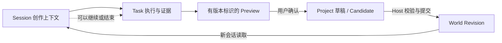
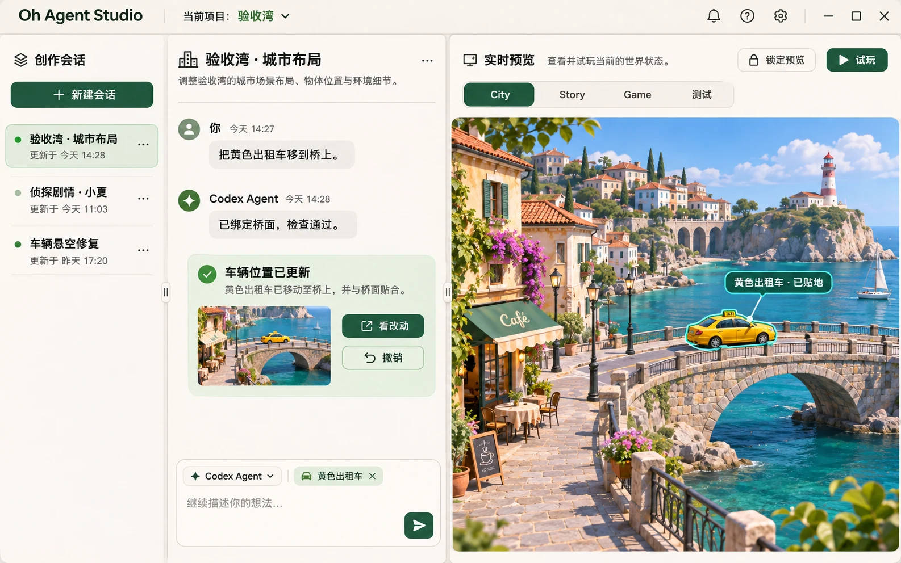
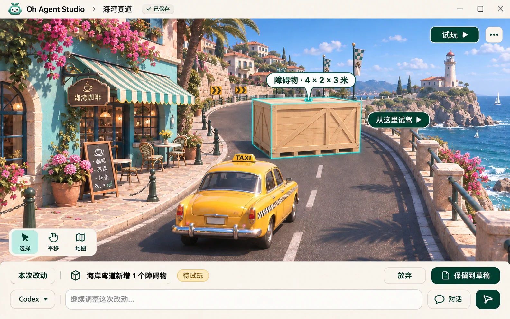

# Agent 游戏编辑器设计稿 · 从创作意图到玩家体验

2026-11-25 · 产品与交互目标稿。配图为概念稿，文中的试玩结果均为验收条件。

创作者想做的是「让玩家在咖啡馆打听失踪画家的线索，然后开车去灯塔」。第一次打开 Studio，他需要一个能开始的地方；改到一半，他需要看见箱子究竟落在哪儿；第二天回来，他想知道昨天试到了哪里。编辑器以这些目标组织入口。同一个咖啡馆，在布置街区时是建筑，在写故事时是会遇见小夏的地点，在设计赛道时又可以是起点。

## 1 · 会话中心的弹性三栏

创作过程以 Session 为入口，对话是控制中心，实时预览用来检查当前世界与本次改动。新建 Session 时选择所属 Project 并说明目标；多个 Session 可并行服务同一个 City。Session 保存创作上下文和历史，Project 保存作品草稿与版本，Task 表示会话中的一次可跟踪执行，World Revision 是城市实际持久状态，Preview 指向明确版本或临时改动。Session 结束或删除不能回滚已经保存的 World Revision。

| 左栏 · Sessions | 中栏 · Agent Chat | 右栏 · Live Preview |
| --- | --- | --- |
| 可搜索、新建、归档 Session；每项显示目标、关联 Project、最近进度和未读状态。切换 Session 时独立恢复 Agent/harness、对话、当前 Task、草稿输入及预览指向 | 自然语言对话、决策卡、Task 结果及变更审查。输入框显示当前 Agent、附件和对象引用。技术计划与证据按需展开 | 标签切换 City、Story、Game 和 Tests。根据当前 Task 更新预览，显示它对应的 Project/Revision/Preview。用户可锁定当前视图，Agent 后续任务不改变它 |

默认比例作为宽窗口原型起点为 **Session 16% / 对话 34% / 预览 50%**，最小栏宽约 220/360/420 CSS px，分隔条可拖动和双击重置。窄窗口逐步折叠 Session 栏，再将预览切成独立全屏视图；保留返回对话的入口与上下文。试玩时自动收起 Session 栏并扩大预览；纯聊天可收起预览。记住用户每个 Project 的布局。预览锁定与否在右栏始终可见。比例是待真机验证的初始值。

当前已有截取并附上「当前视口」的能力开关。它能给获准且支持图片的所选 Agent 提供画面截图，但**不支持用户在截图上点选物体、加编号、画圈或箭头的批注工具**。本稿中预览工具栏的批注按钮、冻结帧同帧拾取、编号标记和随图对象引用均为待实现能力，不应以现有截图附件入口冒充。设计中的流程是暂停/定格当前视口 → 放置一个或多个有文字说明的标记 → 确认接收 Agent 和图片范围 → 预览最终附件 → 发送。批注点与选取对象要绑定同一帧及 World Revision；纹理截图无法提供真实深度或物理测量，Agent 仅能将其作为用户指出的视觉位置。对象引用、量化空间属性和图片分开标明来源，无法定位时要求重新点选。[现有截图附件](../apps/creator-studio/ui/src/features/agent/StudioTaskPanel.tsx)

Session 面板、Agent 对话流、可锁定的多标签 Preview Workspace 是这一方向的新增产品能力。已有 Task Ledger、CityViewport、Story/Game 面板及证据组件可分别承载工作，但现有 Task ledger 不等于可恢复的用户会话，现有视口截图也不等于画面批注。

## 2 · 从哪里开始

| 我现在想做什么 | 入口与落点 | 第一个有意义的动作 |
| --- | --- | --- |
| 我有一个想法 | 项目库 → Host 右上「新建项目」。可描述玩家要做什么，或选一个有封面的起始模板 | 输入「做一段从咖啡馆到灯塔的追踪任务」。预览起步内容与保存目标，创建草稿后带着这句话进入工作区 |
| 我想继续昨天的作品 | 项目库按最近修改排序；卡片显示封面、名称、类型和进度。搜索放在 Host 顶栏 | 打开作品后回到上次对象。若有待处理改动，优先给「查看上次改动」 |
| 我刚玩到一个问题 | 从开发试玩的暂停菜单选择「在此处调整」，带回地点、对象和本次试玩位置 | 直接指出「这辆车悬空了」，或手动调整落点 |
| 我只想写一个故事 | 新建或打开独立 Story，先落在首场戏与角色上。尚未关联城市时用剧情视图呈现 | 写下角色知道的事；需要进城走动或验证地点触发时，再选试玩城市 |
| 我要交给别人玩 | 从作品顶栏进入发布流程，显示即将发布的版本及最近一次完整试玩 | 从玩家入口重跑，核对候选版本，确认发布目标 |

进入项目库时，已有作品优先占据首屏；空库把「描述第一个作品」放到中央。Agent 提问或生成建议时保留输入，直到真正创建草稿才出现项目卡。临时试玩城市、项目草稿和用户正在游玩的主 City 各自有明确名称。

## 3 · 同一个窗口，随任务改变重心

| 情境 | 画布中心 | 底部输入发给谁 | 下一步 |
| --- | --- | --- | --- |
| 创作与手动编辑 | 世界、地图或当前剧情节点。需要精调时打开对象工具 | 已选择的本机创作 Agent；目标对象以标签显示 | 描述、点选、拖动或撤销 |
| 等待 Agent 或需要决定 | 继续浏览原场景。输入上方显示实际执行阶段 | 当前创作对话 | 补选地点、回答创意问题、停止任务 |
| 检查改动 | 临时物体、路线，或可试演的角色行为 | 同一创作 Agent，支持继续说「再往右一点」 | 试玩本次改动、保留到草稿、放弃 |
| 玩家试玩 | 游戏视角、玩法目标、退出入口 | 与角色互动时明确写「对小夏说…」；驾驶时使用游戏输入 | 行动、自由对话、退出试玩 |
| 回到创作 | 恢复镜头、选择、打开的工具及未发送文字 | 创作 Agent | 看实际结果、从刚才的位置再试、继续修改 |

Host 顶栏承载项目库返回、作品名与全局试玩。空闲时创作区只占底部一行。对话记录、地图对象列表、角色属性按需打开；窄窗口中一次展开一个面板。关闭后可用键盘回到原对象。画布上每个必选目标都有带名称的列表入口。选择、试玩和错误均同时用文字及图形表达。

## 4 · 三类创作任务

### City · 我想让玩家走得进咖啡馆

**起点。** 创作者在验收湾街区看到店门与人行道有高差。点店门，请 Agent「把入口接到人行道，保留露台」，也可以直接拖动入口。选区绑定本轮指令，随后转动镜头不会改写任务目标。

**反馈与决定。** 画布标出受影响的门口和路面。两种修法会改变体验时，卡片才请求选择，例如「台阶，更紧凑」与「缓坡，占一段露台」。创作者可以在地图上重新划出允许改动的范围。预览挂载后保留原镜头，屏幕外的修改提供「定位入口」。

**怎样算完成。** 从路边步行到店内，观察角色是否卡住，再返回原镜头保留到 City 草稿。只看到模型已经对齐时，结果写「入口已调整，通行待试玩」。放弃后恢复门口和碰撞范围；重新打开已保存草稿，检查两者都还在。

### Game · 我想知道这个障碍物放得好不好玩

| 时刻 | 创作者操作 | 界面反馈 |
| --- | --- | --- |
| 指向位置 | 点海岸弯道，在底部选 Codex，输入「加一个 4 × 2 × 3 米的箱形障碍物」 | 输入框保留道路名称；若缺位置，直接在地图上点放置处 |
| 看见并修正 | 看落点，继续说「往路边移半米」 | 同一物体更新。纯碰撞体以带尺寸的临时线框显示，有模型的物件显示模型与选框 |
| 从近处验证 | 点「从这里试驾」，在障碍物前接手车辆 | 记录本次试玩使用的预览与起点；离开后呈现实际发生的碰撞或经过事件 |
| 把它变成赛道 | 在地图上设起点、按序点检查点、设终点 | 地图编号与顺序列表同步。断路提示可定位具体路段；从正式起点试跑才能验证整条路线 |

[指令与选区](assets/studio-editor-journeys/game-request.webp) · [驾驶试玩](assets/studio-editor-journeys/game-run.webp)。图中的木箱表示带模型的障碍物。预览时底栏文案定为「预览中 · 尚未保留」，顶栏保存提示需明确指向原草稿。

### Story · 我想让小夏在合适的时候透露线索

**写角色。** 点咖啡馆店主，小工具展开三项：她知道「画家昨晚去了老灯塔」；玩家打听画家去向时可以透露；具体措辞由扮演小夏的 Actor 决定。创作者能直接改条件，也能让创作 Agent 帮忙。编辑多条互相影响的线索时再展开剧情图，点节点可回到角色或地点。

**用玩家的口气试。** 点「从这段对话试玩」。底部收起创作指令，显示小夏头像及「对小夏说…」。先问「今天有什么咖啡？」，接着问「昨天那个背画板的人后来往哪走了？」。同一 Actor 会话接住两轮；玩家可以绕开话题或自由追问。角色卡在会话建立或恢复时提供，玩家每轮只需输入自己的话。

**看故事走到哪里。** 对话成功透露线索后，玩家手记出现「老灯塔」。退出后列出本次实际发生的「与小夏交谈 → 获得线索」，另列「抵达灯塔 · 尚未体验」。若闲聊就泄露了秘密，即使剧情变量仍未推进，也应允许创作者标记该句、收紧角色条件并从对话前重试。重新试演使用新的剧情起点，正常追问沿用当前记忆。

[角色创作](assets/studio-editor-journeys/story-author.webp) · [试玩复盘](assets/studio-editor-journeys/story-review.webp)。创作 Agent 和扮演小夏的 Actor 可以来自不同的本机 harness。前者在创作输入区选择，后者在角色的「扮演者」设置中绑定。缺少可用扮演者时保留角色草稿，并在开始对话处提供选择入口。

## 5 · 跨场景创作：把三段体验连起来

玩家在咖啡馆拿到线索，走到路边上车，开到灯塔后遇见画家。创作者只需从项目库打开一次作品。

1. 在小夏身上编辑透露条件；从节点局部试玩，验证玩家能获得线索。
2. 点击门外出租车，选择「收到线索后提示上车」。任务摘要列出关联的剧情和玩法草稿，明确会写到哪里。
3. 在地图上点灯塔，设置到达时开始下一场戏。从灯塔前试跑时注明「起始条件：已获线索、正在驾驶」，方便单独调到达判定。
4. 从顶栏「试玩」以新玩家身份开始，不注入线索。检查拿线索前后上车提示的差别、途中离开再返回的表现，以及抵达后是否只触发一次。
5. 返回时展示已走过的剧情节点与玩法事件。保留前列出涉及的作品和版本；若一次写入只完成了部分作品，逐项显示结果，允许恢复剩余改动。已完成局部试玩的节点仍需接受全流程验证。

## 6 · 失败、暂停与交付

| 发生的事 | 留给用户的信息和下一步 |
| --- | --- |
| Agent 无额度或不可用 | 保留当前输入、附件及对象，提供「换 Agent 继续」或手动编辑。接替者获得同一目标及已确认决定；原任务仍显示原执行者 |
| 已收到建议，画布没有变化 | 分别显示「正在生成预览」「预览加载失败」或「改动位于视野外」。提供重建、重连或定位。规则修改给出能验证规则的试玩入口 |
| 用户手动修改后，旧 Agent 结果才返回 | 原轮次标为「基于较早的草稿」，提供差异和重新预览。当前画布继续显示最新草稿 |
| 暂停、重开或预览已过期 | 恢复作品及可恢复的编辑位置。有效预览可继续试玩；过期时从已保存的提案重新生成。重新发送与重复点击需防止生成第二份对象 |
| 希望分享给玩家 | 保留到可编辑草稿 → 创建固定候选 → 试玩该候选 → 确认发布。发布版本、安装目标 City 和实际启动的 Run 分别给结果；用户可回到草稿继续创作 |

状态取自对应环节：显示临时对象以运行时挂载为准，行为验证以该次试玩记录为准，保存以宿主写入回执为准。Agent 自述完成可进入对话记录。原始日志留在本机诊断。附图给 Agent 时由用户选择画布范围、看见接收对象，按接收方能力与现有授权提供。[数据处理规则](DATA_HANDLING_POLICY.md)

## 7 · 世界画布的即时编辑能力

**把箱子向右挪半米**有两种入口。手动拖动时，按下即选中，指针移动时箱体跟手并显示相对位移，松手产生一项可撤销的预览。对 Agent 说这句话时，Agent 根据本轮关联的箱子提出同样的位移；收到可应用的改动后，画布在原处显示结果。两条路径从同一个预览继续试驾或保留。等待 Agent 或宿主响应时，镜头、拾取和本地手势仍可用。

### 引擎要提供的反馈

| 用户动作 | 当前帧或下一可绘制帧 | 完成操作后的反馈 |
| --- | --- | --- |
| 点选、移动、旋转物体，或调整碰撞盒尺寸 | 描边、轴向手柄、米制尺寸；反馈贴地、吸附位置及非法落点。Esc、指针取消或丢失捕获可恢复操作前的位置 | 松手形成一次编辑。模型、拾取边界、碰撞形状按同一变换更新，依赖尚未就绪时显示「正在准备试驾」 |
| 接路、修坡、调整检查点 | 在地表预画走向、坡面或序号，标出将受影响的路段；大范围重建期间可以继续看旧的可用场景 | 对受影响区域校验连通、通行与锚点绑定。结果指向具体断点，重新试跑时读取更新后的路线 |
| 把店主绑定到咖啡馆，修改透露线索的条件 | 场景中标出对应人物与地点；条件变化在角色卡显示差异 | 从绑定位置用新规则开始一次对话；已进行中的 Actor 试玩固定原规则，可主动重开验证 |
| 放弃、撤销或重做 | 恢复原位置与标记，保留镜头；一次拖动对应一步撤销 | 删除临时碰撞形状及拾取目标，恢复路线或剧情绑定。保留到草稿后的撤销通过版本化编辑完成 |

**已经能复用的部分。** CityEngine 有射线拾取、修复工具点击与建筑编辑事件；SDK 的世界补丁已有道路增删、节点移动、路宽和地形缓坡的结构校验。可移植补丁对本地会话建筑引用有额外限制。Studio 的障碍物预览目前用 Three.js Mesh 绘制覆盖层并聚焦物体；这段路径能说明箱体画出来了，真实驾驶碰撞仍需独立验证。固定世界包的预览界面也明确标记为只读。[世界引擎](../apps/agent-city/ui/src/engine/CityEngine.ts) · [世界补丁校验](../packages/agent-vitals-city-sdk/src/worldPlanPatch.ts) · [箱体覆盖层](../apps/creator-studio/ui/src/features/preview/useColliderViewport.ts) · [画布入口](../apps/creator-studio/ui/src/features/city/CityViewportPanel.tsx)

### 手势、预览与保存的边界

1. **引擎持有编辑现场。** TS 运行时处理拾取、稳定对象引用、坐标换算、手势和临时对象。在帧循环内合并连续指针更新；松手时才生成一次带基础版本的操作。较重的地形、碰撞或导航重建按受影响范围调度，旧任务迟到时按预览版本丢弃。
2. **SDK 描述可编辑的能力。** 每个视口按当前作品、对象和授权声明可选、可变换、可改路线、可试演等能力。SDK 定义操作、单位、对象引用、预览结果与失效原因；引擎实现它们。Studio 手柄和受授权的 Agent 工具共用操作语义。只读包可定位并查看信息；若源草稿可用，引导打开源草稿。
3. **预览分两步就绪。** 视觉反馈完成后即可继续调整；当同一预览版本所需的物理、路线或剧情数据准备完成，才开放相应的局部试玩。任务摘要明确当前是哪一步。编辑时可比较原稿，试玩始终固定一个快照。
4. **保存有唯一结果。** Host 校验作品范围、操作标识与基础版本后保存。Agent 提案到达时若用户正在拖动同一对象，保留手势，待松手后提供重新预览。保存超时查询同一操作结果。桌面和浏览器共享 TS 交互语义，各自按会话能力决定能否提交；远程路径沿用既有会话授权。

**首条引擎验收。** 在同一对象上先拖动，再用 Agent 微调，再开车碰撞，回到编辑器撤销并再次试驾。在桌面与浏览器分别记录输入到首次绘制的时延、拖动期间帧时间及松手到可试玩的时延。用断开 Agent 通道验证本地拖动仍跟手；用延迟的旧预览验证画布不会跳回。检查取消或撤销后实体、拾取和物理结果一致，保存重开仅有一个对象。计时从真实输入、绘制及运行时就绪回执采集。

### 对象属性 · 自动贴地

在对象检查器的「放置」中提供「自动贴地」。路障、落地道具和停放车辆的模板默认开启，空中道具可选自由放置。创作者将箱子从平路拖上桥面时，箱底应随桥面抬升，松手即可从车前试驾。通过 Agent 新增或移动箱子也走同一放置规则。属性随对象写入草稿，重开、复制、撤销和重做时保留。

| 时机 | 系统行为 |
| --- | --- |
| 创建、拖动或改变尺寸 | 用对象底面或模型声明的支撑点匹配当前可承托表面；离面偏移默认 0 米。拖动逐帧预览，松手合成一次编辑。朝向默认沿用对象设置，随坡倾斜单独配置 |
| 桥面、楼层或坡道重叠 | 优先使用用户当前命中的可承托表面；已放置物保留支撑面引用。桥面重建时重算受影响对象，支撑面消失时保留原位并标记「需重新选择支撑面」 |
| 从编辑进入试玩 | 静态路障使用放置结果同步模型与碰撞体；车辆用轮胎支撑点求初始姿态，启动后由车辆物理处理轮胎接触、悬挂与腾空。退出试玩回到编辑姿态 |
| 旧草稿、悬浮物或缺少有效支撑 | 旧草稿沿用原有变换，主动启用后先预览。自由放置保留指定高度；无支撑时提供选面或取消，避免物体瞬间掉到下层 |

SDK 定义可序列化的放置属性及其校验，City 的 TS 引擎依照支撑面解析姿态并同步拾取与碰撞，Host 按现有草稿版本规则保存。检查器与 Agent 都通过同一编辑操作读取、修改该属性。当前 SceneDraft 的模型与碰撞体已有变换字段，严格校验枚举了允许的对象字段；新增属性需要连同契约、校验、读写与运行时一起落地。[场景类型](../packages/agent-vitals-city-sdk/src/types.ts) · [场景校验](../packages/agent-vitals-city-sdk/src/validate.ts)

验收时分别用鼠标与 Agent 把同一箱子移上桥，比较最终高度与碰撞位置；抬高桥面后检查箱子跟随，撤销后恢复。另验自由悬浮的道具重开后高度不变，车辆越过坡顶时能正常腾空。

### 在画布上批注给 Agent

**入口与动作。** 对象旁的「指出问题」或创作输入框的「批注画布」进入同一个工具。创作者点出租车加标记 ①「出发位置」，圈出树冠加标记 ②「遮挡区域」，输入「让玩家从车里看见远处的灯塔」。输入框出现可展开、可移除的批注缩略图，清楚显示本轮接收者。普通编辑只需点一下对象即可附上引用；涉及遮挡、高差或外观时再附截图。在开发试玩中使用「在此处调整」时取刚才那一帧及其试玩上下文，返回创作输入区。

| 标记 | 创作者看到什么 | Agent 可以可靠使用什么 |
| --- | --- | --- |
| 点物体 | 命中对象描边，显示名称；重叠时可选前后对象 | 本次作品范围内的对象引用、类型、命中位置；有受支持子部件时可指向右前轮，否则标明只命中整车 |
| 点地面 | 落点圆环，可作为位置、路线点或对照点 | 已命中的表面与世界位置，标明单位和坐标系；具备法线数据时可用于贴地判断 |
| 圈选或画箭头 | 图上编号、框或箭头，可写一句说明 | 截图上的归一化点或区域及用户说明；框中有多个物体时分别确认目标。空白、天空和纯图片附件只产生二维标记 |

**同一帧的证据。** 进入批注时固定截图及其视角、视口尺寸、作品版本和预览标识。拾取必须对应同一帧，可用同帧拾取缓冲或冻结采样。编号在缩略图、说明和发给 Agent 的结构化引用中一致。缩放、裁切及高像素密度显示要映射回原图。发送后图片保留原时刻；回到实时画布时按引用重新定位。对象已移动则提示位置变化并允许更新批注；对象已删除则请求重新点选。裁切时排除框外批注，预览用户实际将发送的内容。

**Agent 怎样使用。** 第一次检查只读取获准的目标及参照面。例如从出发位置看不到灯塔，可沿原相机视线检查命中对象；只有运行时返回遮挡检测结果时才指明具体枝叶或建筑。缺少有效深度或测量能力时，可邀请创作者换视角或补点。生成修复提案后沿用同一组标记聚焦预览，可在原视角对比前后，再试驾验证。标记中的对象引用只用于指代，修改仍走项目的预览、版本校验和保留流程。

**发送范围与降级。** 复用现有隔离创作视口及每次任务的接收方约束，只附带所选范围内、允许提供的创作对象。受授权的图片接收方可拿到一张编号截图与对应的有界批注；无图片能力时提供「仅发送对象与说明」，先展示可用内容。纯二维的「这里太暗」缺图时，请用户补文字或选用支持图片的 Agent。更换接收者后重新确认附件。截图端现有基础见 [Studio 任务面板](../apps/creator-studio/ui/src/features/agent/StudioTaskPanel.tsx) 与 [任务执行入口](../apps/creator-studio/ui/src/features/agent/useStudioTasks.ts)，拾取基础见 [CityEngine](../apps/agent-city/ui/src/engine/CityEngine.ts)。同帧批注、稳定引用和差异复查属于新增设计。

**真机验收。** 在同一帧给两辆同名车中的后一辆和旁边路面分别编号。转动镜头再发送，检查 Agent 只引用被选车和原参照面；预览后用原视角对比并试驾。另测删除目标、窄窗口裁切、图片能力缺失、切换 Agent、试玩中车辆移动。每种情况都能说明这条批注指的是哪个时刻、哪个对象，以及哪些位置仅来自屏幕。

## 8 · 原型与真机怎样验收

| 给测试者的任务 | 观察什么 | 通过条件 |
| --- | --- | --- |
| 第一次新建项目，隔天继续 | 能否找回作品、对象和上次未完成事项 | 从项目库可独立进入，已持久化的决定可找回；临时预览过期有明确恢复入口 |
| 修好咖啡馆入口 | 是否能靠场景指出问题并验证通行 | 实际玩家从路边走进店内，放弃和保存各试一次 |
| 摆箱、试驾、换顺序再跑 | 用户能否区分看见、碰撞和保存 | 真实碰撞可归属本次 Run，重开无重复箱体，地图与实际检查点顺序一致 |
| 随意和小夏聊两轮并追问 | 角色记忆、泄密、可接受的不同措辞 | 闲聊不提前透露；问到去向才推进；恢复对话后已取得线索只登记一次 |
| 从头玩到灯塔并交付 | 临时起点与真实玩家起点是否混淆 | 新 Run 从正式入口完成；发布的候选与被验证的版本一致 |

研发按「提出需求 → 得到预览 → 亲手试玩 → 保留或放弃」逐条交付。优先打通障碍物和小夏对话两个样例，一个验证可见与物理效果，一个验证不可见的记忆与条件。Studio 管理创作意图与交互，TS 运行时负责拾取、地图、剧情和试玩，Host 负责授权、版本、幂等写入与持久证据。临时快照不可试玩时，操作明确写「保留后试玩」。真机能力以各条验收记录为准。

相关背景：[此前工作区信息架构](CREATOR_STUDIO_WORKSPACE_INFORMATION_ARCHITECTURE_2026-11-25.md) · [Agent 体验分析](CREATOR_STUDIO_AGENT_EXPERIENCE_REDESIGN_2026-11-23.md) · [交互基础规范](OH_AGENT_UX_GUIDELINES.md)
