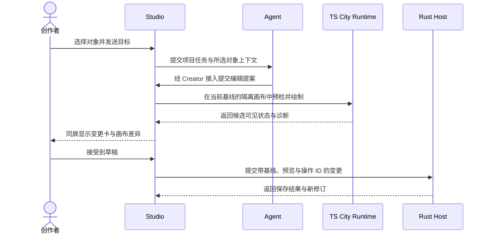

# Creator Studio 编辑器重构实施说明


2026-11-25 工作区入口和工具分层见 [Creator Studio 工作区信息架构](CREATOR_STUDIO_WORKSPACE_INFORMATION_ARCHITECTURE_2026-11-25.md)。
2026-11-22 · 实施规格 · 基线为 `dev@3335ff01` 及当日本地工作区中的 Studio 迭代。

本文定义编辑器的入口、布局、状态所有权、迁移顺序和验收。项目库继续承担浏览、新建与选择作品的任务。代码拆分沿用总重构说明中的 PR-3、PR-4、PR-5。上一轮迭代规格保留已交付功能和验收记录，后续编辑器以本文的可见入口和验收条件为准。[Studio V2 PRD](OH_AGENT_CREATOR_STUDIO_V2_PRD_RFC_2026-11-20.md) · [总重构实施说明](CODE_REFACTOR_IMPLEMENTATION_PLAN_2026-11-21.md) · [上一轮迭代规格](CREATOR_STUDIO_EDITOR_ITERATION_SPEC_2026-11-22.md)

## 1. 重构要解决的差异

| 当前实现和成因 | 重构验收目标 |
| --- | --- |
| 工作区用 `activePanel` 在「玩法、Agent、项目设置、代码预览」间切换。普通项目卡已经打开 Agent，配置场地和试玩返回等入口仍会切到整栏手动工具。 | 编辑作品时右栏显示 Agent。需要绑定场地或检查对象时，从用户刚触发的操作打开局部检查器。关闭检查器后继续同一创作上下文。 |
| 「项目设置」复用旧 `ProjectPanel`，包含新建、切换项目、City 实例、世界包、安装和导出。 | 当前作品的内容与设置有明确范围。库管理、安装和构建操作从对应对象发起。 |
| 「代码预览」可从模板 Game 编辑器常驻标签进入，实际选择已构建游戏和冻结的来源 City，在桌面启动独立窗口。 | 选择具体构建或安装项目后才出现「试玩此构建」。模板作品的主操作使用当前项目的候选试玩。 |
| 截图演示的是未绑定场地的竞速模板，布局只有 2 个可用检查点，玩法要求至少 3 个。相机是通用 City 场景视角。 | 演示分别覆盖可完成的创作流程和场地不足的恢复流程。默认取景体现作品场景。可交互试玩由实际 Run 状态确认。 |
| 现有 Agent 目标、任务、审批和部分城市补丁可运行，效果图还包含对象关联、多轮消息和实时渲染反馈。 | 先呈现可用的真实任务和审批，再以单个对象的真实修改闭环验收多轮与画布联动。 |

[当前工作区编排](../apps/creator-studio/ui/src/app/CreatorStudioApp.tsx) · [竞速浏览器夹具](../apps/desktop/ui-dev/public/tauri-mock.js) · [工作区设计图](../artifacts/creator-studio-v2-imagegen/studio-workspace.png) · [上一轮场地配置截图](../artifacts/studio-refactor-2026-11-22/11-editor-configure-field.png)

## 2. 目标界面和入口

| 界面区域 | 默认内容和操作 | 打开后如何返回 |
| --- | --- | --- |
| Host 顶栏 | 现有 Host 导航、唯一的「返回项目库」入口。编辑器顶层动作提供「内容」与「发布」。项目名和保存状态只出现一处，先沿用画布抬头的现有位置。项目库搜索、新建仍放在 Host 顶栏。 | 返回时恢复项目库筛选、滚动和触发卡片的焦点。使用 App SDK 已支持的工具栏能力。 |
| 画布主区 | 编辑 Game 显示「游戏预览」，独立 City 显示「City 预览」。常驻当前状态和一个推荐动作，例如「配置场地」「开始试玩」「查看结果」。镜头控制和可执行的 Run 控制随能力呈现。 | 打开内容、场地、诊断时保留画布实例、镜头和选中对象。切换作品或源版本时核对对象仍然有效。 |
| 右栏 | 编辑作品时显示「Agent 创作伙伴」，包含连接状态、当前任务或可提交的目标、待确认变更与输入。对象关联有真实选择时才出现。 | 切换临时检查器或底部反馈时保留输入和任务上下文。无执行器时提供连接说明或已有的复制目标能力。 |
| 临时检查器 | 由「内容」、选中对象后「查看属性」、或「配置场地」打开。桌面建议从画布边缘展开；窄窗用抽屉。配置场地直接聚焦首个可处理的字段。 | 关闭恢复触发控件或画布焦点。关闭面板保留草稿，保存后显示可执行的下一步。 |
| 画布底部 | 显示最近一次当前候选的试玩摘要与「查看诊断」，展开后提供当前 Run 结果和可用检查。 | 展开诊断保留当前场景或 Run。运行日志和自动测试在有真实来源时提供对应入口。 |
| 发布确认 | 从顶层「发布」进入。说明当前候选、对本次结果的证据来源、发布范围与阻塞原因。真正提交放在确认步骤。 | 关闭回到同一作品、镜头和右栏。发布完成回显正式版本，安装另行选择并确认。 |

桌面设计基准用 **1440×900** 和 **1280×800**。画布约占可用内容宽度的三分之二，Agent 栏可独立滚动，输入区留在栏底。按实际插件内容宽度重排，**900×800** 验收时保留画布和可见的 Agent 入口，内容或场地使用抽屉。尺寸是本次实施的验收基准，可根据实际宿主导航占宽微调。控件用官方 UI 语义色、清晰焦点和可读的状态文案，集成面板后校验横向溢出、文本放大和键盘顺序。[Oh Agent UX 指引](OH_AGENT_UX_GUIDELINES.md) · [体验设计评审](CREATOR_STUDIO_V2_EXPERIENCE_DESIGN_REVIEW_2026-11-22.md)

### 2.1 旧入口和设计图控件的落点

| 旧面板或原型控件 | 正式位置和首版交付 |
| --- | --- |
| 玩法场地、入口和检查点 | 「配置场地」或「内容 → 场地」。先用现有表单覆盖可用场地选择，画布定位和稳定对象引用接通后再支持从场景直接选点。 |
| 玩法规则、场景 JSON、模型和皮肤 | 内容中的对应小节。按当前作品支持的能力展示。JSON 和原始锚点 ID 收进高级详情。 |
| 新建、切换项目 | 返回项目库，使用 Host 顶栏的新建、搜索及作品卡。现有项目选择器在替代路径走通后从编辑器撤下。 |
| City、世界包、安装管理 | City 详情或「探索与素材／发布管理」，带当前 City 或安装记录的上下文。源码导出从可导出的作品操作进入，体验包导出跟随正式 Release。 |
| 代码预览 | 从 City「已安装内容」或构建列表打开「试玩此构建」，带 `buildId` 及已知的 City 来源。来源不可用时提供显式选择，保留独立窗口及停止路径。 |
| 试玩／调试切换 | 使用「场景预览」「准备试玩」「试玩中」等状态和实际操作。调试走底部「查看诊断」。 |
| 截图、暂停／继续、全屏 | 截图接已就绪画布的捕获能力后开放。暂停／继续由当前 Run 声明。全屏由实际宿主能力决定。 |
| 历史 | 后续接入有来源的作品变更记录后再开放。当前 Run 结果、任务和正式发布记录在各自的详情中可查。 |

独立 Story 继续进入 Story 编辑器。独立 City 和世界包保留只读预览，按照其能力提供查看内容或已安装游戏的入口。两类入口均使用自己的数据范围和状态文案。[项目库详情](../apps/creator-studio/ui/src/features/project/CatalogDetails.tsx) · [代码游戏预览](../apps/creator-studio/ui/src/features/preview/CodeGamePreviewPanel.tsx) · [原型功能审核](CREATOR_STUDIO_V2_PROTOTYPE_FUNCTION_AUDIT_2026-11-22.md)

## 3. 三条必须走通的创作路径

Agent 会话、统一确认保存及三类作品的真机验收细则见 [Creator Studio Agent 体验重设计](CREATOR_STUDIO_AGENT_EXPERIENCE_REDESIGN_2026-11-23.md)。

### 3.1 打开作品和配置场地

1. 项目卡直接打开画布与 Agent。若从「让 Agent 帮我开始」进入，把目标准确带到所选项目，用户显式提交后才进入现有计划流程。
2. Game 缺少场地时，画布仍显示已加载的场景，主动作提示「配置场地」。从项目详情点击同名动作时，打开同一个检查器。列表和画布共用该入口。
3. 检查器展示入口、已选数、最低要求与排序。排序保留用户的选择顺序。缺少布局或合法点位时优先说明阻塞原因，例如「这张地图有 2 个可用检查点，竞速至少需要 3 个」。提供实际可用的布局或新建入口。保存校验沿用 City SDK 的同版本布局、槽位能力及完成阈值。
4. 首次「校验场地」生成与当前基线绑定的预览。选择一旦变化，先前校验结果失效。点击「保存场地」走现有提交事务，收到保存回执后更新修订，关闭检查器并刷新试玩准备状态。
5. 同一作品的规则、场景、场地与皮肤各有草稿。保存一个区域时保留其他区域的未提交修改。切换作品前复用草稿确认规则。请求响应不确定时保留用户输入并用原 `operationId` 查询。确认失效时重新校验，避免重复落库。

[场地模型](../apps/creator-studio/ui/src/features/project/mountEditorModel.ts) · [现有校验及提交入口](../apps/creator-studio/ui/src/app/CreatorStudioApp.tsx#L766)

### 3.2 从场景走到试玩与发布

| 条件 | 主操作与反馈 |
| --- | --- |
| 缺场地或存在未保存修改 | 配置场地或定位草稿。有多个阻塞时优先指出当前必须完成的动作。 |
| 候选读取中或失败 | 读取中提供中性状态。失败时提供「重新读取试玩状态」。画布、底部和发布确认共用同一读取结果。 |
| 已确认当前修订没有候选 | 提供「准备试玩」。底层先沿用现有创建和启动步骤，创建成功后提供「开始试玩」，让用户知道已固定所试版本。 |
| 候选待试玩、正在准备或运行 | 能力可用时提供开始、取消、暂停、继续或退出中对应的动作。待 City 认领时显示「正在准备」，确认运行后才显示「试玩中」。独立桌面窗口沿用现有交接。 |
| 试玩失败或取消 | 显示具体失败阶段、可处理原因及重试。标记版本与环境。用户退出后回到原作品。 |
| 当前候选有可复核结果 | 底部显示结果和来源，发布确认读取同一候选。正式发布由用户确认并等待 Host 回执。 |
| 已发布，或另有新版草稿 | 正式版以该 Release 的操作入口试玩。当前工作区标明新草稿或新候选所处阶段。历史证据仍可从版本详情打开。 |

把可写 Project、不可变 Candidate、不可变 Release、Installation 和 Run 分开。代码游戏 Build 也有独立身份。发布或启动试玩固定目标版本，草稿随后保存为新修订时，现有 Run 继续使用原快照。证据标注 City 客户端回报或 Host 按输入 Trace 复算，两者的含义跟随 Host 回执。候选流程接管常用发布入口后，移除编辑器的「直接发布 Release（旧路径）」按钮。底层命令是否可删按 Studio、MCP 和打包调用方的清单另行验证。[候选门控](../apps/creator-studio/ui/src/contracts/candidate.ts) · [当前状态模型](../apps/creator-studio/ui/src/features/preview/workspaceNextStep.ts) · [Rust Host 的发布及候选实现](../apps/desktop/src-tauri/src/creator_projects.rs)

### 3.3 Agent 修改在画布上出现

先复用现有 Creator 任务、计划批准、执行及变更确认。首个原生用例选一个有稳定引用且能通过当前 Runtime 生成视觉差异的建筑位置或外观；根据接通的能力，再加入一条道路候选及受影响范围的用例。画布选择和内容大纲提供等价入口。发送时捕获对象引用与基线，之后移动选择只影响下一条输入。



时序图表达目标职责。现有提案、审批和 Host 行为先通过已声明的命令接入。各写入路径验证授权范围、预期修订及预览有效性。渲染反馈显示「准备画面」「画布可见」「无法显示」等真实状态。用户放弃、切换作品、遇到版本冲突或预览过期时清除视觉候选，保留可供重新发起的输入。按项目隔离消息和任务，跨项目的延迟消息保留在自己的上下文。多轮阶段用现有任务账本关联项目、用户轮次、任务和提案，新增的消息契约按应用范围评审。

建筑和道路共用预览生命周期与对象引用约定，各自执行已有语义校验。仅影响外观的变更可在当前隔离预览中替换。改变碰撞、道路连通、挂载、规则或脚本时，为检查后的版本准备新的快照或 Run。Studio 接受写入草稿和接受 Candidate 发布是两次独立确认。实时性先验收「校验及渲染就绪后，用户保持在同一工作区即可看到变化」，同时记录从提案到首帧的实测时长，取得基线后再制定性能阈值。[现有 Agent 工作区](../apps/creator-studio/ui/src/features/agent/AgentWorkspace.tsx) · [PRD 实时 Runtime／MCP／SDK](OH_AGENT_CREATOR_STUDIO_V2_PRD_RFC_2026-11-20.md#144-p0-实时反馈与-mcp--sdk-接入优先级)

## 4. 代码组织与状态所有权

目录按已出现的用例逐步落地。已有模型、组件和解析器随责任迁移，复用当前 Host transport。单次调用只需要领域 API 的用例从该 API 直达，跨步骤的流程放入 application。

```text
apps/creator-studio/ui/src/
  app/
    CreatorStudioApp.tsx           路由及功能装配
    studioRoute.ts                 作品、只读场景、构建的导航上下文
    useCreatorHostBridge.ts        Studio 注册的宿主调用和事件适配
  features/
    editor/                        画布布局、内容抽屉、焦点和菜单
    project/                       草稿、内容、场地表单与项目控制器
    agent/                         任务、目标输入、变更卡和审阅
    preview/                       场景状态、候选试玩、Run 与返回
    evidence/                     当前 Run 摘要和详情
    library/                      City 内容、安装、Build 的入口
  application/                    项目提交、候选试玩、提案审阅等多步用例
  host-api/                       projects、candidates、playtests 等类型化 API
  adapters/creatorHost.ts         现有 transport、响应匹配及错误映射
```

| 状态 | 所有者和失效条件 |
| --- | --- |
| 路由与当前作品 | App 保存导航和返回位置。目标包含作品种类与身份。避免从面板标题、未归属的旧 Project 或 Build 状态推断当前对象。 |
| 抽屉、选择和镜头焦点 | 编辑器维护展示状态，真实选中和相机由 viewport adapter 持有。变更作品或基线后核对选择。打开和关闭抽屉时沿用同一渲染实例。 |
| 项目内容及草稿 | 项目控制器持有快照、分区草稿、校验预览引用与待确认操作。校验结果绑定项目、基线和区域。旧请求返回时核对作用域。 |
| 当前候选、正式版本和 Run | 试玩控制器拥有同一个供画布、底部与发布读取的页面模型。Host 持有耐久事实。候选查询精确到项目与修订。Run 查询以实际回执 ID 为准。 |
| Agent 会话状态和提案 | Agent feature 使用现有账本和审批。任务事件与临时视觉预览分开。画布只显示当前项目、基线和提案匹配的结果。 |
| City／Game 运行状态 | TS Runtime 管理拾取、渲染、输入、碰撞、玩法和帧循环。Studio 使用声明的 viewport 和 Run 能力。City SDK 提供共享 DTO、校验和确定性计算。 |
| 持久事实、权限、写入与证据信任 | Rust Host 执行授权、版本比较、幂等提交，持有 Playtest／Release／Installation 等耐久状态与证据。Rust 返回类型化事实，业务文案和界面投影由可信 TS 处理。 |

开始请求时记录作品、修订和请求身份，响应只更新对应作用域。支持取消时随切换取消，否则忽略旧响应。预览到期后重新生成。控制器尽量使用已有解析和错误映射。需要是真值时区分空、加载、失效和不可用。开发浏览器沿用浏览器宿主和合成数据，保留环境标记。原生沿用已授权的 Tauri 路径。真实浏览器预览服务的访问范围沿独立能力契约评审，Studio 编辑器的权限继续执行本地数据政策。[开发指南](DEVELOPMENT.md) · [数据政策](DATA_HANDLING_POLICY.md)

## 5. 开发顺序与可合并条件

| 阶段 | 工程任务和涉及模块 | 通过条件 |
| --- | --- | --- |
| A · 工作区收敛 | 从 `CreatorStudioApp` 提取布局装配，移除四个常驻标签。复用 `WorkspacePreview` 与 `AgentWorkspace`。接线内容抽屉、场地入口、底部诊断和 Host 顶栏。使用现有方法及数据。 | 项目卡、带目标进入、配置场地、试玩返回各有明确去向。正常入口显示画布和 Agent。打开面板后输入、窗口布局、视口和键盘焦点通过截图及操作验收。 |
| B · 入口迁移与项目用例 | 拆出 `ProjectPanel` 内的当前作品内容，迁移库管理和按构建试玩。先为改动路径提取类型化 API，再将场地草稿、预览、保存及结果恢复迁入项目控制器。浏览器夹具用一个已有挂载或可合法绑定的竞速项目保留成功路径，同时保留缺点位的反例。 | 点击场地、信息不足、校验、保存、冲突后重试、返回项目库、按构建启动的路径都能找到。真实晚到响应无法覆盖新选择。替代路径验收后删除原面板入口。 |
| C · 同一试玩与发布状态 | 迁移 `workspaceNextStep` 的状态输入、`CandidatePanel` 控件、`EvidenceCenterPanel` 的候选读取和试玩返回，形成共享的已解析状态。按 projectId、revision、candidateId、runId 的实际合同区分查询。接入发布确认。 | 「读取失败」在画布和详情都只提供可用的重读操作。完成一轮原生候选试玩、证据回流和主动发布。换修订后旧运行继续可查，当前状态无串线。 |
| D · Agent 画布闭环 | 接已有提案和 preview gate，将对象引用、视觉就绪、接受与放弃打通。先一个建筑操作，再接道路校验和候选绘制。按总计划 PR-5 将新增可复用契约放进 SDK，将 Studio 的 City 实现依赖收口到 viewport adapter。 | 同一作品内完成至少两轮有关联的真实协作，能看到实际场景变化。验证接受、放弃、过期、版本冲突及切换项目。主 City 数据与 Edit Preview 的写入目标核对通过。 |

A 可独立发布首屏调整，B、C 在各自改动范围内按总计划的 API 和用例顺序迁移。D 的新共享契约由 SDK 与 City Runtime 负责。总计划 PR-5 验收全仓清除 `apps/agent-city` 深路径。逐 PR 列出入口、状态归属及保留的调用方。A 至 C 沿用现有写入合同，界面阶段可独立回退。D 如需新增共享 DTO，须先完成双端解析与版本策略验证再启用。[总重构 PR-3 至 PR-5](CODE_REFACTOR_IMPLEMENTATION_PLAN_2026-11-21.md)

## 6. 验收矩阵和交付记录

| 证据 | 环境与操作 | 通过标准 |
| --- | --- | --- |
| A1 默认工作区 | 浏览器，在固定宽度从项目卡和 Agent 快速入口分别进入。 | 画布、Agent、作品身份和下一步同时可见。原四个标签消失，作品目标带入准确。浏览器有合成数据标记。 |
| A2 窄窗与焦点 | 浏览器，在 900×800 从键盘打开和关闭检查器，切换底部详情，并在输入框使用中文输入法。 | 页面没有横向溢出。Esc 优先关闭当前抽屉，焦点正确返回。面板切换保留目标和镜头。 |
| B1 场地保存 | 浏览器，使用有至少 3 个合法检查点的竞速夹具，选择入口和目标、校验、保存。 | 查看画布中场地准备状态和保存回执。配置抽屉关闭，返回 Agent。 |
| B2 场地不足与校验失效 | 浏览器，选择只有 2 个检查点的夹具；另在成功夹具中校验后改变目标。 | 数量信息和恢复动作可理解。无效预览无法提交，草稿留在项目。 |
| B3 构建试玩入口 | 浏览器验收入口与只读降级，原生桌面从 City 已安装内容选具体 Build，并启动、停止独立窗口。 | 来源匹配选中的 City 与 Build，原生独立预览可结束并返回。主 City 不被替换。 |
| C1 候选与发布 | 原生桌面，保存修订、创建候选、试玩返回、查看证据、主动发布。另模拟一次候选查询失败和旧请求晚到。 | Run、候选、版本与结果一致。失败可重读，晚到结果无串线。仅明确确认后产生 Release。 |
| D1 Agent 同屏修改 | 原生桌面，用固定相机先截基线；再截候选可见与待确认；最后截保存后的状态。道路用例记录选中区域和诊断。 | 画布变化来自 Runtime，待确认和保存对应不同状态。记录关联提案、目标版本、来源和首帧耗时。另验收放弃、重试和跨项目隔离。 |

每次截图记录场景、窗口尺寸、浏览器或原生、作品或构建版本、实际动作及结果。用同一参考作品与镜头对照设计和实现。效果图主要核对布局和信息顺序，场景美术以带实际素材、光照和相机的视口另做对照。原生试玩、权限、真实证据和落库通过原生操作记录验收。提交记录列出实际执行的命令、失败与未验证项。

```sh
npm run typecheck --prefix apps/creator-studio/ui
npm test --prefix apps/creator-studio/ui
npm run build:browser --prefix apps/desktop/ui-dev
npm run dev:browser --prefix apps/desktop/ui-dev
```

项目控制器和状态模型重点补现有覆盖缺口。校验草稿变化后的失效、返回旧版本时旧请求不生效、候选不可用时禁止创建，以及相同 operationId 的结果恢复。涉及 City SDK、Creator MCP 或 Desktop Host 时加相应包的检查。原生操作通过构建好的 `Oh Agent.app` 验收。[检查命令与原生 App 约定](DEVELOPMENT.md#checks)
