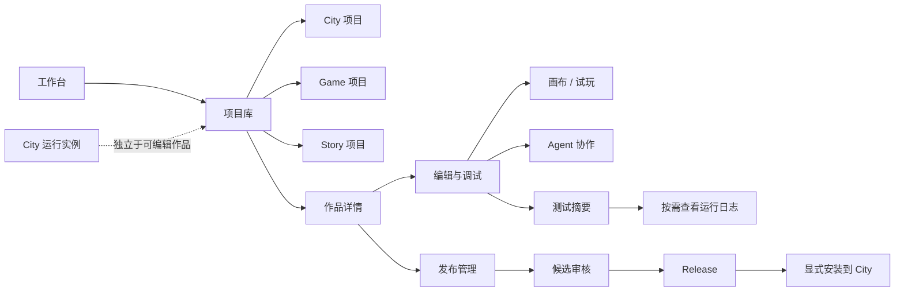

# Creator Studio V2 体验设计评审

日期：2026-11-22  
评审范围：项目库、City/Game/Story 项目详情、编辑与浏览器调试体验  
代码基线：`dev@3335ff014aacb371133b5c79f4b6c9f815cb69ec`  
结论：建议按“作品任务”重排界面，默认隐藏实现细节；先修正浏览器演示中的误导信息，再接入有权限边界的真实预览服务。本文包含的重新设计是可点击 Mock 原型，不代表生产功能已实现。

## 1. 设计结论

Studio 页面只需让创作者快速回答三个问题：

1. **我现在在编辑什么作品？**
2. **Agent、试玩和测试实际发生了什么？**
3. **我下一步可以做什么，是否需要我确认？**

当前 UI 将作品、构建产物、运行实例、Agent 任务和宿主 API 等多种模型同时呈现，迫使用户先理解系统，再完成创作。建议让作品和创作目标占主位；把状态简化为“草稿 / 有待审候选 / 待我复核 / 已发布 / 正在运行”，把 Build、Revision、权限检查、运行证据等转成与下一步决定相关的解释。

新的编辑页延续用户提供的参照：**大画布 + 常驻 Agent + 底部测试摘要**。新项目库采用浅色卡片网格和右侧详情面板，同时将可编辑作品与 City 运行实例分开。

## 2. 评审依据与当前状态

本轮基于 `dev@3335ff0` 当前源码检查，并在本地浏览器实际打开两类页面：

- 当前 Studio 浏览器开发宿主：`apps/desktop/ui-dev` 提供本地 Vite 浏览器壳，Creator Studio 插件以单个 iframe 加载；`browser-plugin-host.js` 检查 `origin`、消息来源 `event.source`、版本和 `instanceId`。浏览器 provider 位于 `tauri-mock.js`，数据只用于演示，没有连接 Host authority DB。
- 当前 Code Game 试玩：桌面版 `CodeGamePreviewPanel` 请求独立 Preview 窗口；Rust 在 `code_preview_window.rs` 创建隔离 WebView 并校验 preview 窗口标签和方法白名单。浏览器模式明确禁用真实 Code Game playtest。
- 新体验原型：本地 HTTP 服务 `127.0.0.1:5182`。在普通浏览器和 `sandbox="allow-scripts"` 的 iframe 中均检查了列表、进入编辑页、切换调试/自动测试和发送演示消息；Mock 预览没有 Host RPC、Agent 执行或本机文件访问。

| 当前界面发现 | 用户影响 | 证据 / 当前处理 |
|---|---|---|
| 首页顶部无论是否选中项目，都能看到“创建 Candidate / 试玩 Candidate / 接受并发布 / 试玩 Release / 直接发布”等操作 | 需要先猜各阶段差异；主要 CTA 和当前状态不匹配 | 当前浏览器截图。将动作放进当前作品的“测试 / 发布”流程，并只显示下一步可做的动作 |
| 项目行直接显示 revision 和时间；Mock 的 `updatedAtMs: 0` 会显示为 1970 年 | 暴露实现字段，还让演示数据看起来像损坏数据 | 当前“我的项目”浏览器截图；应显示“最近修改 / 尚无记录”，不显示原始时间戳 |
| City 归档失败以 `creator_method_unavailable` 呈现 | 用户看到内部 API 错误，无法判断是产品能力缺失、网络故障还是权限问题 | 当前“我的项目”浏览器截图；改为“浏览器演示不支持归档，请在桌面应用操作”，并禁用入口 |
| Story、City、Game 入口与 City 实例列表的边界不够醒目 | 容易把作品、安装对象和运行中的世界当成同一类项目 | 当前 `ProjectsPage.tsx` 已在文案上区分项目与 City 实例，但还缺统一卡片、类型筛选和状态摘要 |
| 首页状态面板同时解释任务账本、执行能力、测试状态 | 对新手来说都是后台工作过程；难以找到正在等待的动作 | 当前 `WorkbenchHome.tsx` 已诚实说明“仅复制任务说明，不会运行 Agent”，保留这条能力事实，但把内部任务账本概念收进详情 |
| Agent 区显示连接数、TTL、事件订阅、artifact/revision 等信息 | 技术诊断和创作对话竞争空间 | 当前 `AgentWorkspace.tsx` 与 `StudioTaskPanel.tsx`；保留“未连接 / 连接中 / 在线 / 失败”和待确认项，连接数/TTL/事件 ID 放入诊断详情 |
| 自动测试、真实运行和人工观察的“通过”容易被当作同一信任级 | 可能让用户把静态校验误认为 City 里真实运行成功 | 本原型中的 12/12 标为 Mock；正式产品应在测试详情注明来源与环境 |

当前截图：

## 3. 哪些信息不必默认给用户

| 默认隐藏 / 收起 | 为什么对创作决策价值低 | 建议展示位置 |
|---|---|---|
| `projectId`、`operationId`、`previewId`、事件 ID、Instance ID | 用户无法据此选择下一步，也不应手工复制内部标识 | “复制诊断信息” |
| 数字 revision、content digest、bundle 大小、schemaVersion、JSON 原文 | 说明内部版本机制，不说明内容是否可用 | 高级详情；冲突时解释“有 3 项新修改” |
| Rust/TS 模块路径、Engine 名称、MCP 方法、IPC/transport、数据库表 | 这是实现信息，普通作者不应理解代码分层才能使用 Studio | 开发者诊断面板 |
| Heartbeat、TTL、轮询次数、订阅 cursor、后台事件流水 | 低层链路噪声 | 合并成真实连接状态；异常时展示原因与恢复动作 |
| 每项 Agent 工具调用和每条绿色校验日志 | 默认只需要结论、影响和需要人类做的决定 | 展开“测试详情 / 运行日志” |
| City 不支持归档时的内部错误码 | 错误码无法帮助用户恢复 | 友好能力提示、明确下一步和重试/桌面入口 |
| 全局可见的 Build、Release、Candidate 操作按钮 | 依赖当前状态；没有选择作品时也出现会制造压力 | 选中作品后在“测试 / 发布”中按状态显示一项主操作 |
| 不可用的 Story Registry 空面板 | 空白技术占位不等于产品入口 | 能力尚未实现时展示清楚的预告/禁用态，不占主导航或首屏 |

以下信息必须保留，因为会改变用户决策：

- 当前作品的类型、名称、关联 City，以及当前处在草稿、候选、发布还是运行阶段。
- Agent 是否真实连接；任务处于计划、执行、待复核还是失败；“已收到”不能显示成“已完成”。
- 试玩环境和目标 City；是否只读；是否会改变正式世界、玩家存档或正式故事状态。
- 测试结论覆盖了什么，以及证据来自静态检查、合成 Fixture、真实运行还是人工观察。
- 发布/安装会产生什么结果，且发布与安装需分别确认。

## 4. 推荐信息架构

### 项目库

- Studio 默认打开项目库。Host 顶栏提供「搜索名称」「新建 Game 项目」，其他页面入口收进「更多工具」。进入编辑器后，顶栏显示「返回项目库」。
- 正文提供类型筛选、最近修改排序、作品卡片和所选详情。当前列表聚合 Game 草稿和 Story Registry；搜索按当前分类匹配已读取记录的名称。零结果可以清除搜索或切换分类。
- City 运行实例作为独立入口或筛选页，不冒充 Creator Project；在项目详情显示安装内容，而非把安装本身当成作品。

| 用户要决定什么 | 建议补齐的信息 | 实施次序和数据来源 |
| --- | --- | --- |
| 这是哪一个作品 | 卡片给出名称、作品封面、一句内容摘要、最近修改。Game 摘要说明玩法目标，Story 说明故事前提，City 说明地貌或可用设施。 | **P0**。已有名称、部分修改时间和类型封面。摘要需作为作者可编辑元数据接入列表；作品截图可以在此后替换分类插画。 |
| 打开后能做什么 | 详情提供一个当前可执行的主操作。Game 可继续编辑，City 实例可打开只读预览。拥有已验证的试玩版本时才显示「试玩」。 | **P0**。编辑与只读预览已有入口。试玩、待复核和已发布状态按相应 Candidate、Release 和 Run 查询，并核对版本。 |
| 为什么还不能开始 | 详情只显示会阻止下一步的前置条件和解决入口，例如「还未配置场地 → 配置场地」「候选已测试 → 查看待复核版本」。 | **P0**。关联 City、场地绑定与发布记录已有单项读取。先读取所选作品，再根据可信状态给出动作。 |
| 需要确认哪些内容 | Game 展示关联 City 和当前版本的最近一次试玩；Story 展示剧情阶段和明确绑定的 City；City 展示已安装游戏的用户可读名称及影响预览的世界能力。 | **P1**。City 详情已有安装记录。其他字段按类型从现有项目、发布、试玩和安装接口聚合，仅补充影响选择的字段。 |

当前的草稿修订号只适合核对版本，等卡片接入可读状态后，移到详情的技术信息。新作者在空列表可直接进入新建流程，模板选择应说明示例玩法、所需 City 或场地、创建后的第一步。项目量超过已加载列表时，先补分页或有界的 Host 名称查询，再把搜索表述为覆盖整个项目库。

### 编辑与调试

- 顶栏：返回项目库、作品名、保存状态；常用次级操作“内容 / 历史”；发布按钮仅在候选就绪时启用。
- 主画布约占 2/3，显示 City/Game 及当前选中对象。上方显示试玩状态和当前可执行的试玩操作，例如「未开始试玩 · 开始试玩」或「试玩中 · 暂停／结束」。
- 右侧约占 1/3，Agent 对话、变更卡、人工确认和输入常驻。Agent 状态显示“未连接 / 正在连接 / 在线 / 需要重连”，不默认展示底层心跳值。
- 底部提供试玩反馈、自动测试和运行日志，可按需打开「查看诊断」检查所选对象、碰撞或道路影响。查看诊断时保留当前试玩状态。默认显示当前版本的关键结论，来源和覆盖范围可展开。
- 选中对象之后用小标签显示关联对象；取消关联是显式操作，避免用户不清楚 Agent 正在修改哪个对象。

## 5. Mock 原型与视觉分析

本次原型提供 6 个虚构 Creator Project（3 City、2 Game、1 Story），默认选中“验收湾”；另有 Mock Agent 对话、测试结果和出租车贴合进度。城市背景是静态 SVG 场景，不是实际 City Engine 渲染。页面顶部持续显示“Mock 数据 · 不连接 Host / 不保存更改”。

视觉检查结论：项目库的卡片和详情面板可以在同一屏完成“找到作品 → 判断状态 → 进入下一步”；编辑页的画布、Agent 对话和测试结果保持同屏。上方截图记录早期稿。当前可点击稿采用试玩状态与明确的启停操作，场景诊断从底部打开。

### 原型暂未解决的体验项

- 城市画面是插画示意，不是真实三维玩法截图；进入正式实现前需接入同一 TS City/Game Runtime。
- 发布、Agent 执行、对象修改、归档和文件导入都是无副作用演示，不应将按钮的原型状态当成开发验收。
- 当前卡片有较高图片比重；窄屏和项目数量更多时需根据用户任务再调整密度与分页。

原型源码与 Mock 数据：[`artifacts/creator-studio-v2-prototype-2026-11-22/`](../artifacts/creator-studio-v2-prototype-2026-11-22/DESIGN.md)。本地服务地址 `http://127.0.0.1:5182/`；该地址只在启动本轮临时 HTTP 服务时有效。

## 6. 浏览器调试与 Web Service 评估

### 已验证的内容

1. 当前仓库的本地浏览器开发宿主可以运行 Creator Studio 插件 iframe 和合成 provider，适合检视页面与无真实数据的交互。
2. 新原型作为本地 HTTP Web Service 可在浏览器独立打开；也可在 `sandbox="allow-scripts"` 的 iframe 中运行，未授予 `allow-same-origin`。为了兼容 opaque origin，Mock 入口使用普通脚本，不使用 ES Module。浏览器端检查了无脚本错误、无横向溢出、筛选和进入工作区流程。
3. 这个 iframe 仅证明**静态 UI 预览可嵌入**；它没有 Host 通信、真实 City/Game 运行、Agent 执行、本机文件访问和持久化。

### 不能据此声称的能力

- 当前 `browser-plugin-host.js` 只接受它创建的那一个顶层插件 iframe 的消息；嵌套预览 frame 的消息不会通过直接 `event.source === frame.contentWindow` 校验。故不能把当前 Creator Studio iframe 直接再嵌一层，并假设沿用它的 Host bridge。
- `tauri-mock.js` 的 Creator provider 是浏览器内存夹具；`creator.project.playtest.start` 直接返回 `creator_playtest_unavailable_in_preview`。它不访问 Rust authority DB。
- 真实 Code Game Preview 由 Tauri 原生独立 WebView 开启，并经过 previewId/window label 与窄方法白名单校验。不能把它宣传成现有浏览器网页 Preview。
- `PLUGIN_NATIVE_LAYOUT_SYNC_SPEC.md` 的评审结论是：同源 iframe 不等于隔离，iframe 与父页共享进程主线程；高权限或可执行外部代码的界面不能为了统一布局而直接搬入通用 iframe。

### 推荐实现边界

- **近期 UI 评审**：继续使用本地浏览器 Web Service + Mock，服务和数据明确标记为演示；可用 sandbox iframe 做布局试验。
- **浏览器里的真实 City/Game 调试**：新增独立、短期、只读 Preview 会话服务；由 Host 创建并撤销有界 preview lease，只给浏览器必要的版本化 DTO 和测试命令。不共享完整 Creator RPC，不直接开放 SQLite、文件路径或玩家状态写接口。
- **TS/Rust 分工**：浏览器继续运行同一套 TypeScript City/Game 运行时、渲染与输入；Rust Host 只负责授权、构建/预览生命周期、只读事实投影和受控提交。调试器以 Host 签发的范围令牌调用少数有界能力。
- **嵌入策略**：针对轻量预览定义独立来源、sandbox/CSP、origin + source + instance/session 校验、消息版本、大小限制、过期/撤销、错误与性能降级；不要复用通用 `plugin_request` 或向游戏暴露 Host 权限。
- **远程控制桌面已有会话**：是另一条明确授权的远程 City serving face，要遵循 `DATA_HANDLING_POLICY.md` 的远程例外；不能由“本地浏览器可预览”自动推出“允许远程桌面控制”。

## 7. 建议的落地顺序

| 优先级 | 工作 | 完成标准 |
|---|---|---|
| P0 | 修复当前 browser mock 的 1970 时间、原始 `creator_method_unavailable`、未选项目仍显示生命周期工具栏 | 无假时间；不支持能力有友好说明；未满足前置条件时无无效主操作 |
| P0 | 项目库信息层次：项目类型/状态/最近修改/搜索筛选；City 实例独立 | 用户不需要识别 revision、BuildId 或数据库类型就能找到作品并判断下一步 |
| P0 | 编辑页沿用户参考同屏展示画布、Agent、测试摘要 | 从 Agent 请求到人工 review 的关键状态不跳到单独的 Agent 日志页 |
| P1 | 把真实 Agent 状态映射为简化语言与证据来源 | 连接、任务执行、待确认、失败来源各自有准确状态；Mock/静态/运行/Host/人工证据有明确标记 |
| P1 | 浏览器 Preview 服务契约与安全审查 | 只读 lease、版本 DTO、权限 allowlist、来源验证、过期与撤销均可测；不把代码在高权限 Studio origin 执行 |
| P1 | 从 Studio 调用真实 TS City/Game Preview | 同一 TS 栈显示真实 City 场景；预览与正式状态隔离，桌面与浏览器模式分别声明支持范围 |
| P2 | 若需要远程控制现有桌面 City，另做远程权限、授权与撤销闭环 | 符合远程例外的数据字段白名单、目标设备授权、可见会话状态、断开后立即撤销 |

## 8. 可验收体验标准

1. 新用户在项目库 10 秒内能说出当前作品的类型、状态和入口；项目、候选版本、Release、City 实例不混用。
2. 列表不默认显示 ID、revision、哈希、协议/方法名、原始时间戳；空态和能力不可用状态都说人话且给出下一步。
3. 点击一个 Game 项目后，可在一个工作区里看到预览、Agent 当前工作与测试摘要；“收到 / 运行 / 待复核 / 已接受”不会混为一个成功状态。
4. 每个通过状态能说明测试类别和环境；浏览器 Mock 不会显示为真实 City 运行。
5. 发布、安装、写入玩家状态需在明确的作品/目标 City 范围内单独确认。
6. 浏览器预览和桌面真机各自有清楚的支持范围，不能用浏览器 Mock 代替 Native Preview 或授权检查。

## 附：建议首屏文案

- 作品库：**“管理可编辑的 City、Game 和 Story。运行实例与项目版本分开保存。”**
- Agent 在线：**“Agent 已连接。当前没有待你确认的修改。”**（只在真实心跳为在线时使用）
- Agent 未连接：**“还没有连接 Agent。你可以先编辑项目，或查看连接说明。”**
- 浏览器不支持真实试玩：**“浏览器模式只预览界面和示例数据。真实 Game Preview 请在桌面 Studio 打开。”**
- 测试结果：**“12 项检查通过 · 静态检查”** 或 **“运行试玩通过 · 验收湾 v12”**；不要只给没有来源的“12/12 通过”。
