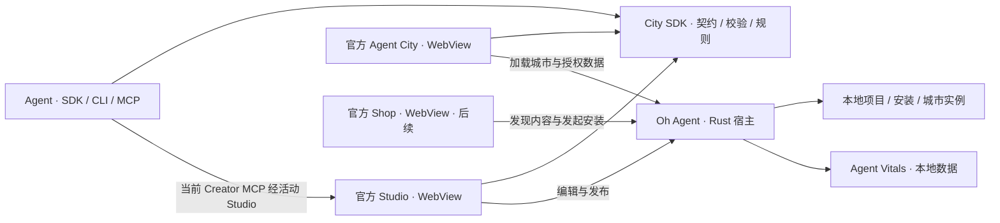

# Oh Agent 架构与 City SDK 迁移方案

2026-11-11 · 架构评审稿

## 1. 产品与 MVP

Oh Agent 提供本地 Agent Vitals 数据和应用宿主。官方 Agent City 是首个可玩的数据可视化游戏，也是 City SDK 的参考实现。玩家在同一个 City 应用里切换城市实例，在地图入口进入小游戏。开发者或 Agent 通过 SDK 创建城市和小游戏，试玩后打包，其他用户可以安装并组合使用。

MVP 用官方双岛城市和一座沙漠城市验证世界差异，用检查点竞速和区域收集验证玩法差异。同一个竞速包应能通过不同的入口、起点和检查点绑定，在两座城市运行。沙漠地图需要改变地形或路网，只替换贴图无法验证世界生成接口。这个闭环验证 City 引擎的复用性。Roblox 的创作、分发和运行分层是长期参考，通用游戏 App SDK、第三方可执行插件和社区交易各有独立的验证条件。

## 2. 当前代码与迁移证据

| 范围 | 已有能力 | 待验证或待实现 |
|---|---|---|
| 主工作区 `dev` | Tauri 宿主加载官方内置 City，City 提供现有地图和玩法。官方插件注册表随宿主构建，宿主一次运行一个活动插件 | 多城市实例、可移植内容安装、外部应用安装 |
| SDK 迁移工作区 `codex/city-sdk-migration-slice` | 引入 City SDK、官方 Studio、Rust Creator 项目服务与本地资产访问。已有项目、布局、挂载与规则链路的实现切片 | 迁移切片尚未合并。需要验证完整通关、跨地图复用、独立打包安装和持久化 |
| 已观察到的桌面试玩 | 项目 revision 2 发布后在 City 就绪，键盘驾驶达到 55.8 km/h，取消后返回同一 Studio 项目 | 旧项目 HUD 显示两个检查点，规则仍要求三个。需要统一检查点来源，并完成一次从起点到结算的真实输入试玩 |

宿主切换可能关闭并重建 WebView。迁移切片的 Creator MCP 入口属于独立 CLI 的 `data-mcp`，通过 `query::plugin_calls` 路由到活动的官方 Studio，再进入宿主项目服务。当前交互依赖 Studio 活跃，宿主保存的项目可在重新打开 Studio 后继续编辑。宿主级后台编辑需要单独的授权和调用入口。

现状依据见 [官方插件接入指南](OFFICIAL_PLUGIN_INTEGRATION_GUIDE.md)、[插件宿主](../apps/desktop/src-tauri/src/plugin_host.rs)、[City 引擎](../apps/agent-city/ui/src/engine/CityEngine.ts)和[场景接口](../apps/agent-city/ui/src/game/runtime/GameScenePort.ts)。迁移细节见迁移工作区内的 `AGENT_CITY_SDK_CONTENT_MVP_SPEC_2026_11_11.md` 和 `AGENT_CITY_GITHUB_DISTRIBUTION_SPEC_2026_11_11.md`。

## 3. 运行时与代码边界

图中的三个 WebView 都是官方应用入口。宿主管理激活和切换，项目、安装和城市实例在 WebView 生命周期之外保存。地图上的小游戏由 City 在当前场景运行，进入小游戏沿用 City 的输入和返回路径。

| 层 | 职责与依赖 |
|---|---|
| Agent Vitals / Rust 数据面 | 提供固定版本、字段和查询上限的 typed DTO。宿主按活动 WebView、描述符和授权检查请求及响应 |
| Rust 宿主与服务 | 管理插件导航、项目 revision、试玩交接、内容校验安装、城市实例和挂载持久化。City 的业务投影、场景生成和玩法运行归 TS |
| City SDK | 定义公开的世界、皮肤、游戏、挂载与规则契约，提供纯数据校验和可独立运行的规则执行器。依赖方向从应用指向 SDK，SDK 保持可脱离 React、Three 和 Tauri 使用 |
| City Runtime | 生成并渲染世界、加载资产、处理输入和地图入口，为玩法提供场景接口。官方受信任 TS 适配器把已授权的 DTO 转为 City 表现数据 |
| 官方 Studio / Shop | Studio 消费项目与试玩接口，优先复用 SDK 提供最小编辑入口。Shop 消费目录与安装接口，沿用官方 WebView 模式 |

`CityActivityCoordinator` 决定当前活动能否进入和退出，`GameScenePort` 管理相机、输入及场景资源的租约。活动退出统一收口到清理路径，在完成、取消和失败时都释放资源。第一轮沿检查点玩法逐步把驾驶适配移出 `CityEngine`，让活动经场景端口使用引擎，把 `CityApp` 留作组合入口。拆分 `creator_projects` 时优先分清命令、事务与内容资产职责。给新增边界加导入检查，覆盖 SDK、Studio、场景引擎和玩法的依赖方向。

## 4. 城市、皮肤与小游戏如何组合

| 对象 | 身份与生命周期 |
|---|---|
| `Project` | 创作草稿，以 `projectId + revision` 标识版本。编辑提交检查预期 revision，重试使用幂等键 |
| `PlaytestSnapshot` / `PlaytestEvidence` | 快照固定试玩输入。证据按 run 记录规则版本、种子、输入 tick、终态和失败对象，支持规则重放与诊断 |
| `Release` / `Package` | Release 固定已发布的草稿版本。Package 是可转移产物，包含版本、依赖、manifest 和可校验的资产；安装固定具体内容摘要 |
| `InstallRecord` | 记录宿主已验证并启用的包版本及摘要。升级先暂存和校验，再原子启用。已有实例保留其固定版本，仍被引用的内容保留到引用解除 |
| `CityInstance` | 玩家拥有的城市实例，具有持久 `cityId`，固定世界、皮肤、种子及布局版本。单一官方 City 插件可以加载多个实例 |
| `GameMount` | 某城市中的一次小游戏布置，固定游戏包摘要和布局版本，记录入口、出生点、检查点等语义绑定。同一个游戏包可以有多个 mount |
| `Listing` / `Entitlement` | Shop 后续加入的目录商品与购买授权。目录发现、权益、安装与场景挂载各有自己的状态 |

世界包指定受支持的生成器及参数，决定地形、路网与可用锚点。皮肤包提供材质、植被和装饰等外观资产。纯外观替换保留锚点，修改几何或地形后重新校验既有挂载，失效时给出明确的重绑提示。模型随包声明用途、格式与大小，安装器校验摘要，本地资产协议提供已验证的资源。旧布局与设置迁移时保留可回退的原版本。

小游戏包声明所需能力和语义插槽，例如一个起点与一组有序检查点。地图入口由 mount 提供，点击后 City 解析绑定并启动玩法。MVP 用已注册规则和受限数据定义创建新内容，允许 Agent 改布局、参数和规则组合。玩法包可随城市一起发布，也可独立安装后绑定其他兼容城市。内容运行只消费 SDK 暴露的场景数据，官方 City 的真实 Agent Vitals 数据访问继续走宿主授权。

## 5. 实施顺序与验收

| 切片 | 工作 | 验收 |
|---|---|---|
| 1. 固定官方 City 基线 | 统一挂载校验、规则、HUD 的检查点来源。把试玩交接固化为保存、激活、认领、结束、返回 | 用真实输入完成一场竞速并结算。取消和启动失败都释放租约并回到原项目。未保存编辑拒绝切换时，Studio 保持前台。记录固定快照和运行证据 |
| 2. SDK 内容可移植 | 定义独立的世界、皮肤和玩法包契约，提供 SDK/CLI 校验、打包与宿主导入。安装校验版本、依赖、大小与摘要 | 将从源码生成的包导入干净客户端并启动试玩。损坏或不兼容的包导入失败后，原实例仍可启动。使用相同快照与输入重放规则结果 |
| 3. 多城市与可重绑玩法 | 保存城市实例与 mount，在 City 地图提供入口、绑定校验和切换 | 双岛与沙漠实例可共存。将同一竞速包在两城分别绑定并完成试玩，再加入区域收集。更换外观保留挂载，布局变化触发重绑。应用重启后恢复正确的城市、包版本与入口 |
| 4. Agent 创作闭环 | SDK 作为必经的公开契约，以 CLI 或现有 Studio/MCP 入口编辑，支持预览、提交、试玩与重新打包 | Agent 在独立工作目录完成创建、预览、试玩、修改和再打包。旧 revision 提交得到可处理错误，重复提交产生一次修改。另一台客户端安装后能进入地图入口完成试玩 |
| 5. GitHub 分发与官方 Shop | GitHub 托管源码与版本化产物，目录用受审查的条目登记兼容性和摘要。官方 Shop 复用同一安装服务 | 从目录找到城市、皮肤、小游戏，在干净客户端安装并组合。升级失败后原版本仍可运行 |

试玩交接以宿主保存的项目、revision、snapshotId 和 runId 为依据。City 认领快照后报告终态，宿主按返回上下文重建 Studio。玩家负责可视试玩，Agent 可执行无头规则试玩、读取结果并修改项目。桌面输入证据与无头规则重放分别验收。

## 6. 仓库与分发

先稳定公开 SDK 契约和打包流程。用独立 GitHub 仓库里的沙漠城市与小游戏验证外部作者能只依赖发布的 SDK 创建产物。官方 City 源码也可随后独立维护，由 Oh Agent 构建流程固定并审查指定版本的官方产物，继续以编译注册的官方插件交付。分仓验收以两个仓库可独立构建、SDK 版本可固定、产物可复现和宿主集成可回滚为准。

GitHub 负责源码与发布托管，目录负责发现，宿主负责安装。首轮可以手动下载并本地导入。线上 Shop 启用前按仓库政策实现固定公开 HTTPS 来源、签名验证和显式授权。下载、安装与数据授权分别处理。Shop 首批内容为城市世界、视觉皮肤和内嵌小游戏，目录与安装闭环稳定后再引入购买权益。

第三方可执行 Game App Plugin 是独立交付阶段，需要包签名、进程身份、沙箱、能力授权、资源预算、故障隔离及更新回滚。Worker 或 WebAssembly 可以作为运行时技术选项，仍需明确宿主导入能力和隔离边界。真实本地数据和远程 City 继续遵循现有数据政策，GitHub 发布与 Shop 目录只处理公开内容和分发元数据。
