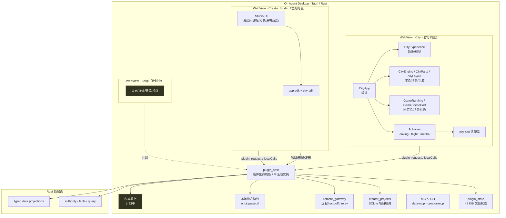
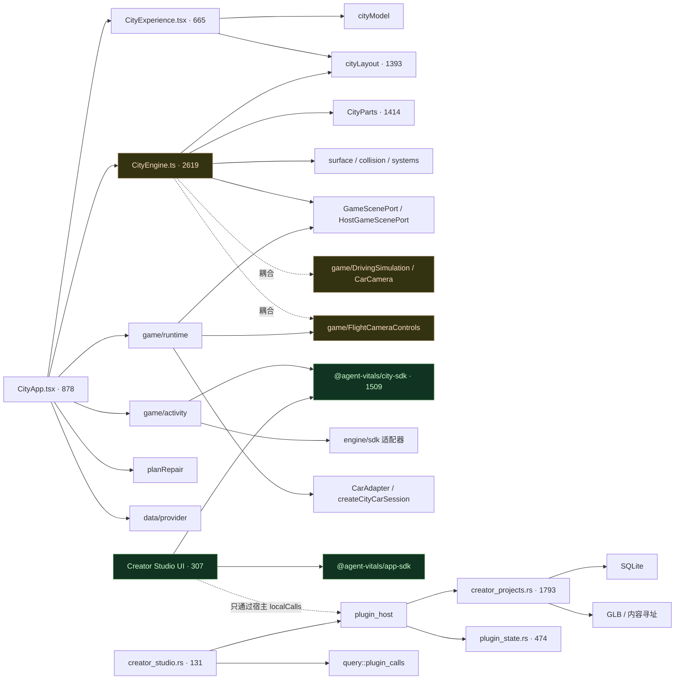
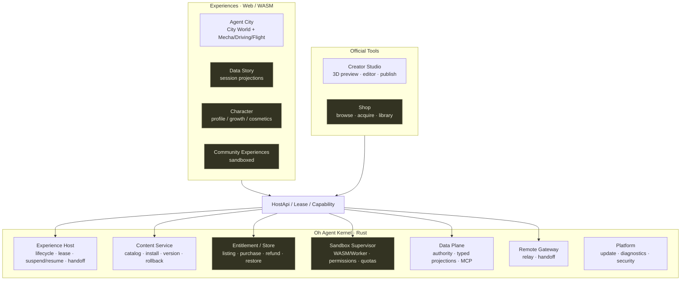
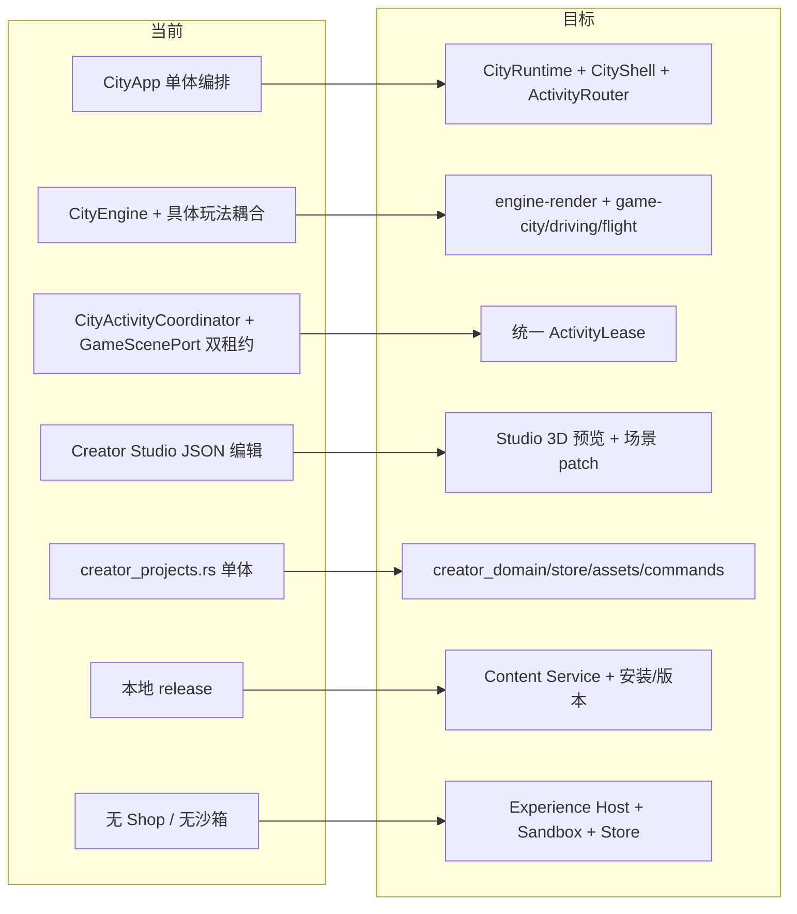

# Oh Agent 架构图（当前 → 目标）

- 状态：架构快照 + 迁移建议，待评审
- 日期：2026-11-11
- 范围：Oh Agent 宿主、City、Creator Studio、City SDK、内容/商店
- 说明：当前代码以 `dev` 与 `codex/city-sdk-migration-slice` 工作区为准；SDK 迁移切片尚未合并，图中会标注“已实现 / 计划中”。

## 0. 三张图分别回答什么

| 图 | 回答 |
|---|---|
| 运行时架构 | 进程、WebView、宿主、数据面怎么部署 |
| 代码依赖 | 模块之间谁 import 谁，哪里耦合 |
| 目标架构 | 按 Roblox 对标，平台应该长什么样 |

---

## 1. 运行时架构（当前）



关键事实：

- 宿主**一次只运行一个活动插件**；
- City 与 Creator Studio 各自独立 WebView，切换会关闭旧 WebView；
- Creator Studio 是**工具型 App Plugin**，不是 Game App Plugin；
- Shop、内容安装、UGC 沙箱尚未实现。

---

## 2. 代码依赖（当前）



边界评价：

| 模块 | 评价 |
|---|---|
| `city-sdk` | ✅ 纯数据/规则，不依赖 Three/React/Tauri |
| Creator Studio | ✅ 只依赖 app-sdk/city-sdk + 宿主调用 |
| `creator_studio.rs` | ✅ 薄 MCP 适配，不直接读项目库 |
| `CityEngine` | ⚠️ 直接依赖 driving/flight 具体玩法 |
| `CityApp` | ⚠️ 878 行总编排，活动/数据/引擎/UI 混在一起 |
| `creator_projects.rs` | ⚠️ 1793 行，领域/存储/资产/命令混合 |
| `GameScenePort` vs `CityActivityCoordinator` | ⚠️ 两套租约并存 |

---

## 3. 目标架构（Roblox 对标）



目标分层：

```text
Kernel（Rust）      宿主、内容、权益、沙箱、数据、远程
HostApi             只读快照、租约、能力、事件
Experiences         City / Data Story / Character / Community
Tools               Studio / Shop
```

---

## 4. 当前 → 目标迁移箭头



迁移顺序：

1. **统一租约**：`ActivityLease` 成为唯一所有权，`GameScenePort` 降为底层资源。
2. **拆 CityApp**：`CityRuntime`（数据/模型/引擎）、`ActivityRouter`、`CityShell`（UI）。
3. **拆 CityEngine**：`engine-render` 不再 import driving/flight；玩法通过适配器注入。
4. **Studio 预览**：独立 `PreviewScene`，共享 `city-sdk` 规则；先“改完重启”，后场景 patch。
5. **拆 creator_projects.rs**：domain / store / assets / commands。
6. **内容服务**：包 v2、安装、版本、回滚、资产 scope。
7. **Experience Host / Sandbox / Store**：按 Roblox 五层补齐。

---

## 5. 边界规则（建议变成 import guard）

```text
city-sdk
  ✗ 不能 import apps/agent-city
  ✗ 不能 import three / react / tauri
  ✓ 只依赖普通数据和注入查询

creator-studio
  ✗ 不能 import apps/agent-city
  ✓ 只依赖 @agent-vitals/app-sdk、@agent-vitals/city-sdk、宿主调用

game/activity
  ✗ 不能 import CityApp
  ✓ 只依赖 HostApi / engine 适配器 / city-sdk

engine-render
  ✗ 不能 import 具体 game（driving/flight/mecha）
  ✓ 只依赖 ScenePort / AssetPort / CameraPort / FrameHook

MCP adapter
  ✗ 不能直接读项目库 / City 内存
  ✓ 只经 plugin_calls 调当前活动 WebView

Rust host
  ✗ 不实现 City 规则
  ✓ 身份、授权、事务、存储、内容验证、导航
```

现有 `verify-mecha-layers.ts` 只覆盖 mecha；建议新增：

- `verify-city-sdk-boundary.ts`
- `verify-creator-studio-boundary.ts`
- `verify-engine-render-boundary.ts`

---

## 6. 组件所有权

| 组件 | 所有者 | 权威 |
|---|---|---|
| 项目草稿/revision | Rust Creator 服务 | Rust |
| 预览凭据 | Rust Creator 服务 | Rust |
| 场景渲染/玩法运行 | City TS | City WebView |
| 小游戏规则 | `city-sdk/runtime` | 纯函数 |
| 内容包/安装 | Rust Content Service（计划） | Rust |
| 权益/购买 | Rust/服务端（计划） | 服务端 |
| 视觉预览 | Creator Studio（计划） | Studio WebView |
| Agent 权限 | Rust host | Rust |
| session 数据 | Rust 数据面 | Rust |

原则：

- **Rust 不解释 City 实体**；
- **TS 不拥有授权/内容真源**；
- **Studio 不直接改 City 内存**；
- **Agent 不绕过项目服务**。

---

## 7. 当前缺口（按图）

| 图 | 缺口 |
|---|---|
| 运行时 | 无 Shop/内容服务；单活动插件；无沙箱 |
| 代码 | `CityEngine` 耦合玩法；`CityApp` 单体；双租约；`creator_projects` 过重 |
| 目标 | 缺 Experience Host、Content Service、Sandbox、Store、Studio 3D 预览 |

---

## 8. 结论

**当前图 = City 模块化单体 + 宿主 + 干净 SDK + Creator 雏形。**
**目标图 = Rust Kernel + Experience Host + 多 Experience + Studio/Shop 工具 + 内容/经济/治理。**

迁移的关键不是“把 City 重写成通用引擎”，而是：

1. 统一租约；
2. 拆 CityApp / CityEngine；
3. 让 Studio 能 3D 预览；
4. 建内容服务；
5. 最后才是沙箱、商店、经济。
