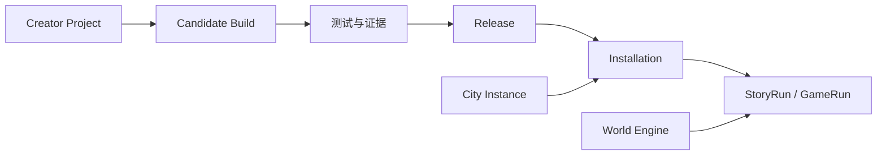

# Oh Agent Creator Studio V2 — Agent 共创工作台信息架构与实施 RFC


2026-11-25 工作区入口和工具分层见 [Creator Studio 工作区信息架构](CREATOR_STUDIO_WORKSPACE_INFORMATION_ARCHITECTURE_2026-11-25.md)。
> **文档性质**：PRD + Information Architecture + UX Spec + Technical RFC + 迁移计划  
> **日期**：2026-11-22  
> **修订**：**r2（2026-11-22）体验设计与浏览器调试复审**——补充当前 dev 代码基线、浏览器 Web Service/iframe 实测边界、哪些信息应从用户默认界面隐藏、项目库与编辑调试工作区原型；详见 §0.3、§13 与[体验设计评审](CREATOR_STUDIO_V2_EXPERIENCE_DESIGN_REVIEW_2026-11-22.md)。  
> **r2 补充**：§14 以 City 建筑 MCP 和道路修复为现有实现，提出共享 Runtime 编辑契约、P0 实时反馈和 MCP / SDK 接入次序。  
> **状态**：Proposed；本 RFC 是产品/架构设计。新增的页面是独立 Mock 原型，**没有修改 Creator Studio 产品源码**；Mock 截图不代表真实 Host/Agent/City/Game 能力。  
> **代码基线**：`dev@3335ff014aacb371133b5c79f4b6c9f815cb69ec`（本地审查）；r1 仍保留 `5e0a7d84` 的历史复核记录。  
> **依据**：当前 Studio 源码与浏览器开发宿主、City/Game 预览实现；当日实测截图；用户提供的 Studio 项目库和编辑页视觉参考；本地 Mock Web Service 原型。  
> **审查限制**：r2 使用本地浏览器 Mock 服务进行 UI/交互检查，未连接 Rust authority DB、未运行真实 Agent 或 Code Game Preview，也未做桌面真机回归；「有代码路径」不等于「功能已端到端验收」。r1 中打包 App（build sha256 72b69f62…）证据仍仅适用于其当日基线。

---

## 0. 核心决策

**Creator Studio 的中心对象应该是人类的创作目标与作品，而不是资源注册表、Build、JSON、SDK 和 Host 指令。**

建议将产品定位从「资源管理后台 + 3D 场景编辑器」变为 **Agent 驱动的 City / Story / Game 创作工作台**。

统一工作流：

**描述创意 → Agent 规划 → 人类批准范围 → Agent 修改草稿 → 构建与验证 → 真实 Preview → 人类审查 → 保存/发布 → 安装/分享。**

六条设计原则：

1. **City / Story / Game 可以各自独立创作和发布**；City 允许安装多个 Story 和 Game，并与其作品生命周期分离。
2. **Project / Candidate Build / Release / Installation / Run 是不同实体**。禁止把不可变 Game Build 当可编辑 Game Project，也不允许从玩家 Story State 推导创作项目。
3. **Agent 是工作流中的常驻协作者，不是一个独立「Agent 日志页面」**；Studio 不复制 Codex/Claude Code 的 IDE。
4. **请求受理 ≠ 完成，构建通过 ≠ 真实 City 可玩，安装完成 ≠ 自动运行**。所有结果绑定可追溯证据。
5. **保留宿主权限、preview/commit、CAS、幂等、只读预览、不可变 Build、安全安装**，UI 改版不能稀释安全边界。
6. **不重新设计 Three.js/World Engine**。车轮悬空等游戏问题通过 Studio 的可视化诊断与真实测试反馈给 Runtime，而不是在 UI 层加入补偿魔数。

### 0.1 P0 验收任务

一个未读过 SDK 文档的人应能做到：

> 打开「验收湾」，让 Agent 提议添加咖啡馆和出租车司机；查看变更、预览、接受修改；准备一个侦探故事；给 City 安装竞速 Game，验证车辆贴地与场景兼容性。

首轮 Agent 创作验收加入同屏迭代：选中竞速检查点，告诉 Agent「挪到桥头」，在当前画布看到候选位置与范围。继续说「再往后一点」，画布更新到最新提案。用户可以保留原稿或接受修改，并用新绑定跑一次试玩。预览显示由候选就绪触发，接受和试玩各自有独立结果。链路要求见 §14.4。

其中 **独立 Story Project Registry 尚未接通时必须如实提示**，可先实现 City/Game 路径，不能用假 Story 数据声称已完成整个流程。

### 0.2 [rev] r1 修订记录（2026-11-20 实测复审）

原稿代码事实全部核实属实（§1.1 逐行比对通过；§1.2 截图问题与当日打包实测体验吻合）。r1 修正八处：

| # | 级别 | 问题 | 落稿 |
|---|---|---|---|
| 1 | P1 | §1.3-B 建议的 `preview.ok === true` 门控会把安装向导全部禁用——宿主 `city_game_install::preview` 响应**没有 `ok` 字段**（grep 实证），前端永远得到 `ok:null` | §1.3-B 改为 `canInstall === true` 门控 + 宿主补 `ok` 二选一 |
| 2 | P1 | 模板玩法（4 个 `playtestSupported` builtin-adapter）是当前**唯一端到端可玩**的创作路径（当日实测走通全链路），原稿却标为 legacy | §3.4/§7/§8 升为一等公民，`LegacyMiniGameEditor` 更名 `TemplateMiniGameEditor` |
| 3 | P2 | ST-07 Task Ledger 未交代与已上线 `creator_session_*`/`creator_job_*`（8 工具）的关系，有另起平行任务系统风险 | §5.4 补行 + ST-07 加"扩展非平行"门槛 |
| 4 | P2 | 全仓无 City 删除/归档能力，Agent 试错放大孤儿残留（当日一次验收即留 2 个空同名城市） | §1.3-C + 新增 ST-13 |
| 5 | P2 | Agent 连接管理无落地承诺；"确认连接状态"验收项现状无法满足 | ST-04 验收扩连接状态最小诚实展示 |
| 6 | P3 | §12 四个 chatgpt.com 外链会腐烂；Multi-Story RFC 不在仓库 | §12 补注（对齐 V3 RFC r2 的处理） |
| 7 | P3 | ST-CO05 证据未区分信任级（现结算证据为 `city-client-reported`） | §10 补 evidenceSource 标注 |
| 8 | P3 | ST-02 拆分低估两个隐性耦合：跨 App 源码引用 CityViewport、大小写 `@ts-expect-error` 兜底 | §7 补拆分风险 |

### 0.3 [rev] r2 修订记录（2026-11-22 体验与浏览器调试复审）

| # | 修订 | 最新结论 |
|---|---|---|
| 1 | 当前代码拆分进展 | r1 关于 `main.tsx` 约 1,405 行的记录是历史基线；当前 `main.tsx` 是 5 行入口，Studio 主编排已在 `app/CreatorStudioApp.tsx`（约 1,113 行），项目库/Agent/预览视图已有 feature 组件。§13 标出当前范围和仍需拆分的主编排。 |
| 2 | 浏览器调试服务边界 | `apps/desktop/ui-dev` 是本地浏览器预览宿主，Studio 插件单 iframe + 合成 provider；不是连 Rust Authority 的生产 Web Service。真实 Code Game Preview 仍是 Tauri 独立 WebView。 |
| 3 | iframe 实测 | 独立静态 Mock Web Service 可在 `sandbox="allow-scripts"` 的 iframe 中渲染与交互；这证明 UI 载体可行，不证明 Host RPC、真实试玩、隔离等价或生产可嵌套。 |
| 4 | 用户信息层级 | 默认隐藏 ID、revision、哈希、RPC、TTL、eventId、原始 JSON 和后台事件流水；保留作品类型、所处阶段、真实 Agent 连接状态、试玩隔离范围、测试来源和待确认动作。 |
| 5 | 视觉与 IA | 用户给定的编辑页和项目库图作为当前高保真方向：宽画布 + 常驻 Agent + 测试摘要；作品卡片 + 详情面板；运行 City 与 Creator Project 明确分层。Mock 视觉原型及实测截图落在 `artifacts/creator-studio-v2-prototype-2026-11-22/`。 |
| 6 | 当前 Mock 的错误状态 | `updatedAtMs: 0` 在 UI 显示 1970 时间；浏览器 City archive 显示 `creator_method_unavailable`；真实 Code Game playtest 在浏览器明确不可用。应改为不误导的产品文案，并按当前能力禁用无效操作。 |

---

## 1. 当前 dev 代码审查结果

### 1.1 文件与真实能力

| 代码位置（固定 commit） | 已核实事实 | V2 设计判断 |
|---|---|---|
| [`apps/creator-studio/ui/src/main.tsx`](https://github.com/Oh-Agent-AI/oh-agent/blob/5e0a7d8/apps/creator-studio/ui/src/main.tsx) | 约 1,405 行；`App` 中包括 `activePanel="library/project/play/agent/code"`，同时处理 City、MiniGame、JSON、GLB、Preview、发布、Agent 活动与审批 | 最大的前端耦合点；先拆领域状态再改导航 |
| [`CityGameLibrary.tsx`](https://github.com/Oh-Agent-AI/oh-agent/blob/5e0a7d8/apps/creator-studio/ui/src/CityGameLibrary.tsx) | City 列表、Game Build 列表、City↔Game 安装预检/提交；Story 标签明确展示「Registry 尚未接入」 | 真实后台概念不应直接成为创作导航 |
| [`cityGameLibrary.ts`](https://github.com/Oh-Agent-AI/oh-agent/blob/5e0a7d8/apps/creator-studio/ui/src/cityGameLibrary.ts) | `LibraryKind=city/story/game`；`InstallationRow`；`buildInstallRequest` 默认 `runAfterInstall=false, replaceCurrentView=false, allowOfficialStoryWrites=false` | 保留安全默认值；把安装行为放入 City「已安装内容」 |
| [`CodeGamePreviewPanel.tsx`](https://github.com/Oh-Agent-AI/oh-agent/blob/5e0a7d8/apps/creator-studio/ui/src/CodeGamePreviewPanel.tsx) | 选择 Build 和真实/合成 City，使用独立 Preview；读取 Preview Status 和 Story Evidence | 保留为「测试」专业面板，而非主导航模式 |
| [`startupLoad.ts`](https://github.com/Oh-Agent-AI/oh-agent/blob/5e0a7d8/apps/creator-studio/ui/src/startupLoad.ts) | 限定重试 `plugin_instance_mismatch` 的宿主启动竞态 | 统一加载器，不让 UI 隐藏真正失败 |
| [`agentApproval.ts`](https://github.com/Oh-Agent-AI/oh-agent/blob/5e0a7d8/apps/creator-studio/ui/src/agentApproval.ts) | 内存审批 Gate 校验 `previewId/projectId/revision/operationId`；Host 仍是最终授权者 | 可复用为 Agent 提交审批层；不等于持久 Task Engine |
| [`creator_projects.rs`](https://github.com/Oh-Agent-AI/oh-agent/blob/5e0a7d8/apps/desktop/src-tauri/src/creator_projects.rs) | `creator.project.*`、`creator.city.*`、`creator.game.preview/commit`、`creator.project.publish/playtest`、场地/资源/车辆等方法与本地存储 | 不能误判为统一的 City/Story/Game Project Registry；应经 Facade 聚合 |
| [`creator_code_game.rs`](https://github.com/Oh-Agent-AI/oh-agent/blob/5e0a7d8/apps/desktop/src-tauri/src/creator_code_game.rs) | 独立代码游戏 Preview、冻结 Build 校验、有界 Preview 记录 | 不要重做 Preview 执行器 |
| [`city_game_install.rs`](https://github.com/Oh-Agent-AI/oh-agent/blob/5e0a7d8/apps/desktop/src-tauri/src/city_game_install.rs) | SQLite 安装表、预检表、幂等回执；更新版本需确认；检查 City Revision 和兼容性 | 「City 已安装游戏」可真实显示，后端应继续持有权威 |
| [`city_runtime.rs`](https://github.com/Oh-Agent-AI/oh-agent/blob/5e0a7d8/apps/desktop/src-tauri/src/city_runtime.rs) | City 时钟、Preview Clock Fork、玩家 Scope、Game Run、受控 Story Commit 路径 | 比旧设计文档的静态状态更进一步，但不是创作 Story Project Registry |
| [`city_scheduler.rs`](https://github.com/Oh-Agent-AI/oh-agent/blob/5e0a7d8/apps/desktop/src-tauri/src/city_scheduler.rs) | Story Schedule/List/Cancel 及验证与测试 | 可为 Story 测试中心提供真实日程数据，不代表多故事编排已完工 |
| [`story_store.rs`](https://github.com/Oh-Agent-AI/oh-agent/blob/5e0a7d8/apps/desktop/src-tauri/src/story_store.rs) | SQLite CAS、Event、Outbox、幂等与部分声明式规则 | 玩家运行事实存储，**不是** Story Project、Package、Installation |

**关键结论**：今天缺的并不是所有 Story Runtime 代码，而是 **Story 创作 Registry、作品生命周期、Story Installation 与多故事组合 UI**。Game/City 有真实基础，V2 应渐进迁移，不应全部推翻。

### 1.2 六张截图体现的具体问题

| 截图/页面 | 人类体验问题 | 源码对应 | 严重度 |
|---|---|---|---|
| City 项目库 | 3 张「验收湾」同名卡；兼容状态未知、世界版本未知占据内容 | `CityGameLibrary` 直接展示 City Records | P1：身份与摘要不足；不应认定数据重复 |
| AVG Story | 「注册表未接入」却占据整个主页面 | `CityGameLibrary` 的 Story 占位是明确写死的 | P0：空能力占主导航 |
| 游戏库 | 显示 0 个 Build，并要求先通过 MCP 构建 | `creator.code.builds.list` 是产物列表，不是 Game Project | P0：项目与产物混淆 |
| 项目 | 中间 3D；右侧城市列表、源码导出、体验包、世界包、新建小游戏混杂 | `main.tsx` `activePanel=project` | P0：未按用户任务聚合 |
| 玩法 | 原始 JSON、GLB、锚点绑定、皮肤混在一起 | `main.tsx` 高级表单与 Mount 编辑 | P0：开发者内部结构成为主流程 |
| Agent | 只显示「已受理」、版本和操作历史，缺目标/执行/验收 | `agentActivity` 最多保留 6 条 + Approval Gate | P0：Agent 仅是活动收件箱 |

### 1.3 两个必须修正的代码级交互风险

**A. 旧 Creator MiniGame 试玩依赖已发布 Release**：`main.tsx` 中 `releaseHint`、`startPlaytest()` 和顶部 Toolbar 依赖 `publishedReleaseId`。这使某条旧玩法路径「先发布后试玩」。**建议**区分供本地验证的不可变 Candidate/Preview Artifact 和正式 Release，允许「构建候选 → 测试 → 接受 → 发布」；实际落地需保持后端封存与预览权限语义。

**B. 安装预检的 UI 是弱三态**：`cityGameLibrary.ts` 的 `canCommitInstall` 当前用 `preview.ok !== false && preview.canInstall !== false`，所以未知的 `null` 在 UI 表达式里有机会通过。Host 仍二次鉴权，因此这是 UI fail-closed 风险，**不是已证明的权限绕过**。

[rev] **修正原建议表达式**：`preview.ok === true && preview.canInstall === true` **不可直接采用**——宿主 `city_game_install::preview` 的真实响应不含 `ok` 字段（grep 实证；当日实测 `parseInstallPreview` 恒得 `ok:null`），照改会把**所有安装**在 UI 层禁用。正确门控二选一：
- 前端：`preview.canInstall === true && 无 error 级诊断`（`canInstall` 宿主确实返回）；
- 或宿主响应补 `ok` 字段后再采用严格表达式。
ST-05 按此修正，并加回归：宿主载荷快照钉死 `ok` 字段的有无。

**C. [rev] City 无删除/归档能力，Agent 试错放大孤儿残留**：全仓无 city 删除方法（grep 实证）；当日打包实测一次验收即留下 2 个空同名城市。§1.2 的「3 张验收湾」正是此机制的产物——ST-IA02 只解决展示诚实，不解决越积越多。建议（→ ST-13）：City 归档/删除（预检已安装内容与 release 引用，拒绝或级联提示），或创建改「延迟注册」（未命名草稿首次保存才进 Registry）。

---

## 2. 作品对象与内容层次

| 实体 | 中文名称 | 身份 | 可否编辑 | 所属服务 |
|---|---|---|---|---|
| `CreatorProject` | 创作项目 | `projectId + projectKind` | 是，revision CAS | Creator Registry |
| `CityInstance` | 城市实例 | `cityId` | 受控 Patch/Revision | City Registry |
| `CandidateBuild` | 候选构建 | `buildId + digest` | 否 | Builder |
| `Release` | 已发布版本 | `releaseId + contentDigest` | 否 | Publisher |
| `Installation` | 城市安装关系 | `installationId + cityId` | 升级/停用/卸载 | Installation Registry |
| `Run / Save` | 游戏运行 / 故事进度 | `gameRunId` / `storyRunId` | Runtime 状态事务 | World/Game Engine |
| `StudioTask` | Agent 协作任务 | `taskId + goalRevision` | 受控计划/验收 | Task Ledger（新增） |

**禁止**：在项目列表里把 Game Build 当作可编辑项目；从 Story Runtime 状态生成虚假的 Story Project；把安装一个 Story/Game 视为直接修改 City 几何；用 City ID 代替 Story ID。

### 2.1 多 Story 概念（继承 Multi-Story RFC）

`Story Project → Story Package/Release → Story Installation → Story Run`。

- `story_id`：作品稳定身份。
- `story_installation_id`：安装到目标 City 的实例（含 bindings、版本、权限、enabled）。
- `story_run_id`：玩家的剧情运行和私有进度。
- 同一个 City 可安装多个 Story 和 Game；多个 Story 可共享公共 `residentId/placeId`，但状态 Scope 与 NPC 私有记忆不共享。
- Runtime 的 `story_store.rs` 与 `city_scheduler.rs` 提供部分存储/调度基础，不能充当独立 Story Project Registry。

---

## 3. 信息架构 V2

### 3.1 顶层导航

```text
Creator Studio
├── 工作台                         /studio
│   ├── 输入目标：今天想创造什么？
│   ├── 从模板开始：City / Story / Game
│   ├── 最近创作
│   └── 等待确认 / 正在执行 / 测试失败
├── 我的项目                       /studio/projects
│   ├── 全部 / City / Story / Game
│   └── 作品草稿、最近修改、状态
├── 探索与素材                     /studio/library
│   ├── 官方模板 / 已下载的内容
│   └── 未来创作者社区与 Store
└── 发布管理                       /studio/releases
    ├── Release / 构建产物
    ├── 安装与兼容性记录
    └── 分发状态（后续）
```

Studio 内现有「资源库 / 项目 / 玩法 / Agent」双层侧边 Rail **合并**；Oh Agent 应用外层「总览、City、会话……」全局导航保留。Agent **不再占一个内容类型入口**，而是作品编辑器常驻协作面板。

### 3.2 三栏工作区

```text
┌────────────────────────────────────────────────────────────────────────────────┐
│ ← 我的项目 / 验收湾 · City           草稿 6 [测试候选] [保存] [发布]            │
├─────────────────┬──────────────────────────────────────┬───────────────────────┤
│ 项目大纲        │ 3D City 画布                         │ Oh Agent / Inspector  │
│ ▸ 世界与道路    │                                      │ 目标：增加咖啡馆      │
│ ▸ 建筑          │      [可点选、看空间差异]            │ 计划：                │
│ ▸ 地点与居民    │                                      │ ✓ 检查 City          │
│ ▸ 已安装故事    │                                      │ ◉ 生成变更           │
│ ▸ 已安装游戏    │                                      │ ○ 自动测试           │
│ ▸ 交互          │                                      │ ○ 等待人工验收       │
│ ▸ 版本与测试    │                                      │ [查看 Diff/证据]     │
│                 │                                      │ 对 Agent 说…… [发送] │
├─────────────────┴──────────────────────────────────────┴───────────────────────┤
│ ▸ 测试/诊断控制台    当前：真实 City 预览 / 正式状态未更改                    │
└────────────────────────────────────────────────────────────────────────────────┘
```

- **左栏**为当前作品对象大纲，不是又一个全局导航。
- **中栏**根据作品变成 City 3D、StoryGraph/对白、Game Preview/场地。
- **右栏**默认 Agent；选中对象时可切换或临时打开 Inspector；支持固定 Inspector。
- **底栏**默认收起，仅在失败、验证或用户主动打开时展示编译日志和技术证据。
- **顶栏**只放作品身份、未保存状态、测试、发布；BuildId/revision/JSON 进入高级详情。

### 3.3 工作台首页

```text
今天想创造什么？
[ 在验收湾增加一家咖啡馆，添加两名 NPC 和一个侦探故事……          ]
                                                      [让 Agent 制定计划]

从模板开始    [🏙 City 世界]    [📖 Story 剧情]    [🎮 Game 玩法]

继续创作      验收湾（City） / 侦探游戏（Story） / Checkpoint Racing（Game）
需要你审核    2 项变更
正在执行      1 项 Agent 任务
最近测试      1 项失败：车辆接地异常
```

如 Agent 未连接，按钮必须如实显示「连接 Codex/Claude Code」或「复制任务说明」，不能假装已执行。

### 3.4 三个专用编辑器

| 编辑器 | 主要画布 | 左侧大纲 | 右侧 Agent 常见任务 |
|---|---|---|---|
| City Editor | 真实三维 City / 世界差异 / 几何诊断 | 道路、地形、建筑、居民、已安装 Story/Game | 规划城市、创建建筑、修复道路、检查车辆接地 |
| Story Editor | StoryGraph / 对话 / 时间轴 / 角色知识 | 章节、分支、角色 Canon、规则、目标 City 绑定 | 创作分支、检测死胡同、检查因果/NPC 记忆 |
| Game Editor | 游戏 Preview / 场地 / 输入与规则 | 玩法、资产、关卡、测试、版本 | 编写 TS、调整规则、修复物理、跑真实 City 测试 |

**Story Editor 暂标“待接入”**，直到有真正的 Story Project Registry 和相关 Host API。不能用“当前 Registry 未接入”的整页阻止用户使用 City/Game 工作台。

[rev] **模板玩法是一等公民，不是 legacy**：checkpoint-race 等 4 个 `playtestSupported=true` 的 builtin-adapter 是当前唯一端到端可玩的创作路径（当日打包实测：创建→修改→发布→真实通关全链路走通；Code Game 路径需 Agent/MCP 写 TS，新手第一步走不到）。Game Editor 必须并列支持两种形态：**模板玩法（结构化表单：入口/锚点/槽位/参数）**与 **Code Game（TS）**；无 Agent 的新手首路径是模板玩法，§0.1 的 P0 验收也依赖它。`LegacyMiniGameEditor` 相应更名 `TemplateMiniGameEditor`（§7/§8 同步）。

---

## 4. 四条用户旅程

### A. Agent 创建一座 City

1. 人类描述目标和风格，Agent 提出 City Generator、Terrain/Road、世界能力与验收标准。
2. 人类确认范围；Codex 在 TS 工作区修改城市定义，SDK 校验/构建。
3. Studio 装载**真实且绑定 Revision 的 WorldSnapshot**，预览变更并展示道路/建筑差异。
4. 出现「汽车悬空」时，Agent 请求地面法线、车轮射线、四轮接地距离、Collision Proxy/World Revision 等证据；不能用任意 Y 偏移声称已修复。
5. 验证后，用户接受草稿版本并选择是否发布。

### B. 创建 Story 再安装到 City

1. 先创建独立 Story Project（不强制立即选择 City）。
2. Agent 创建 StoryGraph、角色 Canon、条件、测试集；本地 Mock/Graph 检查。
3. 人类选择目标 City，完成 `residentId/placeId` 的显式绑定与权限预检。
4. 生成 StoryInstallation，默认不直接运行、不写正式玩家 StoryRun。
5. 同 City 可继续添加其他 Story；共享 NPC 公开位置统一仲裁、私有记忆隔离。

### C. 创建 Game，先试玩再发布

1. 从「驾驶检查点竞速」模板或自由 Agent 代码开始。
2. 生成不可变 Candidate Build，先在合成 Fixture 快速测试。
3. 选择真实 City，使用 `CodeGamePreviewPanel` 现有独立 Preview 链路，读取真实 `runId/status/outcome` 与证据。
4. 人工验收后创建 Release；在 City 内执行 `install.preview` → 查看权限/兼容/更新差异 → `install.commit`。
5. 安装不自动运行、不替换 City 视图、不写正式 Story。

### D. 编辑/维护已有作品

保持旧 Project 的本地未保存草稿；检测到来自 Agent 的新 Revision 时展示 Diff/冲突提醒，不能自动覆盖。历史 Release 不可变；回退通过创建新草稿或显式版本回滚。

---

## 5. Agent 共创工作流与数据契约

### 5.1 为什么需要 StudioTask

当前 `main.tsx` `agentActivity` 是“六条最近请求卡片”，持久化到 `creator-agent-activity:v1`；`AgentApprovalGate` 验证短期 Preview/Commit。它**缺少**任务目标、计划版本、跨步骤依赖、通过/失败证据及完成定义。不能仅把它改名为「AI 对话」就解决问题。

### 5.2 `StudioTaskV1` 草案（未实现）

```ts
type ArtifactRef = {
  kind: 'city' | 'story' | 'game';
  projectId: string;
  expectedRevision: number;
};

type TaskPhase =
  | 'planning' | 'awaiting-plan-approval' | 'ready'
  | 'executing' | 'validating' | 'awaiting-review'
  | 'accepted' | 'rejected' | 'failed' | 'cancelled';

interface StudioTaskV1 {
  schemaVersion: 1;
  taskId: string;
  goalId: string;
  goalRevision: number;
  artifact: ArtifactRef;
  humanRequest: string;
  acceptanceCriteria: readonly {
    id: string;
    evidenceKind: 'schema' | 'test' | 'runtime' | 'visual' | 'manual';
    description: string;
  }[];
  planRevision: number;
  stepIds: readonly string[];
  phase: TaskPhase;
  proposedChangeSetId?: string;
  lastEvidenceId?: string;
  updatedAtUtcMs: number;
}
```

关联：`StudioTaskStep`, `StudioEvidence`, `StudioApproval`, `ChangeSet`。Host/Task Ledger 存权威状态，`agentApproval.ts` 继续承担**被明确批准的变更提交**，不存长期真相。

### 5.3 状态必须可理解

| 真实进展 | 用户显示 | 是否完成 |
|---|---|---|
| 请求接收 / queued | 已收到，等待 Agent 执行 | 否 |
| 运行中 | 正在执行第 N 项 | 否 |
| 构建结束 | 已构建，待验证 | 否 |
| 测试失败 | 测试失败，可查看证据与修复建议 | 否 |
| 真实预览就绪 | 已可试玩，等待你审查 | 否 |
| 草稿提交 | 修改已保存到草稿版本 | 仅草稿完成 |
| Release 创建 | 已发布当前版本 | 仅发布完成 |
| Installation Commit | 已安装到目标 City | 仅安装完成 |

Agent 任务面板四部分：**目标和范围、计划与步骤、证据/差异、需要人类做的决策**。提供停止、重试、退回、接受，而非只有请求日志。

### 5.4 与已有 API 的衔接

| 当前真实机制 | V2 容器 | 处理方式 |
|---|---|---|
| `creator.game.preview/commit`, `creator.scene.preview/commit` | ChangeSet/Preview | 适配，不重写 Host 授权 |
| `creator.project.publish` | ReleaseManager | 从「测试入口」移到明确发布动作 |
| `creator.code.builds.list`, `creator.code.preview/status` | Game Test Runner | 保留不可变 Build 与独立窗口 |
| `creator.code.install.preview/commit` | Install Wizard | UI 预检必须明确为 true 才可提交 |
| `creator.city.list/read` | City Registry Adapter | 返回真实 City 身份；兼容未知不猜测 |
| `city.story.*` | Story Runtime Inspector | 仅作为运行证据，不当作 Project Registry |
| `agentApproval.ts` | ApprovalService Adapter | 保留短期 Scope 与过期判定 |
| [rev] `creator_session_open/status/close` + `creator_job_list/status/wait/cancel`（8 工具，已上线） | Task Ledger Adapter | ST-07 开工前先回答「扩展还是平行」：StudioTask 应是 job 系统的**字段化扩展**（goal/plan/evidence/acceptance），不得另起平行任务系统——与 V3 RFC r1 给 PR-4 的「不造第二套」门槛同一条纪律 |

---

## 6. 发布、安装与作品关系



- **项目**持续编辑；**Build**、**Release** 是不可变版本；**Installation** 属于目标 City；**Run** 属于运行时。
- Story Release 能否采用 `ContentPackageV3` 或独立 `StoryArtifact`，由 Shared Contracts/World Engine ADR 决定；Studio 只暴露统一安装流程。
- 同个 City 支持多 Story/Game，卸载 Story 需提示未完成进度与持久 Scheduler 的取消/迁移规则，不能遗留看不见的定时奖励。
- Marketplace 初期是免费模板/内容发现；定价、付款、授权与创作者分成后置，不要让支付阻塞 P0 用户体验。

---

## 7. 具体组件拆分建议

```text
apps/creator-studio/ui/src/
  app/
    CreatorStudioApp.tsx        # 入口与路由
    StudioRouter.tsx
  features/
    workbench/WorkbenchHome.tsx
    projects/ProjectList.tsx
    projects/ProjectHeader.tsx
    projects/ProjectOutline.tsx
    editors/CityEditorShell.tsx
    editors/StoryEditorShell.tsx
    editors/GameEditorShell.tsx
    editors/ContextInspector.tsx
    agent/AgentWorkspace.tsx
    agent/TaskPlan.tsx
    agent/ApprovalReview.tsx
    agent/EvidenceDrawer.tsx
    testing/PreviewWorkspace.tsx
    testing/DiagnosticsPanel.tsx
    composition/InstalledContent.tsx
    composition/InstallWizard.tsx
    releases/ReleaseManager.tsx
  adapters/
    creatorHostClient.ts        # 复用现有 creatorRequest
    cityRegistryAdapter.ts
    legacyMiniGameAdapter.ts
    codeGameAdapter.ts
    storyRuntimeAdapter.ts
    agentApprovalAdapter.ts
  contracts/
    creatorProject.ts
    studioTask.ts
    studioRoute.ts
  legacy/TemplateMiniGameEditor.tsx   # [rev] 原 LegacyMiniGameEditor；模板玩法是一等公民（§3.4）
```

**渐进迁移**：不一次删除 1,405 行 `main.tsx`。先分离 `CityGameLibrary`、`CodeGamePreviewPanel`、车辆/场地编辑、Agent Approval，再引入新 Shell。后端 `creator_projects.rs` 有成熟的调用验证与已使用的方法；前端先做 Facade，不要为 UI 统一而重写 Rust 存储协议。

[rev] **ST-02 需显式处理的两个隐性耦合**（当日构建链路实证）：
1. 跨 App 源码引用：`main.tsx` 直接 `import { CityViewport } from "../../../agent-city/ui/src/viewport/CityViewport"`——构建顺序依赖 city-sdk link prep（CI 修复 348c2917/e64e9cec 即为此），拆分后的 feature 模块必须保持同一解析路径；
2. 大小写敏感文件系统兜底：`CityGameLibrary.tsx` 的 import 带 `@ts-expect-error`（与 `cityGameLibrary.ts` 同名不同例）。拆分时顺手消除（改名其一），否则 Linux CI 继续携带例外。

### 7.1 UI State / 路由设计

- `StudioRoute` 与 `ProjectSelection`、`ViewportContext`、`AgentTaskContext`、`PreviewContext` 四个独立状态域。
- 不再由单一 `activePanel` 同时承担全局导航、加载城市、切换代码 Preview 和 Inspector Tab。
- 嵌入式 Plugin 不支持 URL 路由时可使用 typed route object，但保留浏览器历史的语义（返回项目不丢草稿）。
- 统一 Host Loader，沿用 `loadStudioValueAtStartup` 的有限重试；错误、空态、加载态必须分开。

### 7.2 Host Facade 草案（**新增目标，不是现有 RPC**）

```ts
interface CreatorStudioHostV2 {
  listProjects(kind?: 'city' | 'story' | 'game'): Promise<readonly ProjectSummary[]>;
  openProject(input: {kind: 'city' | 'story' | 'game'; projectId: string}): Promise<unknown>;
  createTask(input: {artifact: ArtifactRef; humanRequest: string}): Promise<StudioTaskV1>;
  approvePlan(input: {taskId: string; planRevision: number; approvalId: string}): Promise<void>;
  taskStatus(taskId: string): Promise<StudioTaskV1>;
  taskEvidence(taskId: string): Promise<readonly StudioEvidenceV1[]>;
  previewCandidate(input: {buildId: string; sourceCityId?: string}): Promise<unknown>;
}
```

P0 `listProjects` 可以由现有真实列表做**带类型标注的聚合视图**；绝不能拿 `creator.code.builds.list` 的 Build 行谎称可编辑 Game Project。`StudioTask` 需要真实持久后端才能称为已支持。

---

## 8. 旧界面迁移映射

| 旧界面 | 新位置 | 动作 |
|---|---|---|
| 资源库 City 列表 | 我的项目 > City；City 的「已安装内容」 | 分离创作与安装 |
| AVG Story 空页面 | Story 创作入口（Registry 实现后） | Registry 未实现前提供能力说明，不占据主导航 |
| 游戏库 Build 列表 | Game > 构建与版本 / 发布管理 | 不将 Build 叫 Project |
| 全局 City↔Game 安装记录 | City > 已安装内容；发布管理 > 安装情况 | 保留数据 |
| 项目 > 独立城市 / 玩法项目 | City 项目 / [rev] 模板玩法项目（一等公民，非 legacy，§3.4） | 明确不同身份 |
| 项目 > 导出源码、体验包 | 项目操作菜单 / 发布管理 | 保留功能 |
| 玩法 > 规则/场景 JSON | Game Editor > 高级模式 | 保留而非删除 |
| 玩法 > 锚点、槽位 | Game Editor > 场地，优先 3D 点选 | 减少裸 ID |
| 玩法 > 皮肤 | City Editor > 外观 / Render Profile | 所有权归 City |
| Agent > 操作卡 | 常驻 Agent Workspace > 任务时间线 | 旧日志归档 |
| Code Game Preview | Game Editor > 测试 / 独立预览 | 保留 Host 语义 |
| 顶部「发布」→「试玩」 | 「测试候选」→「发布版本」 | 改正确顺序 |

---

## 9. PR 路线与依赖

| 级别 | PR | 主要文件/模块 | 验收出口 |
|---|---|---|---|
| P0 | ST-01 作品类型语义清理 | `cityGameLibrary.ts`、新 `creatorProject.ts` | UI 不混淆 Project/Build/Release/Installation |
| P0 | ST-02 拆分 App | `main.tsx` → feature/editor/adapters | 原 City/Preview/GLB/旧 MiniGame/Approval 运行不退化 |
| P0 | ST-03 新导航与首页 | `WorkbenchHome`, `ProjectList`, `StudioRouter` | 新用户知道从哪里开始，消除重复 Rail |
| P0 | ST-04 Agent 侧栏 | `AgentWorkspace`, `ApprovalReview` | 可以显示目标、范围、已有审批和真实状态，不伪称成功；[rev] 含连接状态最小诚实展示（最近 MCP 会话/活跃工具面探测；未连接显示「连接 Codex/Claude Code」指引，不伪装已连接——§3.3 原则的落地验收） |
| P0 | ST-05 预检和状态可信性 | `canCommitInstall`、Error UI | Unknown 禁止确认；Host 仍有权威校验 |
| P0 | ST-06 先测试再发布 | 候选 Build/Preview 与 Release 入口 | 用户能验证草稿，无需先做正式公开发布 |
| P1 | ST-07 Task/Goal/Evidence 持久层 | 新 Rust Task Ledger + MCP Adapter | 重启恢复任务，进度由证据驱动 |
| P0 | ST-08a Agent 编辑实时预览 | Creator MCP、City SDK 编辑契约、TS Runtime 预览、Studio 对话和审批 | 一次对话内可连续预览建筑、检查点和道路提案。提案通过校验即可上画布，用户可放弃或确认，相关玩法可用新候选重试。见 §14.4 |
| P1 | ST-08b 扩大共创范围 | Story 分支、物理诊断、更多 Game 能力 | 复用同一提案与反馈流程，各游戏声明支持的预览和更新范围 |
| P1 | ST-09 Story Project Registry | Story Editor + 真正的项目 API | 可创建独立 Story，Graph/Canon/条件可测试 |
| P1 | ST-10 已安装内容与多故事 | StoryInstallation/GameInstallation 视图 | 同 City 多 Story/Game；Scope 隔离与冲突处理 |
| P1 | ST-11 证据中心 | City/Build/Run/Trace/Ground Debug | 测试标识真实来源，不把 Fixture 当真城 |
| P2 | ST-12 模板/UGC/商城 | Discover、发布/版权/安全安装 | 内容分发闭环；付款后置 |
| P1 | ST-13 [rev] City 清理与延迟注册 | 归档/删除（带已安装内容与 release 引用预检）或草稿延迟注册（首存才入 Registry） | 孤儿城市可清理；创建失败不残留注册项（ST-IA02 的机制层补强，§1.3-C） |
| P1 | ST-14 [r2] 浏览器 Preview Service | 本地浏览器运行同一 TS City/Game Runtime；Host 签发短时只读 Preview lease 和 typed DTO；独立来源/iframe 消息契约 | 浏览器可实际检查 City/Game 预览，同时不访问 authority DB/文件、不把 Candidate 写成 Release；满足 §13.3 隔离、范围、过期与撤销要求 |

依赖：ST-01→ST-02→ST-03；ST-04/05/06 可在新 Shell 稳定后并行；ST-09 依赖 Story Project Registry 与 Shared Contracts；ST-10 依赖安装/Scope 契约；[rev] ST-13 独立可先行（宿主侧能力，不依赖新 Shell）；[rev] ST-07 依赖「与 job 系统扩展关系」的前置裁决（§5.4）；[r2] ST-14 先完成独立 Preview Service 的 trust/lease 契约，再连接界面；Mock iframe 验证不能关闭该安全门槛。**不要让尚未实现的 Story 和付费商店阻断 P0。**

---

## 10. 验收用例

| ID | 用例 | 必须成立 |
|---|---|---|
| ST-IA01 | 首次进入 | 有创作目标入口、近期项目、待审查任务；不需要先理解 Build/Registry |
| ST-IA02 | 同名的三个 City | 各自有稳定 ID、真实 revision/状态；不自动合并，不误打开 |
| ST-IA03 | Story Registry 不存在 | 诚实标记未可用；不按运行时数据生成假项目 |
| ST-IA04 | Game Build/Project 区分 | Build 只看/测/安装；只有真正 Project 才可编辑 |
| ST-IA05 | 兼容信息未知 | 明确 Unknown，不能默认兼容或安装通过 |
| ST-IA06 | 旧 MiniGame | 原 JSON/场地/GLB/Preview/Commit/发布能力不回归 |
| ST-AG01 | Agent 请求已受理 | 只显示请求接收，不显示修改完成 |
| ST-AG02 | Agent 提议共享 City 变更 | 人类确认、Host Revision/Preview 校验，不越权提交 |
| ST-AG03 | Preview 过期 | 不能用旧 previewId 提交 |
| ST-AG04 | Agent 与本地草稿冲突 | 提示 Diff/重基，不覆盖未提交草稿 |
| ST-AG05 | Agent 断开重启 | 持久任务目标/证据可恢复（Task Ledger 实现后） |
| ST-AG06 | 测试失败 | 展示错误码/证据与下一步修复，不宣称成功 |
| ST-CO01 | 多个 Story/Game 安装到 City | 独立安装与版本；公共 City 不被覆盖 |
| ST-CO02 | 多故事共享 NPC | 公共位置仲裁，角色私有记忆/玩家进度隔离 |
| ST-CO03 | 安装预检为 null/未知 | 确认按钮禁用，Host 复核不变 |
| ST-CO04 | 卸载有持久 Scheduler 的 Story | 有迁移/取消策略，不留隐藏事件 |
| ST-CO05 | 候选构建试玩 | 正式发布前能验证；有 Build/City/Preview/Run 证据；[rev] 证据展示标注 `evidenceSource` 信任级（现为 `city-client-reported`；host-verified 待 V3 RFC V3-16），不得以"有证据"暗示宿主裁决 |
| ST-CO06 | 车辆不贴地 | 有真实道路/地形与车轮接触诊断，不能用固定高度假修复 |
| ST-CO07 | 只读预览/Preview Clock | 不写正式 City、玩家剧情、时钟或经济 |
| ST-CO08 | 第三方执行包 | 无法绕过沙箱和授权在高权限 WebView 执行 |
| ST-UI01 [r2] | 项目库信息层级 | 作品类型、用户可读状态与下一步清晰；默认不展示内部 ID、revision、原始时间戳和 API 错误 |
| ST-UI02 [r2] | 编辑/调试同屏 | City/Game 画布、Agent 当前任务/待确认、测试摘要在同一工作区；底层事件与 JSON 按需展开 |
| ST-BR01 [r2] | 浏览器 Mock | 全程标为 Mock；不能显示成真实 Agent 在线、Host 验证或 City 运行证据 |
| ST-BR02 [r2] | 嵌入式预览 | iframe 来源、sender/session、协议版本、消息范围和过期策略明确；浏览器 Mock 不能持有 Host 通用权限 |
| ST-BR03 [r2] | 浏览器真实试玩 | 使用 Rust Host 签发的短期 Preview lease 与 typed DTO；City/Game 行为继续由 TS runtime 执行；Host 授权与持久化仍由 Rust 负责 |

### 10.1 用户测试

请未读 SDK 文档的用户完成：打开 City → 用 Agent 提议新增咖啡馆 → 查看差异并决定接受 → 真实 City 测试游戏 → 安装。之后再测独立 Story 创建与绑定（Registry 完成后）。观测：首次有效 Preview 时间、迷路次数、错误发布次数、测试失败恢复率、完成率与正式证据覆盖。先测基线，不凭设计文档断言改善幅度。

---

## 11. ADR 待决与安全边界

1. `CreatorProject` 是统一数据库还是 UI 联合视图？**推荐先统一 UI、保留独立 Registry/Adapters**；不改既有 Rust 项目身份。
2. StoryPackage 是 `ContentPackageV3` 子类型还是独立 Story Artifact？按 Multi-Story/Shared Contracts 的 ADR 决策，Studio 不提前锁定包格式。
3. Candidate Build / Release 是否应显式不同身份？**推荐是**，确保先验证后发布。
4. Agent 是否能自动修改公共 City？**默认否**，必须申请权限、预览和确认；正式 City Runtime 是唯一权威。
5. Studio 应否自己内置完整 Agent 聊天/执行？短期支持外部 Codex/MCP，**不要伪装未连接的执行能力**。
6. Inspector 永远占右栏？**默认 Agent，选中对象后 Inspector 切换/抽屉**，避免压缩 3D 视口。

需保护：玩家私有 Story/Agent Session、API Key、绝对文件路径、Prompt 原文、Story Preview Fork、未知社区 JS；分发包只含经批准内容。所有未授权的修改由 Host 拒绝，UI 不自称权限边界。

---

## 12. 与现有 RFC 的关系

- **City SDK** 定义 World/Generator、Place/Resident、WorldSnapshot 与只读能力。
- **City Game SDK** 定义 GameContext、Game Host、规则与受控 Game Run。
- **World Engine RFC** 负责共享世界、事实、时钟、NPC 和事务裁决。
- **Narrative Engine RFC** 负责 StoryGraph、角色 Canon 与因果/知识校验。
- **Multi-Story Composition RFC** 负责 StoryPackage/Installation/Run 与跨故事隔离。
- **本 Studio RFC** 只规定人类创作信息架构、Agent 任务/审查、可见的 Build/Test/Publish/Install 流程和集成边界；**不创造第三套规则引擎**。

参考文档：

- [World Engine RFC v1](https://chatgpt.com/library?file_id=libfile_3df967aa973c81919d1ea97cd05c92bb&account_id=personal)
- [Shared Contracts RFC v1](https://chatgpt.com/library?file_id=libfile_b91e2a5417fc819192206039f9788902&account_id=personal)
- [City SDK V3 Integration RFC](https://chatgpt.com/library?file_id=libfile_af2df33ce98481919810665c853d15ec&account_id=personal)
- [Multi-Story Composition RFC](https://chatgpt.com/library?file_id=libfile_b9a507a12c8c8191a86897d958cb5472&account_id=personal)

**最终落地建议**：先交付 ST-01/02/03 的「作品/产物分离 + 拆巨型 App + 首页/工作区 IA」，再交付可持续的 Agent Task/Evidence。只重画页面而保留单一 `activePanel` 和「项目/Build 混合」数据结构，无法根治截图中暴露的复杂度。

[rev] **引用健康注**：上方四个 chatgpt.com 外部库链接会腐烂，仅作溯源不作依赖；Multi-Story Composition RFC 未入库（docs/ 无该文件）。处理对齐 V3 RFC r2：其被依赖的关键契约（三对象生命周期、安装事务形态、digest 确认）已在 V3 主文 §12.1~12.3 落地，本文 §2.1 与 V3 保持单向一致；上游文档入库后建立显式引用并删除双源描述。

---

## 13. [r2] 2026-11-22 当前代码差距、浏览器调试与体验决策

本节更新 §1–§9 的**当前实现事实**，并覆盖 r1 时代的页面拆分假设。r1 的打包验收仍是 2026-11-20 快照，不应推断为当前 `dev` 的桌面端验收。

### 13.1 当前代码事实

| 区域 | `dev@3335ff0` 当前状态 | 对 V2 的含义 |
|---|---|---|
| Studio 入口与主编排 | [`apps/creator-studio/ui/src/main.tsx`](../apps/creator-studio/ui/src/main.tsx) 目前为 5 行入口；[`CreatorStudioApp.tsx`](../apps/creator-studio/ui/src/app/CreatorStudioApp.tsx) 约 1,113 行，承担路由协调、状态、数据加载和多面板调度 | r1 的 `main.tsx` 1,405 行与 `activePanel` 表格事实是历史快照。宏观 UI/状态拆分已有进展，但主编排仍需按领域拆出 hooks/facades，不应机械搬文件 |
| 当前项目库 | [`ProjectList.tsx`](../apps/creator-studio/ui/src/features/project/ProjectList.tsx) 展示项目名、revision、`updatedAtMs`；[`ProjectsPage.tsx`](../apps/creator-studio/ui/src/features/project/ProjectsPage.tsx) 分开列 Creator Project 与独立 City 实例，并接入 City 归档面板 | 项目与实例的语义分层已在当前文案出现；缺少搜索/类型筛选/卡片状态/详情聚合，浏览器 Mock 的 0 时间和未支持归档仍泄漏为用户信息 |
| 工作台 | [`WorkbenchHome.tsx`](../apps/creator-studio/ui/src/features/home/WorkbenchHome.tsx) 说明目标输入目前只是复制任务说明，不会自动运行 Agent；包含模板卡、最近项目、状态卡 | 诚实能力告知要保留；任务账本、任务持久化和执行能力等解释放到详情，不要把实现状态堆到首页 |
| Agent 与 Task | [`AgentWorkspace.tsx`](../apps/creator-studio/ui/src/features/agent/AgentWorkspace.tsx)、[`StudioTaskPanel.tsx`](../apps/creator-studio/ui/src/features/agent/StudioTaskPanel.tsx) 展示连接记录、Goal/Plan/Evidence、审批、事件与证据 | 后端事实能力存在；体验上需要压缩为创作对话、正在执行步骤、需要人类决定与信任级证据，技术事件可展开 |
| City 视口 | [`CityViewportPanel.tsx`](../apps/creator-studio/ui/src/features/city/CityViewportPanel.tsx) 直接复用 City TS `CityViewport` 与 `CityEngine`，并标识独立 City/只读预览 | 继续坚持 TS 同一运行时；Rust 不负责 City 画面或 Studio 业务投影 |
| Code Game Preview | [`CodeGamePreviewPanel.tsx`](../apps/creator-studio/ui/src/features/preview/CodeGamePreviewPanel.tsx) 在 browserPreview 禁用真实启动；桌面端请求独立 Preview。Rust [`code_preview_window.rs`](../apps/desktop/src-tauri/src/code_preview_window.rs) 负责专属窗口/实例验证和窄方法白名单 | 真实 Code Game 试玩仍不是浏览器宿主能力；浏览器演示状态要与真机 Run 分开 |
| Browser 插件宿主 | [`browser-plugin-host.js`](../apps/desktop/ui-dev/public/browser-plugin-host.js) 仅创建并接收它的顶层插件 iframe；按 origin、`event.source`、版本与 instanceId 校验消息 | Studio 内部若再嵌一层 iframe，不会自动复用现有插件 Host bridge；需要单独声明 Preview 消息面 |
| 浏览器 provider | [`tauri-mock.js`](../apps/desktop/ui-dev/public/tauri-mock.js) 有 Creator Studio 合成 provider；构建/提交/City 读路径只镜像有限方法，`creator.project.playtest.start` 返回 `creator_playtest_unavailable_in_preview`，未知方法返回 `creator_method_unavailable` | 浏览器 Dev 是本地开发/演示面，不是生产 Web Service，也不访问 authority DB |

### 13.2 用户信息层级与布局决策

产品默认界面只回答“作品是什么、当前状态、下一步是什么”。下列内容不放主列表或常驻聊天：ID、revision 数字、digest、数据库/Host 内部方法名、IPC/MCP/transport、Engine 名、心跳/TTL/eventId、原始 JSON、全量测试事件。它们仍保留在按需展开的诊断层，以支持开发者排查。

必须保留的边界：`CreatorProject`、Candidate/Build、Release、Installation、City Instance、Run 各自不同。用“草稿 / 有待审候选 / 待你复核 / 已发布 / 正在运行”表达生命周期，不把“候选”或“构建通过”显示成已发布/真实可玩。

体验布局按用户提供的参照落地：

- **项目库**：Host 顶栏提供搜索和新建入口；正文提供 City/Game/Story 类型筛选和卡片网格；右侧针对选中作品显示类型、用户可理解的状态、世界/玩法摘要、已安装内容和下一步；运行 City 单独入口。
- **编辑/调试**：宽画布、常驻 Agent 协作面板、底部试玩反馈/自动测试/运行日志。只有测试结论或错误需要进一步调查时才展开详细日志。
- **Agent 状态**：连接与任务状态分开；确认“在线”必须有真实连接信号。请求已收到、正在执行、等待复核、人工接受不可合并成单一“完成”。
- **测试状态**：显示检查覆盖与证据来源（Mock、静态、真实运行、Host、人工观察）；无来源的绿勾不得表达可信的实机验收。

详细体验诊断、信息取舍表、验收标准和截图见[体验设计评审](CREATOR_STUDIO_V2_EXPERIENCE_DESIGN_REVIEW_2026-11-22.md)。

两张效果图和可点击原型的控件、状态、对应代码、待补项及验收顺序见[原型功能核对报告](CREATOR_STUDIO_V2_PROTOTYPE_FUNCTION_AUDIT_2026-11-22.md)。工作区顶部显示试玩状态和开始、暂停、继续或结束等实际动作。场景诊断从画布底部按需打开，保留当前试玩状态。

Studio 默认进入项目库。Host 顶栏显示「搜索名称」和「新建 Game 项目」，其他页面切换收进「更多工具」。编辑器提供「返回项目库」。提交搜索后，正文在当前分类筛选已读取的记录，提供结果数和清除入口。正文按「筛选、作品卡片、当前详情」排列。「全部作品」聚合可编辑的模板 Game 和 Story Registry 记录，按原始身份进入相应编辑器。独立 City 另设筛选，选择后提供只读预览和该实例的代码游戏安装记录。项目草稿、代码 Build、正式发布和运行状态各自取证。卡片沿用原型封面插画，展示玩法模板摘要、剧情节点数或 City 地貌。Game 和 Story 卡片保留直接打开，独立的「详情」按钮切换所选内容。详情按类型展示玩法场地、已保存剧情开场和结构，或 City 地貌、同修订的布局锚点及安装记录。安装版本仅展示与安装 Build 精确匹配的索引记录。完整的作者级作品简介、作品专属封面、实时世界能力、主 City 运行标记、通用 City 导入和汇总发布状态待对应能力接通。本轮浏览器中的 Story 和安装记录来自明确标记的合成数据。

项目库提供「让 Agent 帮我开始」。用户输入目标后可选已有 Game 或从模板创建 Game；目标只带到指定项目，桌面用户在 Agent 面板显式提交计划，再批准执行。已有任务进行中时，下一条目标保留为草稿。City 详情补充按实例统计的已安装游戏总数、构建索引有值时的游戏正式名称、已安装 Story 版本，以及桌面上的按游戏准备试玩入口。

当前编辑器的阶段动作、项目库调整及后续原生验收见[编辑器迭代规格](CREATOR_STUDIO_EDITOR_ITERATION_SPEC_2026-11-22.md)。

### 13.3 浏览器调试方案裁决

| 路径 | 当前能做什么 | 不应宣称什么 | 建议用途 |
|---|---|---|---|
| `apps/desktop/ui-dev` 浏览器宿主 | 使用一个插件 iframe 渲染 Studio/City UI，browser provider 提供内存合成数据 | 真实 Rust 数据、Host 授权、Code Game 实机测试 | 本地 UI/布局/交互调试 |
| 本轮 5182 本地 Mock Web Service | 独立浏览器打开，或由无 `allow-same-origin` 的 `sandbox="allow-scripts"` iframe 渲染静态原型 | 当前桌面宿主的 RPC、真实 Agent、持久修改、City Runtime | 证明静态 UI 可嵌入并观察 sandbox 行为 |
| Tauri Code Game Preview | 有界 Build/City Preview 与桌面 WebView 生命周期、allowlist | 现成浏览器网页试玩 | 桌面正式 Preview |
| 未来浏览器真实 Preview 服务 | 尚未实现 | 不得把它说成当前功能 | 先定义 Host 签发、短时过期、可撤销、只读/窄命令 lease，再在独立来源跑同一 TS City/Game Runtime |

`PLUGIN_NATIVE_LAYOUT_SYNC_SPEC.md` 已记录统一 iframe 不等于隔离，并建议保留生产插件的原生 WebView。Studio 的**只读调试视口**与通用高权限插件载体不是同一个问题：可以为它独立设计浏览器 Preview 服务，但不能让不受信任的 Game JS 在 Studio/Host 高权限来源执行，也不能暴露通用 `plugin_request`。

若未来目标进一步变为“通过 Web 控制已有桌面 City 会话”，那是远程 City serving face，必须另做用户主动授权、会话绑定、字段/命令 allowlist、撤销与过期，遵循 [`DATA_HANDLING_POLICY.md`](DATA_HANDLING_POLICY.md) 的远程例外。浏览器本地 Preview 成功不自动授权任何数据远程传输。

### 13.4 Mock 原型与截图证据

- 可点击设计原型：[`artifacts/creator-studio-v2-prototype-2026-11-22/`](../artifacts/creator-studio-v2-prototype-2026-11-22/DESIGN.md)
- 重新设计后的项目库截图：[`creator-studio-v2-library-2026-11-22.png`](../artifacts/creator-studio-v2-library-2026-11-22.png)
- 重新设计后的编辑/调试截图：[`creator-studio-v2-editor-2026-11-22.png`](../artifacts/creator-studio-v2-editor-2026-11-22.png)
- sandbox iframe 调试截图：[`creator-studio-v2-iframe-debug-2026-11-22.png`](../artifacts/creator-studio-v2-iframe-debug-2026-11-22.png)

Mock 包含 6 个虚构 Creator Project（3 City、2 Game、1 Story）、静态验收湾插画、演示 Agent 对话、虚构修复进度和 12/12 测试结果。所有截图顶部均标注“不连接 Host / 不保存更改”。1600×1000 浏览器检查通过：项目列表筛选、打开编辑页、切换调试/自动测试、添加演示消息、sandbox iframe 脚本加载；未发现控制台错误或横向溢出。这些结果只验证 UI 原型，不是产品代码或运行时验收。

### 13.5 最新实施顺序

1. **体验 P0**：修正不可信 Mock 语义（时间戳、未支持能力、空态）；项目库补搜索/类型筛选/用户可读卡片；移除未选项目时的无效全局发布/试玩按钮。
2. **工作区 P0**：将项目大纲/对象选中/Agent 对话/试玩状态/测试结果聚合到一个编辑页；保留“先测试、再审查、再发布”，避免把全量 Task Ledger 呈现给普通作者。
3. **拆分 P1**：从 `CreatorStudioApp.tsx` 提取路由、项目读取、预览控制、Task/Evidence adapter；继续用现有 Host API 和 TS City runtime，不为 UI 新造第二个 Registry/任务账本。
4. **浏览器 Preview P1**：另立 Preview Service RFC，明确数据来源、lease 生命周期、协议大小、命令白名单、隔离和故障恢复；先用只读真实 City DTO，再评估 Code Game 沙箱。
5. **远程控制 P2**：只有显式 remote serving contract、用户授权和撤销完成后才支持浏览器远程操控；不并入本地调试 MVP。

本节覆盖旧的“先拆 `main.tsx` 1,405 行，再画新 Shell”执行次序：当前入口拆分已完成，后续需先解决产品信息层级和浏览器 Preview 能力，再拆剩余大型编排组件。

## 14. 从 City 建筑编辑和道路修复提炼 SDK

**建议建筑和道路共用提案、预览、确认的生命周期，各自保留操作语义和校验规则。** 两条链路可为 Studio 中的实时视觉反馈提供基础。

| 当前能力 | 已有实现 | 可复用的行为 |
|---|---|---|
| 会话建筑模型 | `preview_building` 经 City 插件校验模型继承修改，在当前场景显示半透明候选。`set_building_model` 校验预期版本，保存 City 建筑覆盖后更新画面。 | 在原物体旁或原位置显示候选模型，反馈校验失败，提交后更新资源。[City 建筑处理器](../apps/agent-city/ui/src/data/cityBuildingCalls.ts) |
| 道路和城市修复 | `PlanRepairSession` 使用当前城市布局预检新增、移动、删除、改型等操作。Controller 与 Hook 绘制候选路线、阻塞点及影响范围。修复会话已有撤销、重做和路面试驾检查。 | 复用预检、受影响对象定位、道路候选绘制与路面诊断。City 目前将修复模式与进行中的游戏、驾驶等活动互斥。[修复会话](../apps/agent-city/ui/src/planRepair/session.ts) · [模式接线](../apps/agent-city/ui/src/CityApp.tsx) |
| 世界补丁 | City SDK 已有 `validateWorldPlanPatch`，覆盖道路、高架、场地、建筑移动、地形等补丁结构。 | 扩展现有补丁类型和验证入口。桥接从编辑意图到补丁时继续使用同一条道路校验及应用路径。[City SDK 世界补丁](../packages/agent-vitals-city-sdk/src/worldPlanPatch.ts) |

### 14.1 分工与公共契约

| 层 | 职责 |
|---|---|
| `@oh-agent/city-sdk` | 定义带类型的目标引用、编辑意图、基线版本、差异、诊断、预览事件和变更应用策略。复用现有世界补丁校验。可脱离浏览器和渲染器运行的确定性规则按领域抽取，建筑与道路保留各自规则。 |
| TS City Runtime | 基于当前世界布局执行语义预检并生成候选。负责网格、拾取、道路重建、碰撞体以及候选模型和路线绘制。现有 `PlanRepairSession` 需要拆开可复用的编辑计算与对 `CityEngine`、持久化的依赖。 |
| Studio / City UI / MCP | 将画布点选、修复手势或 Agent 工具调用转换成同一类编辑意图。Studio 负责对话、待审变更和预览视口，City 保留手动修复工具，MCP 通过有界方法调用目标会话。 |
| Rust Host | 鉴权和路由，校验会话及目标范围、基线版本、预览有效期和幂等性，执行授权后的持久提交。Studio 项目写入 Creator Project，City 会话建筑覆盖继续走 City 自己的存储范围。 |

目标接口采用 `inspect → preview → commit`，并支持 `discardPreview`。预览返回变更摘要、影响对象、诊断和渲染所需的数据或引用。Studio 收到校验后的预览结果即可显示候选，用户确认后才提交。拖动道路时的逐帧反馈留在视口本地，Agent 侧按完整提案更新。每条预览绑定项目或 City 实例、预览会话和基线。切换作品、版本冲突或过期后清除画布上的候选，重新计算后再提交。

### 14.2 接入顺序与实时更新边界

1. **先接建筑和道路各一条。** 建筑从现有会话建筑模型中选择一个确定的对象，验证候选轮廓与接受后的更新。道路选一个路段，验证候选路线、阻塞诊断和应用后的结果。Studio 与 City 使用同一语义预检，分别提交到各自授权的目标。
2. **再扩展对象范围。** 接入场地/锚点、道路附属物、地形或装饰时，复用提案和审阅流程。各能力明确声明是否只需更新视觉、需要重建导航或碰撞，或需要启动新试玩。建筑外观与建筑地块移动是不同操作，分别绑定自己的模型或布局版本。
3. **按结果保留试玩状态。** 已确认可局部更新的视觉变更可以在隔离预览中原位显示。涉及路网、碰撞、Story 规则或 Game Build 的变更先完成必要的运行时验证，再按能力重建场景或打开新候选。道路候选轮廓、路面采样和实际驾驶通过分别显示。

首轮验收覆盖同一个对象从 City 工具和 Agent 通道预览的结果一致性、取消后恢复画面、旧版本提案被拒绝，以及 Studio 项目保存后主 City 状态不受影响。多轮对话和浏览器预览服务可消费同一编辑契约，分别按各自入口的权限和会话生命周期接入。

### 14.3 更多实时反馈场景与运行时边界

用户可以在同一个 Studio 工作区连续提交修改。每次请求都应立即显示目标和当前阶段。可直接绘制的候选在校验后显示于当前画布。需要计算路面、碰撞或构建代码时，先在原画布标出受影响对象，保留可用场景，待新资源就绪后切换。预览位置尽量保留相机与选中对象。以下为可支持的体验和实施边界，能力状态以当前 `dev@3335ff01` 源码为依据。

| 扩展对象 | 用户最早可以看到什么 | 当前基础与待接入工作 |
|---|---|---|
| 建筑外观、标牌、装饰、道具 | 调整颜色、尺寸和位置，在原画布显示半透明候选或前后对比。涉及实体碰撞的修改同时标出碰撞范围。 | 会话建筑已有模型预览。场景对象的新增和修改已有 `scene.object.upsert`。需要把项目对象映射到当前视口的可替换对象，再按是否参与碰撞选择应用方式。[建筑处理](../apps/agent-city/ui/src/data/cityBuildingCalls.ts) · [Creator 能力](../packages/agent-vitals-city-sdk/src/creatorCapabilities.ts) |
| 游戏标记、锚点、出生点、触发区 | 移动检查点时立即显示新位置、作用范围和路线。已运行的玩法使用原有绑定，下一次试玩可使用新绑定。 | 已有 `anchor.upsert`、挂载绑定和预检。补画布内标记、受影响挂载列表和预览会话的绑定替换。出生点和触发区仍需检查可达性与重叠。[Creator Host 路由](../apps/desktop/src-tauri/src/creator_projects.rs) |
| 光照、天空、天气、主题与相机 | 预览傍晚光照、降雨或镜头构图。仅改变呈现的参数可在当前预览中更新。整套主题若涉及资源替换，等资源就绪后再切换。 | City 已有环境取样、天气和光照更新。需开放预览专用的参数覆盖，并区分可视时间和剧情或玩法读到的时钟。改变湿滑或可见度规则时，由玩法能力决定切换方式。[City 环境渲染](../apps/agent-city/ui/src/engine/CityEngine.ts#L2393) |
| 道路、桥梁、地形、碰撞体 | 先显示路段候选线、地形影响区或碰撞调试层。路面、碰撞索引和相关路径准备好后，在隔离预览中切换到同一版本。 | 道路修复已有候选绘制与路面检查。驾驶会话依赖版本绑定的地表与碰撞快照。局部重建是后续优化，当前首版可生成新的预览快照并从安全位置重试。[道路候选绘制](../apps/agent-city/ui/src/planRepair/usePlanRepair.ts#L176) · [驾驶快照检查](../apps/agent-city/ui/src/game/runtime/createCityCarSession.ts#L140) |
| 车辆与飞行器 | 涂装、外观及调试轮廓在画布中显示。轮胎半径、碰撞尺寸和悬挂调整后，从同一检查点重新跑短程验证，查看轮胎与路面接触结果。 | Creator 已有飞行器 Profile 与性能估计。该接口不能作为汽车接地已验证的证据。汽车需要重新准备驾驶快照、碰撞与载具配置。[飞行器 Profile](../packages/agent-vitals-city-sdk/src/vehicleProfile.ts) · [驾驶会话](../apps/agent-city/ui/src/game/runtime/createCityCarSession.ts) |
| NPC、对话、Story 与任务流程 | 选中 NPC 后显示新台词、对话分支和涉及的角色。修改角色记忆、调度或条件时，从隔离故事状态复跑相关片段。 | 有 Story 草稿校验和部分原生 Preview State Fork 基础。需给 Studio 做会话绑定的场景台词预览及片段重放。正式玩家进度、角色记忆和时钟由原运行实例持有。[Story 编辑器](../apps/creator-studio/ui/src/features/story/StoryEditorPanel.tsx) · [Story Fork](../apps/desktop/src-tauri/src/city_runtime.rs#L140) |
| 玩法参数、HUD、脚本与 Build | HUD、提示文字和无状态视觉参数可优先在画布预览。胜负条件、计分、脚本或依赖变化时先显示差异，然后启动新候选试玩。 | 声明式模板规则已有独立执行和回放基础。Code Game 以不可变 Build 和冻结来源启动。游戏包未来可按版本声明允许即时更新的具体参数，未声明的字段使用新 Run。[规则 Runtime](../packages/agent-vitals-city-sdk/src/runtime.ts) · [代码游戏 Preview](../apps/creator-studio/ui/src/features/preview/CodeGamePreviewPanel.tsx#L69) |

**对话与画布使用同一个提案标识。** Studio 收到校验通过的候选后通知当前视口。视口回报「候选轮廓已显示」或「场景预览已显示」，之后由对应运行器独立回报「试玩验证通过」。用户确认保存后，由 Host 回报已提交。收到提案、完成渲染、运行通过、写入成功是四个独立事实。保留上一份可用预览，在新的渲染完成后再切换。旧提案迟到时按会话、版本和序号丢弃，避免连发两条请求时看到旧效果覆盖新效果。

**实施顺序。** 第一批做建筑外观、普通道具和检查点，让用户在一次对话中连续对比可视变更。第二批做道路轮廓、地形和碰撞预览，并明确哪类修改触发重新试玩。第三批做车辆诊断、Story 分支调试和玩法参数。分别记录提交候选到首个可见反馈、完整场景就绪及试玩结果的耗时。对话模型生成耗时单独记录，以实际设备测量决定响应目标。

### 14.4 P0 实时反馈与 MCP / SDK 接入优先级

P0 验收的是用户在同一 Studio 工作区内可以连续提出修改、看到效果、接受或放弃，并验证玩法。以当前桌面 Studio 的现有入口打通链路，浏览器 Preview Service 按 ST-14 接入同一套接口。§14.3 的对象顺序用于安排独立交付，ST-08a 首轮完整验收包含一条道路提案及其候选试玩。

| 优先打通的能力 | 优先复用的接口 | 交付要求 |
|---|---|---|
| 识别当前作品和选中对象 | `creator_capabilities_list`、`creator_scene_inspect`，City SDK 对象引用与挂载约束 | Agent 拿到项目及基线版本、稳定对象引用与允许操作。画布选中对象变化后，已有候选保持原作用范围。 |
| 建筑、场景道具与检查点 | `creator_scene_preview`、`creator_game_bind_preview`、现有 City 建筑预览逻辑，City SDK 的场景与挂载校验 | Project 编辑走 Creator 接口，City 会话建筑继续使用 `preview_building` 的原语义。复用视觉反馈实现。挂载预检结果和真实可达性验证分别显示。 |
| 道路修复与新候选试玩 | 现有 `PlanRepairSession`、`validateWorldPlanPatch`、项目范围的 `creator_scene_preview` 中的 `city.patch.upsert`，以及现有候选试玩入口 | Agent 与手动工具复用道路预检与候选绘制。首版道路提案可用单个完整补丁显示，先画影响和诊断。路面与碰撞准备好后按版本一致的快照开启试玩。 |
| 提案通知、画面确认与持久提交 | Creator 任务事件与现有 `previewId`、Creator 提交路由，配合 SDK 预览会话契约 | `creator_task_submit_result` 继续负责提交任务结果供复核。每个中间候选可更早显示，通过一次明确的预览就绪通知接到视口。运行时回报对应预览实际绘制，保存继续经人工确认与 Host 原有版本校验。 |

City SDK 定义对象引用、补丁、诊断、版本与应用模式。TS Runtime 兑现三类应用模式：当前视口的视觉更新、准备好后一致切换的场景资源、启动新试玩。Game SDK 优先提供声明式锚点绑定与试玩上下文。新增可运行中修改的参数时，由玩法声明字段和适用时机。模板规则执行器保留既有 tick 和回放语义。

首轮验收用真实项目和真实视口执行建筑、检查点、道路三类修改。连发两条修改后可确认较早的结果无法覆盖最新画面，放弃可恢复基线，批准后读取新草稿版本。性能记录三段时间：用户发送请求到状态反馈、候选通过校验到视口绘制第一帧、候选准备到可操作试玩。Host 记录的 Preview 证据与视口展示、真实试玩结果分别呈现。
