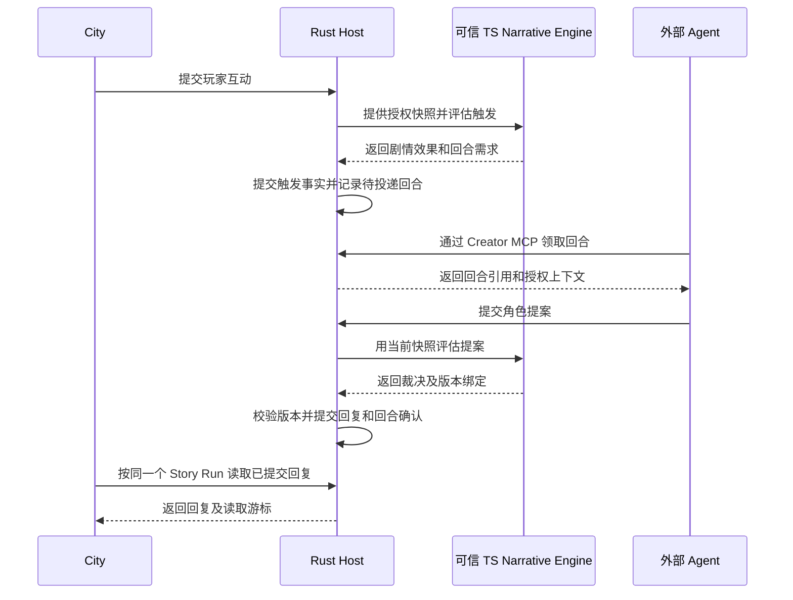

# Oh Agent Narrative Engine SPEC

日期：2026-11-21

状态：Proposed，供架构与实现评审

代码基线：`dev@f80ce5bf`，投递分支 `feature/host-delivery-bus@1df7fbb6`

关联：[City SDK V3 RFC](OH_AGENT_CITY_SDK_V3_INTEGRATION_RFC_2026-11-19.md) · [Actor Adapter SPEC](OH_AGENT_ACTOR_ADAPTER_SPEC_2026-11-21.md) · [Host Delivery Bus SPEC](OH_AGENT_HOST_DELIVERY_BUS_SPEC_2026-11-21.md) · [数据政策](DATA_HANDLING_POLICY.md)

## 1. 目标与范围

首期让玩家在 City 与故事角色对话。外部 Agent 可以扮演该角色，基于当前剧情提出回应。Narrative Engine 按选定 Story 版本的规则评估提案，Host 提交剧情事实后，玩家在原 Story Run 看到回复。桌面和独立浏览器体验使用同一套 TypeScript 叙事规则。

首期纵向切片选「邀请 NPC 去咖啡馆」。时间、地点或已发生事件可以约束剧情推进。此切片涉及邀请与回复，不改变居民公共位置，不分发奖励，也不要求自主 NPC、多 Agent 编排或通用脚本执行。远程桌面剧情能力另设发布门槛。

## 2. 当前实现与缺口

| 当前实现 | 对本 SPEC 的影响 |
| --- | --- |
| Narrative SDK 已提供图结构验证、可达性、Canon 和知识/因果检查。图边的 scope、条件和效果仍含占位类型。 | 复用纯算法。先定义可执行的有限条件和效果，避免把静态可达性当作当前回合可触发。 |
| Rust 已有 Story Project、Installation、Run、Preview Fork 及 State/Event/Outbox 事务。普通 `city.story.read/commit` 仍走 gameId 合成作用域。 | 保留事务基础，补显式 Story Run 的玩家命令和回复读取。现有 Timeline 检查工具仅作诊断入口。 |
| Actor 适配器已有注册、上下文及 Intent 提交。近期修复已保留底层拒绝结果，并收窄上下文查询到指定 Run。 | 查询范围收窄后仍需把已授权连接绑定到具体角色和 Run。匹配数据库中存在的 Run 只完成对象校验。 |
| Rust 中存在剧情候选计算、提示组装及邀请增加好感度的规则。 | 把叙事语义移至可信 TS 求值器和 Story 内容包。Rust 保留授权、校验边界和事务。 |
| 独立投递分支已有队列和取件，取件即送达的实现仍早于确认和重投方案。 | W7 的接入条件是经授权领取、提交后确认、断线可恢复和去重。 |

代码锚点：[SDK exports](../packages/agent-vitals-narrative-sdk/src/index.ts) · [图类型](../packages/agent-vitals-narrative-sdk/src/graph/types.ts) · [Actor 适配器](../apps/desktop/src-tauri/src/actor_adapter.rs) · [City Runtime](../apps/desktop/src-tauri/src/city_runtime.rs) · [Story Store](../apps/desktop/src-tauri/src/story_store.rs)

## 3. 所有权与依赖

| 组件 | 职责 |
| --- | --- |
| World Engine（TS） | 查询地点、居民、公共位置和场景交互，提供受限世界能力。 |
| Game Engine（TS） | 运行一局游戏，处理输入、固定步、玩法状态和结算。叙事只消费经允许传入的结果事件。 |
| Narrative Engine（TS） | 解释 Story 图、角色 Canon、知识边界、因果和条件。决定哪些边可走，产出有界的叙事效果和诊断。 |
| Story 内容包 | 声明角色、对白、条件、分支、效果和默认回应。以不可变发布摘要固定版本。 |
| 外部 Agent | 扮演角色并提交受限提案，维护自己的对话记忆。 |
| Rust Host | 授权角色与 Run、限制预算、管理回合投递和租约。使用版本检查、原子事务和幂等回执提交事实。 |
| Studio / City / MCP | Studio 管创作、校验、预览和发布。City 管游玩和对白呈现。MCP 暴露授权后的领取、读取和提案接口。 |

City SDK 拥有公共身份、时钟与作用域。Game SDK 拥有游戏协议。Narrative SDK 引用共享契约，City 和 Game SDK 保持独立。应用装配层把三者接起来，通过窄接口交换事实与命令。启动游戏、移动居民、安排未来任务分别使用对应领域的受权能力。

## 4. 内容、运行与协议

延用 `Story Project → Release → Installation → Story Run`。Project 可编辑，Release 是不可变的图和 Canon 快照。Installation 绑定 City、发布摘要和地点/居民引用。Run 固定其 Installation 与发布摘要，并保存游标、状态版本和事件序列。临时 ViewSession 关闭后，Run 仍可继续。重置生成新 `storyRunId`。旧 Run 留在原摘要，更新需要显式迁移或结束该 Run。

下表是逻辑契约，命名在接口落地时与现有 V3 DTO 对齐。

| 对象 | 必须绑定 |
| --- | --- |
| `NarrativeSnapshotV1` | 已授权的 Story scope、发布摘要、状态版本、剧情游标、因果证据，以及实际参与判断的时钟或世界版本。 |
| `ActorTurnV1` | Host 生成的回合 ID、目标角色、授权的 Run、触发事件引用和过期时间。队列携带最小引用，Agent 通过受限接口取上下文。 |
| `ActorProposalV1` | 回合 ID、幂等操作 ID、选定回应或剧情边、受限对白与必要参数。提交人和 Run 归属由 Host 确定。 |
| `NarrativeDecisionV1` | 通过或拒绝、稳定诊断、求值所用快照版本、规则摘要、白名单效果与事实引用。 |
| `NarrativeCommitReceiptV1` | 操作 ID、已提交事件 ID、新版本及回合状态。回复界面使用这个提交结果或按同 Run 读取。 |

首期执行子集只包含故事布尔值/有界计数比较、已提交事件存在性及简单组合条件。效果限于本 Run 的状态更新、追加剧情事件与推进游标。有界对白作为可呈现内容；对白里声称发生的事实必须能从已提交事件证实。未识别条件、效果或版本返回诊断并停止提交。结构可达、当前可触发、求值缺上下文三种状态分别显示。

求值输入显式提供时钟和事实。相同快照、规则版本和提案得到相同裁决。定时、玩家动作、游戏结算等确定性触发可直接进入相同求值流程，只有需要语义回应的触发才创建 Actor 回合。

## 5. 对话与提交时序



### 5.1 可信执行与提交

桌面 P0 建议使用随官方应用发布的 TS 求值器，由 Host 经固定请求接口调用。求值环境需要在 Studio 关闭时仍可用。具体载体可用受控工作进程或嵌入执行环境，选型以打包、实例识别、隔离、超时终止的实测为准。交付前须验证 Host 只接受其发起的求值请求对应的结果。浏览器与外部 Agent 只提交动作或提案，Host 自行调用求值器。

**载体定案（评审 S1，2026-11-21）**：首期选定 **rquickjs 嵌入执行环境**（已在依赖树中，city-game-sdk 使用同一引擎）。rquickjs 为同步嵌入引擎，由 Rust Host 在调度点同步调用——不需要跨进程桥，也不需要独立工作进程生命周期管理。求值请求/结果通过一个 64-bit nonce（`evaluationNonce`）关联：Host 生成 nonce → 求值器返回时必须携带相同 nonce → 不匹配则丢弃结果并重试（最多一次）。浏览器和外部 Agent 不直接调用求值器。

Host 给求值请求绑定 Run、发布摘要、提案摘要和所读取的版本。求值与等待在写事务之外。提交时在短事务中重查会话权限、回合领取状态和参与判断的版本。若版本已变或求值不可用，停止写入，返回重读、重新求值或暂不可用。若将来某类公共效果无法与剧情事实一起原子提交，应经同事务 Outbox 执行并明确显示待生效状态。

**Broker 延迟定案（评审 S2，2026-11-21）**：`creator_actor_turn_wait` / `creator_actor_turn_confirm` 加入 headless 臂白名单（与 story 工具同模式），Studio 关闭时照常应答。MCP 面不阻塞 30s 长轮询——`wait` 工具改为「返回当前可用的投递（可能为空）」+ Agent 侧按自身节奏轮询（与 `creator_job_wait` 的有界等待语义一致）。broker 超时维持 15s 上限，够单次分发。

**迁移定案（评审 S3，2026-11-21）**：host_delivery.rs 迁至 desktop crate 的路径是「先建后删」——desktop crate 建 actor_turn.rs + 迁移版 host_delivery.rs（复用本分支已验证的状态机），MCP 面的 creator_actor_turn_wait/confirm 改为经 broker 转发到 Host（与 story 工具同模式），MCP-crate 内旧实现删除。旧行不迁移（投递行是易逝通知，bus_schema_version 重置即重建）。

### 5.2 投递与重试

触发事件与投递意图同事务写入，或以已有 Outbox 作为可恢复来源。去重键包含作用域、触发事件和角色。领取产生有期限的授权，超时后允许重领。成功回复与回合确认在同一事务，或由已提交的回复回执恢复确认。重复提交同一操作返回原回执，载荷不同返回冲突。队列满或回合最终过期时，City 显示本次回应不可用，玩家可以明确重试。关闭或撤销连接可使旧领取失效。

## 6. 目录落点

```text
packages/agent-vitals-narrative-sdk/src/
  contracts/       Story 图、Canon、知识及版本化求值接口
  graph/           结构校验与图算法
  runtime/         纯 TS 触发评估与剧情求值
apps/agent-city/ui/src/narrative/
  cityNarrativeAdapter.ts   世界交互与叙事输入对接
  storyRunView.ts           已提交事件到对白界面的投影
apps/desktop/src-tauri/src/
  actor_adapter.rs          身份、授予的作用域与预算
  actor_turn.rs             回合用例、领取授权与确认
  host_delivery.rs          通用投递状态和持久化
  story_store.rs            剧情事件、状态、Outbox 与事务
crates/agent-vitals-mcp/src/mcp/
  creator_studio.rs         Actor 工具定义、入参与 Host 转发
```

TS 求值器的桌面启动适配器随执行载体选型落位。SDK 通过 DTO 和窄接口接收依赖。Studio 编辑预检、City 本地预览和正式求值复用同一解释规则，生产 Actor 通道继续使用 Creator MCP 和 Host broker。

## 7. 部署与数据边界

| 场景 | 作用域与数据 |
| --- | --- |
| 桌面正式 Story | Host 持有权威 Run 和持久存储，可信 TS 求值器处理授权后的上下文。 |
| Studio Preview | 使用绑定候选内容和基线版本的 Fork。测试事件、时钟、回复和队列均归 Fork，退出后按 Preview 语义清理。 |
| 独立浏览器体验 | 使用已批准的作品包和隔离的访客状态。浏览器适配器负责自己的生命周期，复用同一 TS 规则。 |
| 浏览器加入桌面会话 | 需要单独声明并评审 Story 命令、回复字段、接收设备范围、停止和撤销语义。正式提交仍由桌面 Host 裁决。 |

Agent 上下文按角色和已授权 Run 投影，Canon、知识和最近事实各自设字段与字节上限。近期事件及候选剧情条件只能引用该 Run 可读的事实。允许共享的知识使用显式声明和授权。Host 只保存必要的剧情事实、作用域、回执和诊断。外部 Agent 的原始提示词、多轮记忆、模型输出原文、路径和凭据不写入投递库。面向浏览器的 Story 分享须遵守现有数据政策，Delivery Bus 本身限定于本地。

## 8. 实施顺序与验收

| 阶段 | 交付 | 完成证据 |
| --- | --- | --- |
| N1 契约与纯求值 | 从现有图类型定义可执行子集，沉淀快照、提案和效果契约。用咖啡馆 Story 包替代新路径中的硬编码邀请规则。 | 相同输入裁决一致。条件缺失、未知效果和伪造事实均明确拒绝。 |
| N2 显式 Run 与可信求值接线 | 固定发布摘要，接 Host 求值入口和按 Run 读取回复的接口。 | 状态或规则变化时旧裁决拒绝提交。关闭 Studio 后正式 Run 仍可访问。 |
| N3 Actor 回合闭环 | 按授权会话领取、投递重试、有效回复与确认、City 呈现。与 W7 同步收敛。 | 玩家的话送到正确 Agent，断线可重领，最终在原 Run 见到一次回复。 |
| N4 Studio 与浏览器 | Studio 展示条件、诊断和 Fork 证据。独立浏览器用受支持作品验证相同规则。桌面远程 Story 另设授权验收。 | 合成浏览器场景与桌面 Preview 对同一输入得出相同剧情结果。正式状态与预览隔离。 |

### 发布前验收

- **N-01 授权隔离。** 同角色跨两个 Story、同 Story 跨两个玩家、同玩家跨两周目均不会串读、串投或串写。
- **N-02 事实可信。** Agent 声称「约会已发生」而缺已提交事件时，不推进相关剧情，City 不把声明显示为事实。
- **N-03 崩溃恢复。** 触发提交后入队前、领取响应前、回复提交后确认前分别中断。重启恢复后无静默丢失或重复效果。
- **N-04 并发与版本。** 两个提交竞争同一状态，只有符合当前版本的裁决可以落盘。内容更新保留旧 Run 摘要。
- **N-05 生命周期。** 关闭对话视图不结束 Run。新周目不继承旧周目私有事实。Preview Fork 不影响正式时钟、状态和 Outbox。
- **N-06 离线体验。** 无 Agent 或求值器暂不可用时，显示可恢复状态。Story 包有已声明的固定回应时可经同一规则链运行。
- **N-07 回传验证。** 通过真实 City 界面和接入 MCP 的 Agent 验证玩家同 Run 可见回复。Host 单测、工具回执和队列行作为分层证据。
- **N-08 Web 边界。** 浏览器独立玩法与桌面远程会话分别验证。授权未覆盖的 Story 数据和命令在远程入口拒绝。

本文件为目标方案。桌面求值载体、Story Release 的独立存储形态、远程 Story 字段和命令白名单仍需在对应阶段定案。
