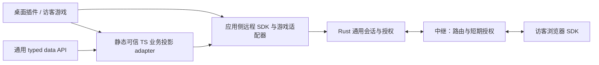

# 通用远程游戏交互架构

日期：2026-11-08　状态：分阶段实施中，未达到生产发布验收（当前快照见下文）

## 目标和边界

Rust 宿主提供可复用的远程会话和本机数据访问边界；游戏插件负责场景、玩法协议、规则、输入和界面。新增使用既有远程会话及公开场景数据的游戏，只需接入插件侧 SDK，不新增 Rust 游戏分支。梦境首版由访客浏览器本地运行独立游戏；机甲手机续玩仍由桌面游戏会话持有权威状态。两者复用通道，但各自维持现有语义。

**架构决策（用户明确要求，2026-11-09）：Rust 只实现通用远程通道与通用 typed data API，不承载 City、游戏或其他插件的业务投影。** 既有“本机数据通过注册的 Rust 业务投影 handler 输出”规则与此决策冲突，按下述渐进迁移取代。Rust 仍是数据访问与授权执行边界：按官方 descriptor 限定 typed dataset、通用字段、查询形状及字节/数量上限，校验插件实例和授权，并返回类型化、有界 DTO；不开放 arbitrary SQL、原始 authority DB、日志、文件或 unrestricted host IPC。可信、编译期注册的 TS app adapter 对获准 DTO 或 app-owned 场景状态执行版本化业务投影、脱敏、重键和访客合同校验。远程通道只承载经过权限检查的有界 envelope，不解析业务结构。

## 当前状态更新（2026-11-10，通用 typed data / objects / remote session）

本段为权威状态快照；后文按阶段追加的记录是历史证据，描述切片完成时的状态，不代表现在仍未接入或已经发布。源码已登记 `city-dream:v1` capability、`dream.bootstrap` session profile 和 projection grant；可信 TS manifest 包含 Dream host adapter，桌面 City 已接发布预览/确认、邀请和访客审批/撤销/停止流程。访客入口可解析 Dream capability。Rust 提供通用远程 session/relay 通道，不解析 Dream、Mecha 或其他游戏业务消息；通用会话合同统一使用 `sessionId`。City 快照由静态可信 TS Dream adapter 做版本化 schema/引用检查、匿名重键与压缩。

Rust 通用 `typed-data.read` 提供受限的 harness session 与聚合 DTO、`harness-session-detail:v1`、`session-excerpts:v1` 和 `session-cost:v1`。分页固定查询终点及 data revision，每页最多 500 条、最多 4,000 条、快照 10 分钟过期。City 默认 provider 由可信 TS adapter 组合通用 sessions、stable refs、summary/activity/model/time/findings/skills/workflow aggregates 与按需 detail/excerpts/cost；这些读取不再依赖 `city:v3` parity 或 fallback。通用 object/scope/CAS/event 与 plugin-call primitives 已接入 City 资产收藏、建筑对象、小队状态及事件调用。旧 SQLite 资产/建筑/claim/mailbox 的有界只读导出仍用于 copy-forward 和引用核对。

`city:v3` 不再承载 City 主展示或编辑写入；生产侧仅在存在未映射旧资产引用时作为临时 crosswalk 来源，随后应由有界迁移合同替代并退役。旧 `city_assets.rs` 导出和跨表身份映射仍在生产调用链，必须保留到所有需保留引用完成映射并核对闭包；真实旧数据预检尚未完成。Agent City UI package 有 typecheck/build scripts 且本地构建产物含 `remote.html`，但这不证明生产 Worker 已部署。生产 Worker freshness 与真实 Tauri → Worker/Relay → 访客 E2E 尚未验证；本轮未查询真实 City 本机数据，也未向线上发送快照。城市使用量和会话标题的授权展示合同已在 UI 明确披露。真实 City 全字段迁移、资产映射、真实多布局 payload、桌面/访客画面对照、撤销/断线/重连及生产配置仍待验收。Mecha display 保留原 230 KiB 限额；已知合成场景 433,015 bytes 超限，压缩/分片仍需单独设计与验证。

## 职责与接口

| 层 | 负责 | 不承担 |
| --- | --- | --- |
| Rust 通道与会话 | 连接、设备配对、授予与撤销、按会话路由、大小与速率限制、取消和资源回收 | 机甲回合、驾驶输入或游戏状态解释 |
| 宿主插件边界 | 核验注册插件、活动实例、能力声明、用户授权及响应交付时状态 | 由远端自由选择宿主方法或扩大声明权限 |
| Rust typed data API | 通过固定 typed dataset/query 合同读取源数据；执行 descriptor 字段授权、活动实例检查和通用数量/字节上限；返回类型化 DTO | City/game/plugin 业务 schema、业务过滤/重键/压缩/投影，任意 SQL、日志或文件访问 |
| TS 可信业务投影 adapter | 以编译期内置身份绑定受信任 app；将有界 typed DTO 或 app-owned 场景状态映射到版本化业务 DTO，执行业务 allowlist、脱敏/别名与 visitor 合同校验 | 直接访问 authority DB、harness logs、任意宿主 IPC 或超出 descriptor typed scope 的字段 |
| 插件远程适配器 | 声明版本、处理游戏消息、校验业务命令、关联游戏实例、管理同步与 UI | 获得未声明的本机能力 |
| 浏览器玩法 | 渲染、输入、本地状态及游戏生命周期；权威模式下向游戏宿主提交命令 | 直接调用桌面宿主 IPC |

SDK 提供 `openSession`、`requestAccess`、`approve`、`revoke`、`send`、`close` 等语义；具体参数、错误码和兼容策略须在实现前冻结。授权由宿主建立并绑定活动插件实例、会话、接收者和声明的能力版本。插件可声明能力，但声明本身不授予访问或新增数据权限；未注册、超出授权、实例失效及未知版本均拒绝。

通道承载带版本的信封：会话 ID、能力 ID、连接身份、消息 ID、消息类型和有界正文。会话及接收者身份由宿主或中继根据已认证连接确定，不能信任正文自报的身份。通道对正文只执行通用资源限制和路由检查；插件适配器负责其版本化消息类型、字段和业务状态校验。回复只能投递至对应授权请求者，发送及交付前均复查授权。广播需要能力声明和逐接收者检查。正文及凭据不写日志，中继只保留政策允许的短期授权元数据。

通道需要限制完整信封和正文的字节数、队列与在途请求数；过载明确返回错误，禁止无限缓存。压缩必须限制压缩前、压缩后及解压后大小。断连、插件实例失效、关闭和到期触发取消、队列清理及资源释放；已经交付的数据无法被远程收回。可靠性、重试和顺序由协议明确声明，不能把一次投递误认为恰好执行一次。

## TS 接入合同

TS 分为通道 SDK、插件适配器与玩法宿主三部分。通道 SDK 统一会话范围、信封编解码、请求关联、连接状态及取消；不解析游戏状态。能力适配器负责版本协商和消息校验，把消息交给对应游戏实例。玩法宿主负责异步进入、退出、输入和场景租约；退出需幂等，异步进入结果必须能被取消，避免旧任务重新占用场景。接口字段、协议和错误码在相应迁移阶段冻结，禁止无兼容层直接替换现有协议。

Agent City 已有 `GameScenePort` / `GameSceneLease`，由 `CityEngine` 执行相机和场景对象的独占租约、宿主 epoch 校验、取消和恢复返回视角。远程玩法适配器应把这个现有租约作为宿主能力注入 `GameSession`、`FlightWorld` 或 Mecha world，不再建立第二套相机/场景租约账本。独立梦境浏览器没有桌面 CityEngine 时，先用同一接口的浏览器实现提供本地场景生命周期；接口不能让访客请求获取桌面宿主的租约。

已新增 TS `acquireRemoteGameplay` 桥接函数，复用 `GameScenePort.acquireResult`，将忙碌/不可用/取消归一为远程进入错误，并在异步申请期间被取消时释放刚取得的租约。它当前是宿主接口基础设施，尚未从远程页面挂载驾驶或飞行，也没有实现独立梦境本地玩法宿主。

现有 `RemoteMatchClient` 保留机甲请求结果、版本冲突、重连和对局事件语义；`DreamSnapshotChannel` 保留快照解码、授权失效清理和单次请求限制。两者先共用 `remoteEnvelope.ts` 的作用域信封，不提前合并业务状态机。后续应抽出可注入 socket、超时和取消的请求关联器，验证断线、迟到回复与资源释放，再逐步替换各客户端。TS 类型检查不能单独构成数据访问授权：本机源数据必须通过 Rust typed API 的 descriptor scope 与活动实例检查；City/game 业务投影由静态可信 TS adapter 实施，然后由通用远程通道传输。

实施验收包含：同一输入在迁移前后生成兼容的信封；拒绝不同会话、能力及应用的回复；UTF-8 字节上限生效；现有机甲与梦境客户端回归；模拟第二个插件只依赖 SDK 即可传递自身消息。后续完整 SDK 还须验证取消、超时、重复回复、连接更替及撤销后清理。

## 两类交互

**独立梦境：**桌面用户发布固定版本的城市投影并批准访客。访客取得快照后在浏览器实例内创建驾驶、飞行或机甲游戏状态；操作和存档与桌面及其他访客隔离。玩法切换通过应用侧场景租约协调输入、相机和资源释放，无须为每种游戏新增 Rust 消息协议。

**宿主权威会话：**手机续玩等场景由桌面插件管理权威游戏状态。访客适配器提交版本化命令，应用宿主检查身份、规则和状态 revision，再返回确认或快照。命令 ID 去重、冲突恢复、断线重连和交还由该游戏协议定义。通用通道提供关联和授权，不决定游戏规则。

两种模式的链接须绑定各自能力及授权范围，不能将梦境访客的只读快照权限转换成桌面棋局控制权。未来多人同场需要单独定义权威、同步及权限模型。

## 对现有代码的调整

1. 保留 `remote_transport.rs` 的连接能力；从 `remote_gateway.rs` 抽取通用会话管理，按宿主生成的会话标识管理并发、连接、取消和队列，移除固定 City/机甲会话键、机甲 WebView 和游戏协议分支。
2. 收敛 `remote_protocol.rs` 为通用信封和能力检查。由宿主可信注册表把授权会话绑定到插件实例及声明的消息入口；注册过程不能允许插件自行扩大数据或宿主权限。
3. 将机甲方法、身份及对局语义移到 Mecha adapter 边界；旧协议与旧链接先通过兼容适配器运行。Rust gateway/registry 只校验通用作用域、descriptor grants、消息类型/方法集合、实例身份与 resource envelope，不注册或调用 Mecha/City 业务 validator。
4. 当前 `plugin_projections.rs` 和 `city_dream_projection.rs` 是迁移缺口：它们把 City-specific schema、引用一致性、实体重键和 gzip contract 放在 Rust；保留这些代码与测试作为行为/安全基线，不能视为达成最终架构，也不能在迁移前增加新的游戏/插件专属 Rust handler。
5. 渐进迁移：**S0 冻结兼容合同**，记录现有 Rust candidate→envelope 输出、拒绝类别、匿名化规则与字段 provenance；**S1 增加通用 typed data API**，descriptor 仅声明固定 dataset/version、通用 field IDs、受限 query shape、max rows/bytes 与权限 scope，Rust 返回类型化 DTO 并统一检查字段、实例授权、限额，不接受 SQL/路径/任意 JSON selector；**S2 TS shadow adapter**，以已授权 TS built-in adapter 重做 City 投影，与 Rust 输出做 differential tests（合法输入兼容、畸形/越权均拒绝、引用完整、重键不泄露）；**S3 切换发布链**，owner UI 只调用 typed API + TS adapter，Remote Gateway 仅传递有界 envelope，逐项通过隐私和全链路测试后关闭旧 Rust业务 handler；**S4 移除旧 handler**，在 parity/security tests 完成后删除 City 分支及专属 grant 语义，保留通用 dataset access grants 和 transport caps。
6. TS app adapter 必须来自官方静态 trusted manifest 并绑定宿主注入的 app/capability/instance scope；未经验证包和 browser preview 使用合成/脱敏数据。新增游戏不修改 Rust 通道；增加本机数据访问只能增加经审查的 typed dataset/field contract，不允许增加任意 IPC、SQL 或文件能力。

## 实施顺序与验收

- **基线**：记录现有机甲续玩、断线与交还行为，保留现有协议和未提交工作。记录通道容量及真实城市尚未测量的限制。
- **通道抽取**：先以兼容适配器迁移原机甲链路。验证两个不同能力的会话互不覆盖、取消不串扰、伪造身份和跨会话投递被拒绝，并回归旧机甲续玩。
- **插件 SDK**：以合成游戏适配器验证新增第二种游戏无需修改通道 Rust；覆盖拒绝未知能力、过载、断连、重复消息及授权交付前撤销。
- **数据 API 与业务投影迁移（新增架构阶段）**：先定义通用 typed dataset/query DTO、descriptor field scopes 与资源上限；再把 City 业务投影在 TS adapter shadow-run 与旧 Rust 投影做差分验证。全部安全/兼容证据通过前保留旧链路作过渡，但标记为架构债务、禁止宣称目标分层达标。
- **梦境发布**：完成可信 City 投影和真实授权后接入桌面发布、独立访客批准、快照发送和关闭。核对真实城市各布局模式及大小，验证中继不持久化正文，做桌面与访客同场景对照。
- **玩法接入**：依次复用驾驶、飞行和机甲，验证每位访客独立状态、退出资源释放以及桌面城市和存档不受影响。

## 当前实施记录（2026-11-08）

- TS 已建立通用远程信封与请求通道，并由梦境快照和机甲远程客户端复用。请求关联、in-flight 上限、超时、取消、UTF-8 字节限额、会话范围检查、迟到/重复/未知 response 丢弃及失效清理集中在通道；游戏事件和业务解析仍由应用客户端处理。能力注册表负责选择 TS 页面适配器，开发专用条目在生产构建中不可解析。
- Mecha 请求规则、宿主事件解码、启动 payload 及业务 payload 投影校验已收敛到 Mecha adapter；Mecha 投影模块现在从 `remote_gateway` 模块树移入 adapter 边界。gateway 调用 hook 获得准入或生命周期请求，再负责 session token 定位、host hook 调用、转发和通用信封封装。Rust 通用协议层提供只写入 app/session/capability 范围的 `wrap_message`。
- Rust 注册项已扩展为适配器消息策略入口：每种 capability 注册自己的请求校验、宿主消息与 payload 校验、内层会话协议选择。Mecha 适配器提供实现；gateway 收到/返回游戏消息时按受信任 manifest 查找 hook，不再直接调用 Mecha 的这些协议校验函数。registry 单测中的合成 Island 适配器验证了通用 hook 可独立提供这些策略。
- Rust `remote_registry` 不再内嵌 Mecha 命令清单；它只提供通用注册项查询和能力/方法派发，Mecha 适配器提供自己的静态注册项和命令分发。独立的 `remote_adapter_manifest` 是受信任内置适配器的显式清单，避免 registry 和 plugin host 直接依赖 Mecha 模块；受信任应用仍需在此审查后登记，不能运行时自注册。查询同时匹配插件声明的完整 capability，避免共用方法名错误命中旧版 capability。未知应用、方法、capability 或扩大后的 capability 均拒绝。网关仍实现 Mecha 会话及 relay 操作原语，尚未成为独立的通用会话 broker。
- 通用 `RemoteSessionBroker<T, Snapshot>` 持有活动 session store、启动握手 token 和按键隔离的快照缓存；gateway 现在从适配器传入 app ID，并按 `app_id + capability_id + session_id` 存储会话，同一 capability 可有多个活动 session。每个 session 使用独立 token/WebView，控制请求接受通用 `sessionId`，并暂时兼容原有 `matchId`。adapter 提供启动计划（relay、创建请求、join/freeze 请求及链接策略），Mecha 经典与 v1.5 启动流程已合并到同一 gateway lifecycle；relay URL 通用检查位于 transport。链接路径、session/player/websocket/access/device 参数名、secret 的 fragment/query 位置及 capability 参数位置均由 adapter 的 `RemoteLinkSpec` 提供，gateway 不再写死 Mecha 查询键。连接任务、host request/status/error framing 与 token 隔离的 lifecycle waiter 放在 `remote_session_runtime.rs`。恢复快照缓存采用 16 项 LRU 上限。Relay room/access 的 HTTP action 与响应解析已封装进通用 `remote_transport::RelayConnection`，但 Gateway 仍负责跨 relay 与游戏宿主的授权顺序编排。
- 早期验证记录：UI `typecheck` 及 envelope/dream visitor/mecha client 的 8 项测试通过；Rust `remote_gateway::tests` 8 项、当时的 `remote_sessions::tests` 2 项和 `cargo clippy --lib -- -D warnings` 通过。这些测试还未覆盖真实 Tauri 多 WebView 生命周期或多个浏览器端到端并行运行。当前 session broker 测试数和多会话能力以本节最新实施记录为准。
- **（历史实施快照；其中 Dream 未接线判断已过期）** Rust 传统适配器清单仍只登记 Mecha；当前 Dream 改由官方插件 descriptor 中的 capability/profile/grant 与 TS 静态 host manifest 接入通用 host runtime。Tauri 消息入口为通用 `remote_host_message`，连接任务、token 生命周期 waiter、relay room/access HTTP client 和 host runtime 已抽离到通用层。驾驶、飞行和访客本地机甲使用合成 CityEngine 验证；这些验证及 Dream owner UI 的源码接线都不等于真实 City 发布、Relay 联机或任意城市均有可用战场。不得据此宣称整体架构验收完成。
- 本轮验证原始结果：`cargo test --lib remote_registry::tests`：1 passed、0 failed；`cargo test --lib mecha_remote_adapter::tests`：6 passed、0 failed；`cargo test --lib remote_gateway::tests`：8 passed、0 failed；`cargo clippy --lib -- -D warnings`：完成，0 warnings；Agent City UI `npm run typecheck`（`tsc -p tsconfig.json --noEmit`）：退出码 0；`git diff --check`：通过。未运行全量 Rust、UI 行为或浏览器验收。

## 实施状态与后续门槛

| 阶段 | 状态 | 退出条件 |
| --- | --- | --- |
| TS 通用信封 / 请求关联 | 已落地，局部测试通过 | 增补撤销前交付、重复回复、重连及容量边界用例 |
| 插件注册与 Mecha 迁移 | v1.5 可按官方插件描述符中的 capability 和 `remoteHostEntry` 走 generic host/runtime；Rust Mecha manifest 不再是 v1.5 启动前置条件，旧 v1–v3 仍走 manifest。City 展示数据已改为 capability 授权的版本化 projection handler；TS 有合成 Island 第二 capability 的 host 生命周期合同测试 | 增补 Rust generic 启动与 TS-only adapter 的组合/端到端覆盖；验证 Tauri E2E；继续确认旧协议兼容退出策略 |
| 通用 Rust 会话 / 传输 | 会话索引、host lifecycle waiter、连接 runtime、Relay HTTP client 与 descriptor-driven start 已 adapter-neutral | 继续把 relay 授权编排和取消/资源回收收敛到通用 broker；验证真实多 session Relay 并发、启动中插件实例撤销和资源关闭 |
| City 可信数据 / Dream 发布 | capability/profile/owner flow 已接入源码；但 `plugin_projections.rs` / `city_dream_projection.rs` 仍含 Rust City 业务 schema、引用校验、重键与压缩逻辑，是待迁移缺口；合成测试只证明当前旧实现行为 | 定义通用 typed dataset/query、descriptor field scope 与 row/byte caps；TS City adapter shadow-run 并做 parity/security tests；切换 owner 发布链并移除 City-specific Rust handler。其后验收 session 名称/用量、真实全链路、视觉一致性及 Relay 正文不持久化。完成前不宣称目标架构达标或生产可用 |
| Driving / Flight / Mecha 玩法入口 | Driving / Flight 已接入访客本地城市与租约；Mecha 未迁移 | Mecha 复用同一访客本地玩法宿主；验证所有玩法状态隔离、退出恢复与触控/键盘输入 |

### 本轮实施记录：适配器注册边界

- 将 `AdapterRegistration`、handler 类型和 capability 感知的注册项查询保留在通用 registry；独立的 `remote_adapter_manifest` 维护受信任内置适配器来源。Mecha 的 capability→methods→validator 支持函数映射及控制命令分发由 `mecha_remote_adapter` 声明。派发同时核验应用 ID、精确 capability ID、方法白名单与完整 capability。实现中发现旧 `mecha.remote.stop` 对同时声明 v1/v4 的 City 插件会优先选择 v1，无法停止 v1.5 会话；已新增绑定 v4 的本地宿主方法 `mecha.remote.stop-sequential` 并更新手机续玩 UI。它只改变宿主内部 IPC 路由，不改变中继游戏协议。
- `remote_gateway` 去掉 `control_for_city` 命令分支，保留通用启动、邀请/批准/撤销、停止等会话原语。Mecha 适配器解释 Mecha 命令并提供启动计划、join/freeze 请求和链接策略；经典与 v1.5 复用同一个 `start` lifecycle。Tauri hidden WebView 创建、请求投递、关闭、窗口/token 匹配及 lifecycle reply 解码由 adapter hooks 提供；`remote_host_message` 校验身份、调用 decoder，再把通用 lifecycle event 交给 runtime waiter。Gateway 仍编排 relay 注册、配对、邀请和关闭；runtime 持有连接任务与生命周期等待器。运行时插件不得自注册或通过 TS 声明获得本机 IPC 权限。
- 适配器注册项同时提供远端请求校验、内层协议选择、宿主响应校验和宿主数据校验；relay gateway 通过 manifest 解析 capability hook，不再直接调用 Mecha 的协议函数。合成 Island 注册项验证 registry 能够调用非 Mecha hook。它仍是 registry 层合成验证，不代表真实第二插件完整接入。
- v1.5 停止方法绑定已修正：旧通用 stop 在 v1/v4 同时声明时会选到 v1；续玩界面改用只登记在 v4 的本地 `mecha.remote.stop-sequential`。这不是中继协议变更。
- `remote_sessions.rs` 的 `SessionKey` 加入 session ID；Mecha gateway 对多活动 session 按 `matchId` 寻址，stop 和其他会话控制要求 payload 提供匹配 ID。joined/frozen 状态由单一全局 watcher 改为带 match ID 的值并使用 ID 条件等待，避免并发 session 消费错误结果。v1.5 桌面控件保存 start 返回的 matchId，并在 stop 请求中传入。
- Mecha 适配器现在将自身 app ID 传入 gateway；gateway 的 session key、relay 房间注册及回包信封使用 session 自身的 app ID，不再在这些公共路径内固定编码 `city`。Mecha WebView URL、桥接事件、启动 payload 与 Mecha capability 验证仍然特定于适配器。
- 注册项现还包含 `create_host_session`、`send_host_request`、`close_host_session`、`host_window_matches` hooks；gateway 使用它们生命周期管理 host window，而不再知道 Agent City WebView URL、自定义事件名或窗口标签前缀。合成 Island registry fixture 也带 host hook，测试 window identity 路由。
- 本轮把 `decode_host_reply` 与 `status_event` 也纳入可信适配器注册项。Mecha adapter 负责识别 ready/created/joined/frozen/message 帧、校验 v1.5 冻结快照与 match ID；gateway 通过 `HostLifecycleEvent` 处理握手和消息队列。Tauri IPC 命令及 Agent City host 调用均改名为 `remote_host_message`，状态事件携带通用 `appId/sessionId/status` 字段。
- 本轮把启动玩法细节移到 adapter 的 `prepare_host_session`：它负责校验并生成创建请求、join/freeze 请求与链接策略；gateway 仅执行共同的注册、host 握手、owner 配对和 session 入表流程。经典与 v1.5 的重复启动函数已合并。Mecha 投影源文件改名为 `mecha_remote_projection.rs` 并挂在 Mecha adapter 模块下；relay URL 的 HTTPS/凭据校验移到通用 transport。
- 本轮新增 `remote_session_runtime.rs`，把 relay frame 准入、请求错误回复、host hook 投递和连接状态事件从 gateway 移入通用 session runtime。`remote_transport` 的退避等待现在可被 cancel 打断；重连前会丢弃断线期间积压的旧回复，避免把过期消息发到新连接。恢复快照缓存设为 16 项 LRU，避免停止的 session 永久占用内存。
- TS `RemoteRequestChannel` 增加默认 64 个 in-flight 限额；容量溢出明确返回 `remote_backpressure`。仅匹配 pending request 的 response 可完成请求，其余 response 不再流入应用 message handler。专属测试覆盖 abort/timeout、close/error、scope mismatch、迟到/重复/未知 response、UTF-8 上限和容量恢复。
- Adapter lifecycle 新增 `stop_policy` hook：Mecha v1–v4 继续使用 freeze snapshot；不需要保存状态的适配器可声明 `CloseOnly`。Gateway 对 `CloseOnly` 跳过 host freeze 请求、清除旧快照并返回 `snapshot: null`，避免把另一个会话遗留的状态误当成本次结束结果。合成 Island 注册项与 gateway policy 测试验证该分支；这只是策略扩展，尚未形成第二个生产 adapter。
- 通用 host session 的 lifecycle 与链接形状从 `remote_gateway` 常量迁到官方插件包描述表中的版本化 `remoteSessions` profile。Profile 声明 bootstrap/approval/stop 方法、停止策略、bootstrap 上限和链接参数；Rust 在读入描述表时校验版本、大小、路径及参数名，运行时只消费已验证的受信任 profile。Mecha v4 使用该通用 profile；合成 Island profile 验证自定义链接与 `CloseOnly`，不需要 Rust 解析游戏 payload。Relay 在房间注册和 host 连接时安排 15 分钟 host lease；host 断线回调将期限延后 15 分钟，重新连接续租。租约到期时若 host 在线则续租，否则 Durable Object alarm 清除孤儿房间与访客；这也覆盖了 close 回调缺失的情形。替换中的旧 host 延迟 close 不会清除新 host 的请求或访客。验证结果：Relay `npm test` 26/26、`npm run typecheck` 通过；Rust profile 与 planner 定向用例通过，`cargo clippy --lib -- -D warnings` 通过。完整 Tauri `cargo test --lib` 有两项失败：manifest 流限制测试未收到预期的 “bytes limit” 错误；`overview_memo_concurrency_and_stale_guard` 在真实本机 `~/.agent-vitals` authority schema v33 高于当前二进制支持的 v32 时观察到同步状态竞争，均不是本次 remote profile 代码路径。该工作仍不表示 Dream 的生产发布/授权 handler 已接通。
- TS 继续负责 capability-specific adapter：它必须实现 profile 声明的 bootstrap/approval/stop lifecycle 方法，并将应用 payload 交给现有应用会话逻辑；Rust 只看 transport envelope，不解释场景或游戏状态。Mecha v1.5 与 Dream 均已在源码中注册对应 host handler；Dream 的 profile、projection grant 与发布者管理流程已接线，待真实 host/Relay E2E 验收。
- **（历史状态快照，后续已接入 descriptor）** TS host adapter lifecycle 已支持异步 `start(signal)` 和 Promise 型 `handle`：初始化成功后才发 `ready`；请求进入每 adapter 有界 FIFO（64），未就绪/已关闭时拒绝派发；handler rejection 收敛为稳定 `unavailable` 错误类别；关闭先设门、移除监听、Abort，再抑制迟到响应。旧测试曾断言 `city-dream:v1` 没有 remote capability/profile/grant；该判断现已过期，当前声明见本文件开头状态更新。
- 梦境访客侧新增 `VisitorGameScenePort` 基础实现，复用既有 `HostGameScenePort` 生命周期算法，但只接受 visitor renderer 的内存回调，不引用桌面 `CityEngine`、relay 或存档。它验证 visitor 浏览器中的 scene acquire/release/abort/epoch 失效及独占租约；随后 Flight 复用该 visitor-local renderer/租约接入，Driving 和 Mecha 仍未挂接，也不改变 Dream 发布门禁。
- Dream visitor 现在在自己的 `RemoteCityScene` `CityEngine` 实例上复用既有 `useCityGame` / `GameSession` / `GameScenePort`，提供自由飞行和穿环挑战入口及原有 `GameHud`。访客实例将 `persistProfile: false` 显式传入 hook，不载入或写入本机 flight profile；引擎自身也只存在访客页面。Flight 是第一个真实接入的访客玩法，驾驶和机甲尚未接入。
- 本轮 Agent City UI `npm run typecheck` 成功；`verify:remote-city-scene-browser` 通过移动 viewport 下的独立城市渲染、点击“自由飞行”进入现有自由练习 HUD、清除快照、拒绝畸形快照和恢复渲染。截图输出 `/tmp/agent-city-dream-synthetic-390x844.png`，展示访客本地飞行状态；该浏览器用合成城市，不证明真实 City 投影发布安全。
- 本轮将 Driving 接入 Dream visitor 自己创建的 `CityEngine`，复用 `useCityDrivingPlay` 与 `createCityCarFreeDriveSession` 安全出生流程；只提供普通 free-drive/VTOL 本地玩法，不调用正式驾驶凭据入口。访客关闭 `persistProfile`，并通过显式 `notifyHostBusy: false` 避免宿主 busy IPC。移动端新增 Flight/Driving 按住式触控按钮，按 pointer ID 追踪并在松开、取消、暂停或卸载时释放输入。
- Driving/Flight 浏览器验收使用合成城市，覆盖进入飞行、退出到城市、选择 VTOL、进入驾驶、前进/喷升触控按下与释放、暂停时撤销触控输入、退出驾驶后回到城市，以及清除/畸形快照恢复。结果：`verify:remote-city-scene-browser` 通过；截图 `/tmp/agent-city-dream-driving-390x844.png`。UI `npm run typecheck` 退出码 0；`git diff --check` 通过。该验证不使用桌面真实 City 投影，不证明远程发布已授权或生产可用；当时 Mecha visitor 接入尚未完成（后续见本节末尾）。
- 2026-11-09 增加 Rust `rekey_candidate_for_publication`：候选中已实现字段和对象层级的校验先执行，再由宿主为 district/building/entity 类 ID 生成 128-bit 随机别名，并递归改写值及 JSON map key；改写后再次运行相同覆盖面的校验。Rust 合成测试覆盖不同发布的 ID 去相关及道路、建筑、地块和冠顶引用完整性；TS projection 合同测试接受新 opaque alias。该范围不能表述为完整 Agent City 场景的全量 allowlist：布局组合和视觉字段的侧信道审查仍未完成。**（本条关于发布 handler 缺失/入口关闭的结论为当时状态，已由后续接线更新。）**
- 随后将处理器注册为 City 插件本地 `city-dream:v1` 投影：只接受 `city` 声明的 projection，要求显式 `candidate` 字段；入口经现有 `plugin_request` 核验活动 WebView 实例，响应前再次核验实例有效。投影返回已随机重键的匿名候选，不创建中继房间、不授予访客、不产生出站流量。负例覆盖未声明投影、非 City 插件和无效候选；`plugin_projections::tests` 3/3、`city_dream_projection::tests` 14/14、`cargo clippy --lib -- -D warnings`、UI `typecheck` 和 `git diff --check` 均通过。该入口仍需在真实布局版本/数据来源上验收，且远程发布授权与快照交付 handler 尚未实现。
- 2026-11-09 接入“城市设置 → 梦境城市 → 预览访客城市”：仅内嵌桌面、真实本地数据、首帧完成且没有驾驶/飞行/战棋/航拍/导出/修复时可用。候选读取同一时刻 `CityEngine` 已应用的 model/layout/backdrop/camera，经 City 本机 Rust projection 校验并随机重键，再由访客端同一 Three.js renderer 展示；面板显示实际快照/压缩信封大小和共享字段范围。本机生成序号不作为发布版本或权限依据，场景更新会使未完成的异步预览失效。它不创建发布、链接或访客授权，不连接 relay，也不向外发送数据。UI `npm run typecheck` 通过，`git diff --check` 通过；尚未在 Tauri 真机运行该面板，也未完成真实场景外观对照，因此远程发布门槛仍全部有效。
- Gateway 启动记录由 broker 的单一 `starting_host` 改为 token 索引集合；`remote_host_message` 按 token 定位对应启动记录。结合前一切片，ready/created 使用 token watcher，joined/frozen 由各 `Active` session 持有。全局操作锁本轮保留；现在启动记录可并存，但 start/control/stop 仍串行执行，因此尚不宣称支持并发启动。
- 本轮将 gateway 全局操作锁替换成 `SessionOperationLocks`：按 app/capability/session key 获取异步互斥锁，同一 session 的控制与停止保持顺序，不同 session 可并行执行；随机 session ID 使不同 start 也使用独立锁。RAII guard 在无等待者时回收锁表项；下次获取时会清理被取消的等待任务留下的孤儿锁，避免锁表无限增长。启动记录按 token 索引，与此锁策略配合支持并发 host handshake。
- 2026-11-09 继续消除通用 gateway 的 Mecha 命名和访问假设：活动记录以 `session_id` 存储，计划中的可选游戏预检/结束前状态捕获改为 `approval_request` / `stop_request`；旧 `matchId` 仅保留为兼容输入和响应别名。访客批准现在仅在 adapter 提供可选 `approval_request` 时等待宿主游戏校验，纯只读访客可以直接走中继访问授权，不必伪造一次“加入对局”。这为 Dream adapter 接入通用 session lifecycle 提供了必要原语，但还没有注册 City adapter 或建立远程授权。`cargo check --lib` 通过；`remote_gateway::tests` 11/11、`mecha_remote_adapter::tests` 9/9 通过；后续仍需抽离 relay runtime/watcher 并验收真实 City host。
- 2026-11-09 开始把通用 capability 权限从 Rust Mecha registration 移到已打包的官方插件描述符：`plugin_request` 从当前活动实例的可信定义读取 capability；通用 `remote.session.*` 生命周期不再要求存在 Rust 游戏 adapter。Gateway 可按描述符的 `remoteHostEntry` 创建隐藏 host WebView，并用 app/capability/session/token 通用作用域收发消息；未知或不唯一的 TS host factory 仍拒绝启动。纯 gameplay bootstrap 与插件本地 `dataProjections` 权限解耦；generic fallback 校验 bootstrap 大小，并拒绝未经授权/验证的显式 projection envelope。旧 typed v1–v3 仍使用 Rust adapter 兼容路径。该切片当时尚未执行定向新测试；第二个完整插件端到端适配器和 Tauri/Relay E2E 也未完成。
- 2026-11-09 将 Gateway 中的 ready/created/joined/frozen 信号等待与超时移至 `remote_session_runtime::HostLifecycleWaiters`，按 host token 注册、通知、等待及清理；Gateway 仍只负责 WebView 身份校验、adapter 解码和业务消息投递。`remote_host_message` 现在复制必要路由记录后释放 session store 锁，再访问 waiter registry，消除原有 state→watcher 与 start 路径反向锁序可能造成的死锁。连接 outbox 改为 start 时创建并由 gateway/runtime 共用同一有界队列，消除 runtime 启动前请求进入旧队列而丢失的竞态；移除了因此变成无用的 `SessionStore::get_mut`。随后将 relay 注册、owner 配对、邀请、待批设备、批准/撤销和 room close 的 action/字段解析封装进 `remote_transport::RelayConnection`，链接响应改为必需字段的类型化结构；Gateway 保留批准次序（确认 pending → 可选宿主校验 → relay 授权）和 Mecha/adapter 链接策略。验证：`cargo check --lib`、`cargo clippy --lib -- -D warnings`、`remote_session_runtime::tests` 5/5、`remote_gateway::tests` 11/11、`mecha_remote_adapter::tests` 9/9、`remote_transport::tests` 5/5、`git diff --check` 通过。Relay 测试包含本地 mock HTTP 对 owner pairing 的路径、Bearer 授权头与 typed response 的检查；未进行真实 Tauri 多 WebView 或 relay 并发端到端验证。
- 2026-11-09 开始 Dream owner 侧冻结数据层：新增 `DreamPublicationStore`，只在进程内存放压缩后的不可变快照，按 session ID 查找并绑定来源插件实例；支持实例级清理、单会话撤销、过期自动清除及最多 16 项上限。冻结时把本地预览 wall-clock revision 重写为 publication revision 1 和 layout revision 1，避免把采集时间带给访客。该 store 尚未接入 City host、Relay、授权 UI 或链接创建，因此当前仍无任何远程发送路径。
- 本轮将宿主桥接最后一跳从 `__AV_MECHA_REMOTE_REQUEST__` 改为通用 `__AV_REMOTE_HOST_REQUEST__`。Rust adapter hook 发送显式 `appId/capability/sessionId/token`，建窗时注入同一作用域上下文；TS `RemoteHostAdapterRegistry` 必须匹配上下文后才把请求分发至精确注册的 app/capability handler。Mecha v1.5 是当前首个适配器；合成 Island adapter 用相同方法名验证不会跨 app/capability/session/token 串路。subAgent 复核确认：TS `sessionHost=1` 启动入口仍直接初始化 Mecha v1.5 handler，宿主创建/冻结/回复解码也不是通用生命周期合同；旧 capability v1–v3 仍无法经此宿主处理（这一限制在本轮之前已存在）。因此本轮只统一了宿主请求桥接，不添加第二个 Rust 生产适配器，也不打开 Dream host/publish；通用 host runtime 与 adapter lifecycle 是下一切片。
- 随后将 `sessionHost=1` 改为 `RemoteHostRuntime`，按本机注入的 app/capability/session/token 从受信任静态 `remoteHostManifest` 选择唯一 adapter；未知或重复匹配拒绝。TS adapter 生命周期服务统一发出 ready/created/joined/frozen/message 回包，runtime 负责附加 token、验证每个请求的完整作用域、超时/页面退出时 abort adapter 工作并幂等 close。Mecha v1.5 创建、命令、冻结和本地协议处理已迁入 `MechaV15RemoteHostAdapter`；Rust 仍是身份验证、回包解码、冻结快照校验和 Relay 授权的权威边界。
- Relay 路由到 host 的请求可附带 Relay 注入的 `peer` 身份。通用 TS registry 只接受 `owner|guest`、受限 `playerId` 和可选的 64 位十六进制设备别名，拒绝未知字段及非预期角色后才将其交给 app adapter；app adapter 仍须按自己的 capability/profile 决定如何授权。此元数据供 Dream 的访客审批和多设备隔离使用，不代表 Dream 已注册或获准出站。
- 当时的 Dream 快照审查确认：为保持 City renderer 可重建性仍需保留布局、建筑、树木、花园和山体的渲染 seed；这些值是场景内容字段，但可能使两次发布的同一场景可关联，发布 UI 必须披露。那一轮仅替换了 `activityKey`；后续对 `coastalConfigKey` 的处理见下方最新字段来源增量。City 地形/实体 seed 不能直接重映射而不改变画面。
- **（历史状态快照；其 descriptor 与 UI 判断已 superseded）** City Dream 的远程 projection handler 在 Rust 完成候选深层校验、实体重键后才 gzip/base64，产物为 `dream-city-gzip:v1` 且受 4 MiB 解压前文、压缩后及 230 KiB envelope 限制。TS `DreamCityRemoteHostAdapter` 只接收该唯一 projection，缓存不可变 envelope，只对 Relay 注入且格式有效的 guest peer 响应 `dream.snapshot`；关闭时清除快照。后续已登记 Rust descriptor 并接入 owner 发布 UI；真实端到端验收、真实布局来源审查与 payload 测量仍待完成。
- 随后完成跨字段来源审查，发现海岸缓存键原先串入完整配置数值。Rust 发布重键现在会重新生成 `coastalConfigKey` 的 128-bit 随机值，Rust 测试检查同一来源的两次发布键不同且输出不含原始键。该变更只影响缓存身份，不影响海岸几何。其余待披露/产品授权的高风险可见信号包括：scaleTier 与会话总量分档相关、楼高/形态由 token 总量派生、district slot 保留空间/近似时间顺序、自动背景楼数量随建筑数量变化、市政设施随区内数量阈值变化、相机包含发布者当前视角。生产授权仍关闭；发布界面需明确展示这些字段或使用经过评审的匿名化渲染策略。
- 该 runtime 可按静态 manifest 解析 Mecha v1.5 和 Dream City handler；旧 capability v1–v3 没有 TS host adapter。合成 Island 测试验证 factory 选择、请求隔离、生命周期消息与 teardown；Mecha 桥接测试通过 generic runtime 实际创建/移动/冻结 v1.5 对局，Dream handler 另有合成 guest/envelope 合同测试。**（本条记录时 Dream descriptor 未登记；该状态已由后续切片 superseded。）**仍需给旧 capability 明确兼容 adapter 或明确停用策略，并完成 Dream Tauri/Relay E2E。
- 本轮原始验证：Agent City `npm run typecheck` 退出码 0；定向 host runtime/Mecha adapter/projection tests **15 passed, 0 failed**；完整 `npm run verify:mecha` **453 passed, 0 failed**；`git diff --check` 通过。本轮没有真实 Tauri 多 WebView/Relay E2E。
- 同一切片收紧 Dream 场景投影中可由使用数据派生的展示字段：palette 固定为不含 harness identity 的匿名主题，旗帜平均分配，地标高度固定，冠楼依据匿名位置而非使用量/时间选择；建筑施工进度固定完成且时间序号固定为 1。Rust allowlist 现在拒绝带活动施工比例或时间排序的 Dream 模型。TS `remote-city-display-projection.test.ts` 18/18、`npm run typecheck`、Rust `city_dream_projection::tests` 14/14、`plugin_projections::tests` 3/3、`cargo clippy --lib -- -D warnings` 及 `git diff --check` 通过。楼高、体量等城市视觉几何仍源自当前模型，发布前还需完成字段来源和间接推断审查。
- 本轮 Rust 复验：`cargo test --lib remote_sessions::tests` 7 passed（包含同 session 串行、跨 session 并行、取消等待者后的锁清理），`remote_gateway::tests` 11 passed；`cargo check --lib` 成功；`cargo clippy --lib -- -D warnings` 成功；`git diff --check` 通过。尚未在真实 Tauri 多 WebView 与 Relay 上进行并发端到端验证。
- 本轮复验原始结果：Rust `remote_registry::tests` 1 passed、`mecha_remote_adapter::tests` 9 passed、`remote_gateway::tests` 10 passed；`cargo check --lib` 与 `cargo clippy --lib -- -D warnings` 均成功。Agent City `visitor-game-scene-port.test.ts` 4 passed、`remote-request-channel.test.ts` 7 passed、`dream-snapshot-codec.test.ts` 4 passed、`dream-visitor.test.ts` 6 passed、`remote-envelope.test.ts` + `remote-gameplay-host.test.ts` + `remote-request-channel.test.ts` 11 passed；UI `npm run typecheck` 成功。Relay `npm test` 21 passed，`npm run typecheck` 成功；`git diff --check` 成功。仍未运行全量 workspace、完整 UI/browser 回归或真实多 WebView/relay 并发验收。
- 本轮验证原始结果：`cargo check --lib` 和 `cargo clippy --lib -- -D warnings` 通过；`remote_transport::tests` 2 passed、`remote_session_runtime::tests` 2 passed、`remote_registry::tests` 1 passed、`remote_sessions::tests` 5 passed、`remote_gateway::tests` 9 passed、`mecha_remote_adapter::tests` 8 passed、Mecha projection tests 18 passed；Agent City UI `remote-request-channel.test.ts` 7/7 passed，`npm run typecheck` 退出码 0；`git diff --check` 通过。仍未运行完整 Rust workspace 或 Tauri 多窗口/relay 端到端验收。
- 本轮验证原始结果：`cargo check --lib` 通过；`cargo clippy --lib -- -D warnings` 通过；`cargo test --lib remote_registry::tests`：1 passed、0 failed；`cargo test --lib remote_sessions::tests`：4 passed、0 failed；`cargo test --lib remote_gateway::tests`：8 passed、0 failed；`cargo test --lib mecha_remote_adapter::tests`：7 passed、0 failed；Agent City UI `npm run typecheck` 通过；`git diff --check` 通过。没有运行全量 Rust/UI 浏览器或真实多 WebView 验收。
- 本轮验证原始结果：`cargo check --lib` 通过；`cargo test --lib remote_sessions::tests`：4 passed、0 failed；`cargo test --lib remote_registry::tests`：1 passed、0 failed；`cargo test --lib remote_gateway::tests`：8 passed、0 failed；`cargo clippy --lib -- -D warnings` 完成、0 warnings。该测试覆盖注册 hook、存储键隔离与业务校验，尚未做多窗口实时并行的 Tauri 端到端运行验证。
- 2026-11-09 开始落地 Rust 通道与游戏协议的首个拆分切片：注册项新增 `WirePolicy`。v1.5 (`mecha:v4`) 采用 `AppValidatedOpaque`，旧 `mecha:v1`–`v3` 保留 `LegacyTyped` 兼容。opaque 路由在 Rust 只校验通用 `app-remote:v1`、app/session/capability 绑定、request ID、对象 payload、capability 方法白名单及宿主响应类型/声明事件；受限大小的响应与冻结快照正文不解析 Mecha 字段。入站命令 envelope 原样转入已授权的 TS host，Mecha adapter 在 TS 验证 scope 并转换为本地顺序战棋协议。v1.5 本地创建/join/freeze 握手也切换到通用 envelope。加入 generic reply/opaque snapshot 合同测试；当前 `cargo check --lib` 成功、Agent City `npm run typecheck` 退出码 0、`git diff --check` 通过。尚未运行 Rust/TS 单测或真实 Tauri/Relay E2E。
- （历史状态，记录于 Dream 源码接线之前）早期记录曾指出 v1.5 `prepare_host_session` 和 host URL 仍由 Mecha adapter 提供；当前 generic v1.5 已改用 opaque bootstrap 和插件描述符入口。旧 v1–v3 的 Rust adapter manifest 仍保留作协议兼容，City 本机展示 typed migration 仍未完成。该记录中的“Dream 发布仍未启用”只描述当时状态；当前源码已有发布 UI，生产部署和 E2E 仍未验收。
- 2026-11-09 继续移除 v1.5 的 host 与启动消息专属耦合：Mecha 开局由 TS 组装成 opaque bootstrap；Gateway 共用 planner 校验中继 URL/大小，并包装通用 `session.bootstrap/join/freeze` 请求，不再读取 Mecha `initial/placements/commands` 或构造游戏协议消息。adapter 不再提供 v1.5 `prepare_host_session`；它只提供单独的 City 显示投影 validator，因为快照含受政策约束的本机数据。v1.5 host 窗口由通用 Gateway 根据受信任 `plugins.json.remoteHostEntry` 创建；旧 v1–v3 继续走原 adapter hooks。当前 `cargo check --tests` 成功、无 warning；Agent City `npm run typecheck` 和 `git diff --check` 成功；未执行单测或 Tauri/Relay E2E。
- （历史状态，记录于 Dream 源码接线之前）早期记录曾要求 capability 必须由 `remote_adapter_manifest` 登记；当前 v1.5 generic session 已直接读取可信插件 capability。仍待以完整第二个插件适配器验证新增游戏不改 Rust，并验证 Tauri/Relay 端到端授权与资源清理。该记录中的“Dream 发布仍关闭”仅是当时的代码状态；现有发布流程尚未通过生产验收。
- 2026-11-09 将 v1.5 的城市展示数据拆成 `city-remote-display:v2` projection：TS bootstrap 把 Mecha `site` 留在玩法字段，把城市 model/layout 放入 projection envelope；插件 descriptor 为 `mecha:v4` 单独授权该 projection。Rust `plugin_host` 在创建 relay room 前核验 descriptor grant，调用 `plugin_projections` 的 projection-ID/version dispatcher，再由 City projection handler 严格 allowlist、按本次交接随机重键所有实体/引用并复查 schema/大小；Mecha adapter 不再注册 bootstrap validator，Gateway 只转发已投影 bootstrap。对外 `RemoteCityDisplay` 在 TS host 内重新组合城市 DTO 与 Mecha site。加入 bootstrap 负例，确保未授权 capability/projection、未知插件和重复 projection envelope 均拒绝；校验 envelope ID/grant 完成后才调用投影处理器。验证：City projection 单测 1 passed、descriptor grant 单测 1 passed、bootstrap 拒绝用例 2 passed、Mecha bridge 1 passed、TS 合成 Island host adapter 4 passed；`cargo check --tests`、UI `npm run typecheck` 与 `git diff --check` 通过。尚未做 Tauri/Relay E2E。
- TS 通用 host/runtime 已有第二 capability 的纯 TS 合同测试（合成 Island），证明其无需新增 Rust 游戏分支即可完成 scope 绑定、ready、request/response 和 teardown。它不是已打包/生产 capability，也不覆盖 Rust generic 启动到 TS host 的真实 WebView E2E；新生产 app 仍要在官方插件描述符声明能力，并在可信 `remoteHostManifest` 注册 factory。本地数据仍必须由 Rust 的版本化投影处理器提供。
- **（历史状态，已被 2026-11-09 后续接线切片 superseded）** 当时桌面端缺少 Dream remote profile/grant、owner UI 和冻结快照回复路径。现在源码已登记 profile/grant 并接入 owner lifecycle UI 与 host handler；是否能真实通过 Tauri/Relay 创建房间、交付可信快照及完成授权清理，仍待端到端验证。
- Relay alarm 已通用化清理过期 access grant 和未消费的一次性 ticket；access 到期会删除关联请求路由/限流记录并断开该设备 socket，room close 会取消 alarm。Relay `npm test` 22/22、`npm run typecheck` 成功；Rust `cargo check --tests`、两项 bootstrap projection 拒绝测试、UI `npm run typecheck`、TS Island host 4/4 和 `git diff --check` 均成功。Relay 只在内存中路由消息正文，Durable Storage 不写正文。宿主异常断开时，过期 access/ticket 会清理，但 `room:v1` 中的 capability/session/owner hash 元数据仍可一直留到显式 close；自动清房须先定义桌面重连宽限期，避免重连时丢失正在运行的会话，并为孤立 room 设定硬过期边界。
- Remote session 现绑定发起它的桌面插件 `instanceId`；owner ID 由宿主注入覆盖调用方字段。插件替换/关闭及 watchdog 判定插件故障时，宿主会同步删除对应 active/starting session、清除 waiter/快照、取消 relay task 并关闭隐藏 host；relay room close 异步执行。创建握手只有在同一个 starting token 仍由同一 owner 持有时才可原子 promote 为 active，避免 close 与 `pair_owner` 并发后复活失效会话。访客请求派发、host reply 投递、invite/approve/stop 操作均复核 owner 存活；暂时隐藏的 suspended 插件保留同一实例和远控会话，恢复或销毁时按既有生命周期处理。加入 owner 注入与 atomic promotion 单测；Rust `cargo test --lib` 287 passed、`cargo clippy --release --all-targets -- -D warnings` 和 `cargo check --tests` 成功。Agent City UI `npm run typecheck`、`npm run build` 成功（Vite 提示现有大 chunk）；Relay `npm test` 22/22、`npm run typecheck` 成功。尚未运行 Tauri 多 WebView/Relay E2E；**记录该切片时 Dream 发布尚未接入，后续源码接线状态见本文件开头。**

### 2026-11-09 访客本地机甲接入

- Dream 独立访客页的 `RemoteCityScene` 新增“机甲战棋”入口，复用该访客实例的 `CityEngine` 和正式 `MechaBoard` / `SequentialMechaMatch`。Mecha 通过现有场景所有权实现与 Flight、Driving 互斥；退出回到访客城市。`remoteControlsEnabled={false}` 隐藏桌面远程控制入口，战棋命令和状态只存在于当前访客浏览器，不发给城市主人或 Relay；没有引入远程控制权、共享存档或新的 Rust 游戏分支。
- 排查最初的浏览器“三维战场不可用”时，确认不是场景租约冲突：租约前 camera owner 为 orbit，且没有 cinematic、game/driving frame 或其他 mode lease；租约成功后才出现提示。真正原因是开发/远程场景默认启用 connected Assault 候选模型预览，访客本地对局不需要该预览却承担了它的资源失败路径。`MechaBoard` 现在提供可选 `connectedAssault` 显式覆盖，未指定时保持现有 ambient runtime 行为；Dream standalone 本地模式传 `false`，避免加载联机专用候选资产。访客仍传 `remoteControlsEnabled={false}`。
- 合成浏览器城市固定 seed `74031`、8 栋 synthetic building，沿生产 `layoutCity → anchorsFromCity → siteFightShapes → MechaBoard` 选址；此 fixture 可生成平地/靠岸/巷战窗口。浏览器真实通过本地 Mecha 3/3 部署、确认部署、提交待机行动、敌方阶段并进入第 2 回合；也验证场景退出、飞行、VTOL 驾驶、远程控制隐藏、快照清除、畸形快照拒绝和恢复。已用不同部署坐标完成放置；当前部署坐标列表仍会显示其他机甲已占用的格子，用户误选时由规则拒绝为 `duplicate_cell`，这是单独的 UI 可用性改进项。
- 最新验证：Agent City `npm run typecheck`、`npm run build`、`npm run verify:mecha`（453 passed / 0 failed）和 `npm run verify:remote-city-scene-browser` 均退出码 0；原始浏览器输出 `PASS synthetic visitor city, local Mecha deployment and round, flight, VTOL driving, remote controls hidden, clear, malformed snapshot and recovery`；Relay `npm run typecheck` 与 `git diff --check` 通过。Vite 生产构建仍提示 `host.ts` 静态/动态混用和超过 500 KB 的 chunk；这是构建告警，不影响本轮退出码。截图 `/tmp/agent-city-dream-mecha-390x844.png`、`/tmp/agent-city-dream-mecha-round2-390x844.png`、`/tmp/agent-city-dream-synthetic-390x844.png`、`/tmp/agent-city-dream-driving-390x844.png`。这一轮仍无真实 Dream 发布、Relay 连接、桌面真实数据访问或 Tauri 多 WebView E2E；访客本地机甲接入不解除 Dream 生产发布门禁。

### 2026-11-09 typed data 与 City TS 投影迁移切片（历史切片记录；当前状态见文首）

- 新增通用 `typed-data.read` Rust plugin 请求入口和 `harness-sessions:v1` 固定 DTO：插件 descriptor 通过 `typedDataGrants` 约束字段、窗口、行数及结果字节；查询只走已有 harness query API，不能传 SQL、表名、路径或任意 JSON 选择器。Rust 查询响应前复查同一活动插件实例。TS SDK 新增 typed data client，对 request/reply correlation、字段覆盖和分页结构进行校验。当前 grant 覆盖全部可用 harness 的 session 统计，最多 500 行；DTO `maxBytes` 不包括 IPC wrapper 字节。
- 新增 `dreamTrustedProjection.ts`，把 Dream 快照严格 schema/引用校验、按发布随机别名重键、校验后二次检查及 gzip 编码从 Rust 迁到静态可信 TS adapter。owner `CityApp` 现在从当前 `CityEngine` 捕获并在同一适配器生成候选快照与压缩 envelope，发布客户端只发送有界 gzip DTO。Rust `city-dream:v1` 在 descriptor 中声明为远程 opaque passthrough；在匹配 grant 后只接受对象，并执行通用 bootstrap 大小界限，不解析 City 字段。旧 Rust `city_dream_projection` 仅 `cfg(test)`，作为安全/差分基线。
- owner 管理流程新增两项状态修正：每次重新捕获快照都会重置两个 consent 勾选；分享发布仍活动时，切换驾驶/战棋不会让“管理远程访问/关闭”入口失联。同步修正文档中过时的 Rust handler 当前职责表述。
- 验证：Agent City `npm run typecheck` 成功；Dream/owner/visitor/city projection 定向 Node 测试 **37 passed / 0 failed**；Rust `plugin_host::tests` **19/19**、`typed_data::tests` **4/4**、Rust `city_dream_projection::tests` 基线 **19/19**；另 `cargo check --lib` 与 `cargo clippy --lib --tests -- -D warnings` 通过。SDK `npx tsc --noEmit` 成功，typed-data SDK 测试 **2/2**。
- 本切片没有读取真实 City 主机数据，也没有把快照发送到 relay.ohagent.ai；没有构建/安装应用或部署 Worker。仍需真实 Tauri 多 WebView → Relay → 访客浏览器 E2E、真实城市 payload 和桌面/访客画面对照、撤销/断线/重连、运行时 owner dialog 授权交互验证。生产发布保持未验收状态。

### 2026-11-09 Mecha remote display TS 投影迁移切片

- 将 `city-remote-display:v2` 的字段白名单、深层结构/引用检查及每次 handoff 的实体与引用随机重键迁到静态可信 TS adapter。Mecha v1.5 owner 在启动 generic session 前调用 TS projector，访客 host 收到 bootstrap 后再校验；原 `city_remote_display_projection.rs` 与 Rust dispatch 仅保留 `cfg(test)` parity baseline。descriptor 将该 projection 从本地 `dataProjections` 移入 exact-capability `remoteProjectionPassthrough` grant。未更改 Mecha 协议、数值、回放格式或既有 230 KiB/256 KiB 边界。
- 验证：Agent City typecheck 与 City projection/Mecha host bridge tests **18/18**；Rust `plugin_host::tests` **20/20**，旧 Rust display baseline **1/1**；`cargo check --lib`、`cargo clippy --lib --tests -- -D warnings` 和 `git diff --check` 通过。
- 实际容量问题保持显式：已有 synthetic RemoteCityDisplay 为 **433,015 bytes**，超过原 230 KiB 单 projection 限额，新的 TS projector 会拒绝；现有 Mecha remote handoff 因而不能支持该大小的场景。该切片没有放宽限额或引入压缩/分片。继续接入前需为 remote display 设计向后兼容的压缩/分片方案，并验证 Relay 及 host 全路径预算。
- 新增通用 `harness-sessions:v3` 固定 DTO：全 Harness 跨分页读取，字段限于 opaque 插件范围 session ID、已清洗标题/来源、窗口与 lifetime 时间、token buckets、model IDs/coverage，以及不暴露数据库 key 的通用 `window_order`。固定窗口终点与 authority revision 绑定续页，最多 500 行/页、4,000 行/数据集；v1/v2 继续兼容。另新增 `usage-summary:v1` 全 Harness 计数/token 汇总、`activity-summary:v1` DST-aware 时区日桶、`model-usage:v1` 全窗口模型 token/legacy/unknown 汇总、`time-coverage:v1` 全生命周期 time coverage，以及 `finding-summary:v1` 分离 current backlog/window-new 并报告 capability availability 的聚合；findings 不含 issue category、ID、fingerprint、evidence 或 metadata。
- 该历史切片当时的状态：session list 与 aggregates 都只在 `?cityTypedShadow=1` 下运行，默认 City provider 未切换。后续已将 session list 和 summary/activity/model/time/findings/skills/workflow aggregates 提升到默认 provider，并保留同 revision v3 parity/fallback；session detail/cost/excerpts 也已接入 typed-first 与 v3 parity/fallback，详见文首快照。
- 本轮 typed-data 验证：Rust typed-data **14/14**、plugin-host **20/20**、`app_harnesses` **7/7**；SDK typecheck 通过且 typed-data **9/9**；Agent City typecheck 通过且 shadow **10/10**；descriptor JSON 解析与 `git diff --check` 通过。workspace clippy 在本轮新增 dispatcher 后待最终复验。仅用合成数据对拍，未读取真实 City 本机数据；当时的旧 `city:v2/v3` 投影和默认 UI provider 状态已由后续 typed-data 切片部分推进，但资产/建筑/claims/mailbox 仍未迁移，不能宣称默认 City 数据面完成。

旧协议在兼容验证通过后再计划迁移和移除；本设计本身不代表通用通道、可信发布或生产部署已完成。相关梦境方案见 [实施 SPEC](./AGENT_CITY_DREAM_CITY_IMPLEMENTATION_SPEC_2026_11_08.md)。
