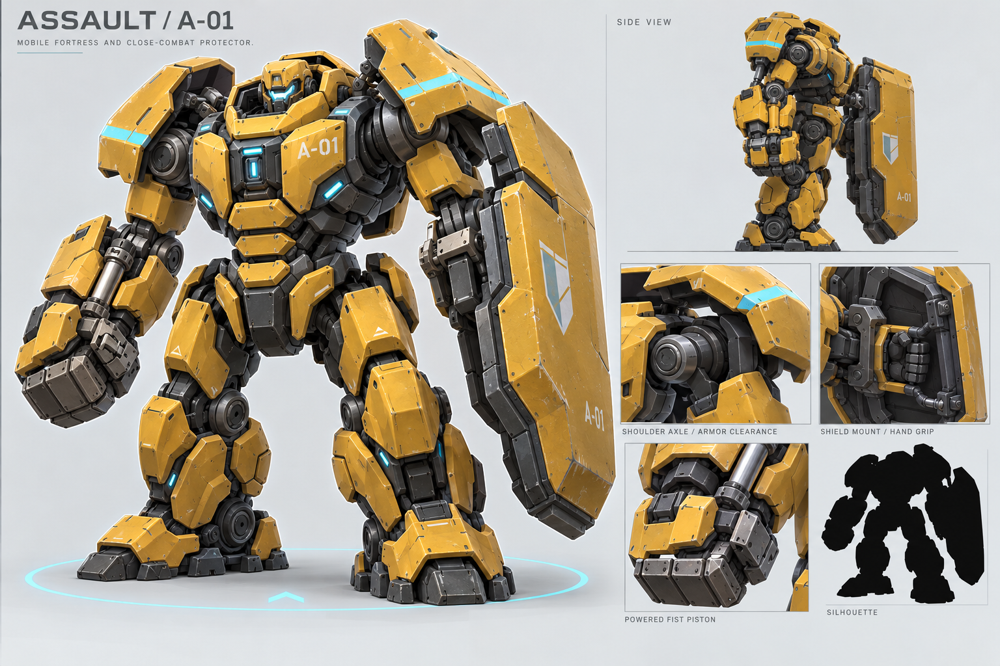
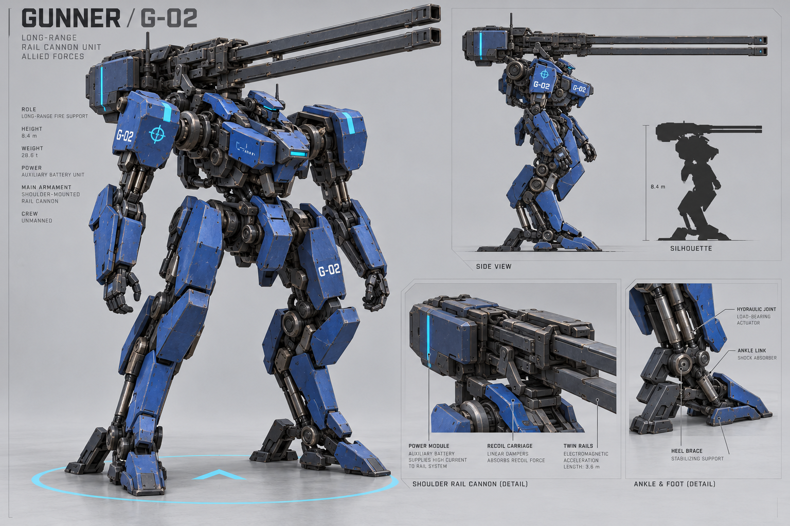
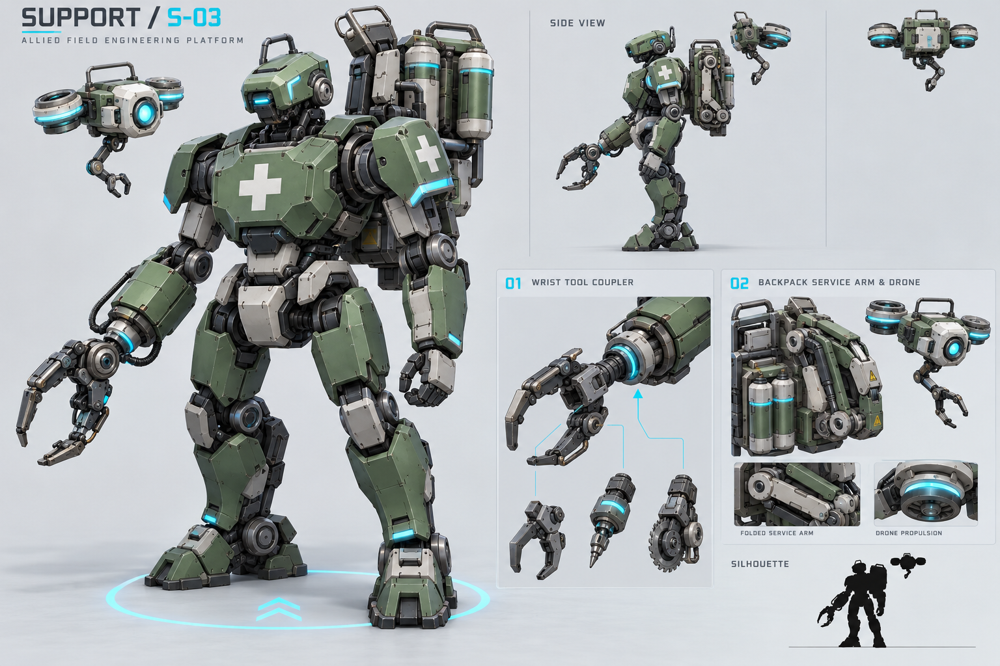
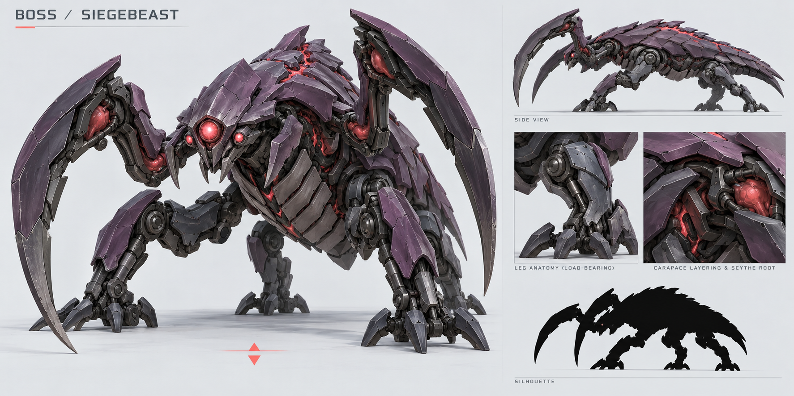
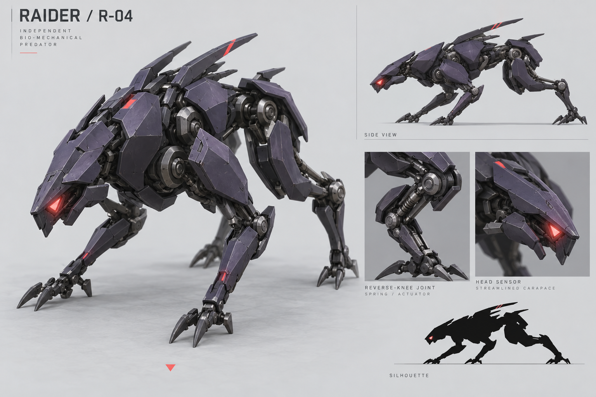

# Agent City 机甲概念重构 · 2026-10-26

由 imagegen 根据用户提供的角色与阵营设计说明生成。每张包含主视图、侧视图、结构细节和剪影，用于角色外观及建模方向评审。

## 共同设计约束

- 深色承重骨架、可解释的关节传动、少量大块涂装装甲分层。
- 我方保留黄、蓝、绿兵种涂装，统一青蓝 `#4FD8FF` 阵营识别点。
- 敌方保留低饱和紫色外壳，统一珊瑚红 `#FF5C72` 眼部与器官识别点。
- 职业以外轮廓和装备识别；阵营以统一色带和标记形状识别。

## 使用说明

这是概念设计参考，机械细节密度高于实战低模需求。建模时保留大轮廓、传动与安装关系，合并次级甲片并减少螺钉与表面刻线。图中文字、尺寸、重量等生成式注释没有经过工程确认，不覆盖项目现有世界尺度或玩法参数。

本次仅新增设计稿，不据此自动修改模型或战斗数值。

## 突击：移动堡垒

巨盾、重拳、宽肩；肩关节与悬挂肩甲分层，盾牌具有握架与厚度。

## 射手：远程火力平台

长双轨肩炮、后坐滑轨、独立供能模块与后跟支撑。

## 支援：野战维修平台

实体维修无人机、工具快换接口、折叠维修臂与白色医疗标记。

## Boss：生物机械战争巨兽

三眼、外展双镰、层叠甲壳、四足承重结构与前探头部。

## 袭扰者：低伏猎手

楔形躯干、逆关节与窄爪、后掠外轮廓，使用独立于 Boss 的结构。

