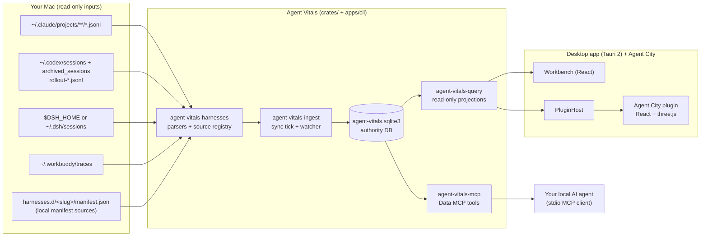

Oh Agent is an open-source platform for analyzing AI agent behavior data. Agents are now part of everyday work and life, and Oh Agent's goal is to make your agents' history useful to you. Oh Agent is built on the open-source Agent Vitals engine, and Agent City is its first app:

- **Agent Vitals**, the foundation: a local-first agent behavior data engine, embedded in the app (no server, no network port, no daemon). It finds the session logs your agents already write, parses them, and stores usage facts and behaviour findings in a local SQLite database. Then it serves that data through narrow, read-only interfaces.
- **Agent City**, built on top. It's an open-world data-visualization game that reads one of those interfaces and turns your sessions into a 3D city you can explore and replay.

Everything runs on your Mac. Nothing in this path uploads your data.

What "game" means today: desktop City has free flight and ring challenges, and driving is still in development. The web demo hides the game controls.

<!-- source: README.md ("What you can try today" table: Flying, Driving, Website gameplay rows) -->

## Key facts

- **Desktop shell:** Tauri 2 (`tauri = "2"`), app `Oh Agent.app`, identifier `ai.ohagent.desktop`, version `1.0.0-beta.3`.
- **Workbench UI:** React 19 + Vite + Tailwind 4, in `apps/desktop/ui-dev/`.
- **Agent City:** React 19 + three.js 0.186 + Vite, TypeScript, in `apps/agent-city/ui/`.
- **Core:** a Rust workspace of layered crates under `crates/` (data, domain, harnesses, query, ingest, billing, trust, MCP).
- **CLI:** `agent-vitals` (`apps/cli/`). The desktop bundle ships it as `bin/agent-vitals`.
- **Storage:** one SQLite file, `agent-vitals.sqlite3`, in the data folder `~/.agent-vitals/` (override with `AGENT_VITALS_HOME`).
- **Website:** static landing page in `website/landing/`, plus a copy of the real City frontend that only gets synthetic data.
- **Naming:** the desktop app is `Oh Agent.app` (`ai.ohagent.desktop`, renamed on dev in `5c29146`). Crates, the CLI, the internal executable `agent-vitals-menubar` and the data folder still use `agent-vitals`.

<!-- source: apps/desktop/src-tauri/Cargo.toml (tauri = "2", version 1.0.0-beta.3); apps/desktop/src-tauri/tauri.conf.json (identifier, bundle.resources "../../../target/release/agent-vitals": "bin/agent-vitals") -->
<!-- source: apps/desktop/ui-dev/package.json (react, tailwindcss, vite); apps/agent-city/ui/package.json (react ^19.3.0, three ^0.186.1, vite ^6.1.0) -->
<!-- source: crates/agent-vitals-runtime-core/src/core/home.rs (AGENT_VITALS_HOME → ~/.agent-vitals, legacy ~/.skill-vitals); crates/agent-vitals-data/src/authority.rs (default_authority_path → agent-vitals.sqlite3) -->
<!-- source: README.md ("Repository names, CLI commands, crates, application identifiers ... still use agent-vitals") -->

## What are the two layers, in code?

| Layer | What it is | Where it lives |
| --- | --- | --- |
| **Agent Vitals: sources and parsing** | Per-agent log parsers and the source registry | `crates/agent-vitals-harnesses/` (`src/sources/session_harnesses.rs` is the registry) |
| **Agent Vitals: storage and sync** | Sync service, tick, watcher, SQLite authority database | `crates/agent-vitals-ingest/`, `crates/agent-vitals-data/` |
| **Agent Vitals: metrics** | Pure rules, cost and billing, diagnostics | `crates/agent-vitals-domain/`, `crates/agent-vitals-billing/`, `crates/vitals-core/` |
| **Agent Vitals: data interface** | Read-only projections for apps, the Data MCP server, the CLI and exports | `crates/agent-vitals-query/src/query/` (`app_harnesses.rs`, `app_local.rs`, `export.rs`), `crates/agent-vitals-mcp/`, `apps/cli/` |
| **Host bridge** | Checks which plugin may read which projection, then calls the query layer | `apps/desktop/src-tauri/src/plugin_host.rs`, `plugin_projections.rs` |
| **Plugin protocol** | Shared TypeScript types and transport | `packages/agent-vitals-app-sdk/` (`harness-data.ts`, `city-ui-projection.ts`) |
| **Agent City** | Renderer, replay, flight and driving, photo and film export | `apps/agent-city/ui/`, registered in `apps/desktop/plugins.json` |

City reaches Vitals only through the host: `City → SDK plugin_request → PluginHost → plugin_projections → query::app_local → read-only database`. City never opens the database, never gets SQL, and never sees log paths.

How clean is the boundary? Partly clean.

- **Clean:** City has no Rust code and no database access. It only gets the projections declared in `plugins.json` (`city:v2`, `city:v3`, `city-settings:v1`, `harnesses:v1`). The generic `harnesses:v1` interface (`harnesses.list` / `harnesses.sessions`) is not City-specific.
- **City-named projections stay opt-in:** `city:v2` / `city:v3` still live in the shared query crate and SDK, and they are still the City scene feed. A second plugin does not receive them unless its own `dataProjections` lists the key. Session open uses the active plugin id as the handle scope (`app:{pluginId}:`). The resolver does not branch on `plugin_id == "city"`.
- **Not one package:** "Agent Vitals" is the whole Rust workspace plus the CLI, the Python twin and the desktop workbench. No single crate is called "Vitals" (`vitals-core` is only the diagnostics core). The desktop workbench reads Vitals data through its own Tauri IPC commands in `apps/desktop/src-tauri/src/lib.rs`, not through the plugin interface.

<!-- source: docs/CITY_LOCAL_DATA_PROJECTION.md ("City → app SDK plugin_request → Rust PluginHost → plugin_projections → query::app_local → readonly AuthorityDb") -->
<!-- source: apps/desktop/src-tauri/src/plugin_projections.rs (harnesses.list/harnesses.sessions → query::app_harnesses; projection key allowlist gates city:v2/city:v3; session_target → plugin_session_target(plugin_id)); apps/desktop/plugins.json -->
<!-- source: crates/agent-vitals-query/src/query/app_local.rs ("Explicit local-presentation projection; never reused by MCP or export"); packages/agent-vitals-app-sdk/src/city-ui-projection.ts ("Official same-host City MVP contract") -->
<!-- source: docs/APP_PLUGIN_HARNESS_DATA_CONTRACT.md (harnesses:v1 generic contract); apps/desktop/plugins.json -->
<!-- source: apps/desktop/src-tauri/src/lib.rs (generate_handler!: read_overview, data_status, … workbench IPC) -->

## How do the parts fit together?

<!-- TBD: Starlight does not render mermaid by default. Add a mermaid integration (for example a rehype/remark mermaid plugin) or pre-render this diagram to SVG at build time. Keep the text description below either way, since crawlers read the text. -->

In words: agent log folders on disk (Agent Vitals inputs) → harness parsers → sync service → SQLite authority database → read-only query layer → either the desktop UI (workbench and the Agent City plugin) or the local Data MCP server.

## What are the Rust layers?

The core is split into crates that may only depend on lower layers. `agent-vitals-runtime` is a facade that re-exports them.

| Layer | Crate | What it does |
| --- | --- | --- |
| L0–L1 | `agent-vitals-runtime-core` | Data folder, clock, state files, pricing tables, logging |
| L2–L3 | `agent-vitals-query` | Source registry, session lookups, read-only queries and projections (including City's `app_local.rs`) |
| L4 | `agent-vitals-billing` | Budgets, price discovery, quota reminders |
| L5 | `agent-vitals-ingest` | Sync service, 5-minute tick, file watcher, findings evaluation, manifest install |
| L5 | `agent-vitals-trust` | Trust / egress audit |
| L6 | `agent-vitals-mcp` | Data MCP tools (the outbound face) |
| — | `agent-vitals-harnesses` | Per-agent log parsing (Claude Code, Codex, DSH, WorkBuddy, generic manifests) |
| — | `agent-vitals-domain`, `agent-vitals-data`, `vitals-core` | Pure rules, SQLite schema and writers, diagnostics core |

<!-- source: crates/agent-vitals-runtime/src/lib.rs (layer table L0–L6, "只能依赖严格更低层", tests/module_layering.rs); Cargo.toml [workspace] members -->

## Where does each part live in the repo?

| Path | Purpose |
| --- | --- |
| `apps/desktop/src-tauri/` | Tauri host: tray, IPC commands, `plugin_host.rs`, `plugin_projections.rs` |
| `apps/desktop/ui-dev/` | React workbench (Overview, Usage, Sessions, Settings…) |
| `apps/desktop/plugins.json` | Registry of official built-in plugins (currently only City) |
| `apps/agent-city/ui/` | City renderer, replay, flight/driving, photo and film export |
| `packages/agent-vitals-app-sdk/` | Shared plugin protocol and UI transport |
| `apps/cli/` | `agent-vitals` CLI, including `data-mcp serve` |
| `crates/` | Rust core (table above) |
| `packages/agent-vitals-python/` | Python compatibility implementation, kept byte-identical via golden tests |
| `catalog/` | Official pricing catalog and (empty) source-manifest index |
| `integrations/dsh/` | DeepSeek Harness skill bundle |
| `website/landing/` | ohagent.ai landing page and synthetic City demo |

<!-- source: README.md (Repository map); AGENTS.md (Project Structure); apps/desktop/plugins.json; catalog/README.md ("Currently the index is empty") -->

## How is it built and tested?

- **Rust:** `cargo test --release`, and `cargo clippy --release --all-targets -- -D warnings` as the CI lint gate. The desktop crate is its own workspace, so building the CLI does not build the app.
- **Python parity:** `python3 tests/golden_runner.py --diff` checks byte-for-byte golden outputs; the same runner can compare the Rust binary against Python.
- **City:** `npm --prefix apps/agent-city/ui run typecheck`, plus the `verify:city*` scripts in `apps/desktop/ui-dev/package.json`.
- **macOS app:** `bash scripts/build-macos-react-app.sh`, then open the `.app` bundle. Never run the bare menubar binary.
- **CI workflows** (`.github/workflows/`): `verify.yml`, `app-contracts.yml`, `desktop-platforms.yml` (Windows/Linux packages), `release.yml`, `release-desktop.yml`, `pricing-sync.yml` (daily at 03:17 UTC), `package-clawhub.yml`.

<!-- source: AGENTS.md (Build, Test, and Development Commands); README.md (Development quick start); apps/desktop/src-tauri/Cargo.toml ([workspace] opt-out comment); .github/workflows/*.yml -->

## What does the website run?

The landing page at ohagent.ai embeds a build of the real City frontend from `apps/agent-city/ui`, produced by `tools/build-city3d.mjs` into `website/landing/city3d/`. It only receives synthetic sessions and never reads local logs.

<!-- source: website/landing/README.md ("node ../../tools/build-city3d.mjs", "The builder replaces the generated city3d/ directory"); README.md (Web demo row) -->

## Design rules worth knowing

- **Read, don't record.** Oh Agent installs no hooks or telemetry; it reads what agents already wrote.
- **No upload.** Network use is limited to public price/FX catalogs, release checks and explicitly chosen official downloads, with no local data in requests.
- **Raw text stays in the agents' logs.** The database stores anchors and counts, not full transcripts.
- **Honest numbers.** Unknown prices stay "unresolved", never zero.
- **Plugins never touch the database.** The host runs the query and returns only the declared projection.

<!-- source: docs/ARCHITECTURE.md §0 ("它自己不记录 —— 它读执行环境已经写在磁盘上的东西"); AGENTS.md (Data Retention & Serving-Face Policy, items 1–6; Billing fallback rule) -->

## Roadmap / 规划中

Not in the code at `dev` `bf7196a`. Listed so readers don't mistake plans for features.

- **Partial:** MCP tools can get / preview / set / reset one session building model (`docs/CITY_BUILDING_MCP.md`). An open City window plays construction from a shared `CityEntityChanged` host event (`entity_kind=building`; road/vehicle handlers later). Successful `preview_building` shows a translucent ghost; compliance / detail-regression / design-coherence rejects flash the lot. Soft design issues return `data.warnings` without blocking. The same write path fans out a squad IM envelope; agents publish `chat`/`claim`/`release` via `im_publish` (`docs/CITY_SQUAD_IM.md`).
- **TBD:** Incremental hot update. City refreshes on its own after each sync, but it reloads the full projection and rebuilds the scene; sending only changed sessions and patching single buildings isn't implemented. See [Data pipeline](/docs/architecture/data-pipeline#how-does-agent-city-update-when-new-sessions-arrive).
- **TBD:** A community gallery of cities (UGC). No code for this exists in the repo.
- **TBD:** Signed public installers. GitHub Releases is still empty.

See [Integrations](/docs/integrations) for the full list of what exists today.

## Related

- [Agent Vitals engine: crates, CLI, MCP tools, App SDK](/docs/vitals/overview)
- [Data pipeline: from session logs to the database](/docs/architecture/data-pipeline)
- [City model: how sessions become buildings](/docs/architecture/city-model)
- [Integrations and extension points](/docs/integrations)
- [Add a new data source](/docs/contributing/adding-a-data-source)
