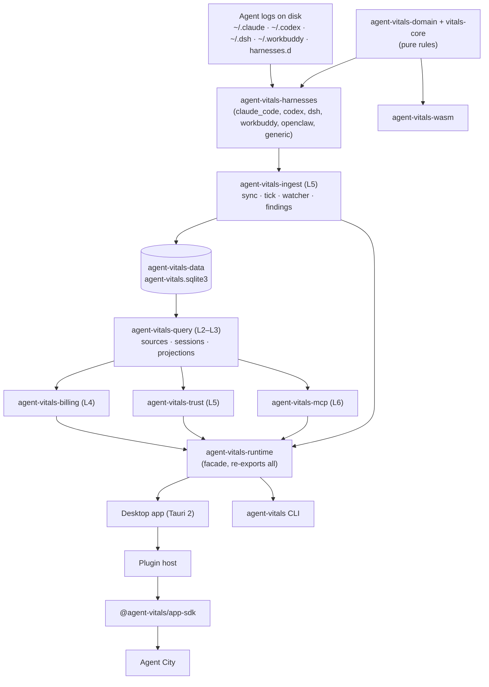

Oh Agent is built on the open-source **Agent Vitals** engine, and Agent City is its first app. Agent Vitals is a local-first engine for AI agent behavior data. It reads the session logs that Claude Code, Codex, DeepSeek Harness and WorkBuddy already write, turns them into usage facts and behaviour findings, stores them in an embedded SQLite database, and serves them through read-only interfaces: a CLI, a stdio MCP server, and projections for apps. It's a set of Rust libraries linked into the desktop app and the CLI, not a server: it opens no network port and runs no daemon.

## Key facts

- **Embedded, not a service:** the data layer is described in code as "an embedded local data layer, not a standalone service: no network port, no daemon."
- **One store:** `agent-vitals.sqlite3` in `~/.agent-vitals/` (or `AGENT_VITALS_HOME`). It doesn't repair itself; a corrupted file is rebuilt with `data-migrate`.
- **Who runs it:** the desktop app links the crates and syncs every 5 minutes in-process. The `agent-vitals` CLI runs the same code on demand.
- **Interfaces out:** the `agent-vitals` CLI, Data MCP tools (stdio only), App SDK projections, and JSONL exports.
- **Two implementations:** Rust is the product; a Python twin is kept byte-identical through golden tests.
- **Name:** "Agent Vitals" was the project's earlier name, so crates, the CLI and data folders are still called `agent-vitals`.

<!-- source: crates/agent-vitals-data/src/lib.rs ("这是一个**嵌入式本地数据层**，不是独立服务：不开网络端口、不起 daemon"; authority "不自愈——损坏需 rm + data-migrate 重建") -->
<!-- source: crates/agent-vitals-ingest/src/ingest/engine.rs ("进程内同步引擎"; desktop calls sync_service in-process, CLI sync-facts is another shell over the same function); scheduler.rs (tick_period 300 s) -->
<!-- source: README.md ("Oh Agent is the public brand … still use agent-vitals") -->

## How do the crates fit together?

<!-- Note: mermaid diagram shows simplified data flow; Cargo dependencies follow the L0–L6 layer table below (each crate depends only on lower layers). -->

In words: agent logs → `agent-vitals-harnesses` parsers → `agent-vitals-ingest` sync → `agent-vitals-data` SQLite store → `agent-vitals-query` read layer → billing, trust and MCP on top → the `agent-vitals-runtime` facade → the desktop app and CLI. In the desktop app, the plugin host passes projections through the App SDK to Agent City. The pure rules in `agent-vitals-domain` and `vitals-core` are shared by everything, including the wasm build.

## What does each crate do?

| Layer | Crate | Role |
| --- | --- | --- |
| Pure | `vitals-core` | Harness-agnostic behavioural audit engine (events, signals, detectors, findings). The SV601–SV614 rules run here |
| Pure | `agent-vitals-domain` | Shared vocabulary (usage fact, source identity, harness capability) and cross-agent calculations (behaviour, cost, usage) |
| Pure | `agent-vitals-provider` | Provider identity and attribution. No I/O, SQL or network |
| Adapters | `agent-vitals-harnesses` | Per-agent log parsing and the session source registry; file I/O sits behind the `sources` feature |
| Store | `agent-vitals-data` | The SQLite authority store: schema, migrations, transactions, the single fact writer, typed repository |
| L0–L1 | `agent-vitals-runtime-core` | Data folder, clock, leases, state, pricing, tool-response envelope, events outbox |
| L2–L3 | `agent-vitals-query` | Source config, manifest registry, watch topology, summaries, traces, exports, app projections |
| L4 | `agent-vitals-billing` | Budgets, billing preview and attribution, price discovery, quota reminders |
| L5 | `agent-vitals-ingest` | Sync service, in-process engine, tick scheduler, watcher, findings evaluation, manifest install |
| L5 | `agent-vitals-trust` | Local trust / egress history audit |
| L6 | `agent-vitals-mcp` | Data MCP tool layer, the outbound face where redaction is reviewed |
| Facade | `agent-vitals-runtime` | No code of its own; re-exports the layers so `agent_vitals_runtime::X` paths stay stable |
| Tooling | `agent-vitals-probe` | Runner for the desktop "Test" tab (identity probes; credentials passed in memory only) |
| Browser | `agent-vitals-wasm` | wasm-bindgen wrapper: pure behaviour audit and cost folding on events already in memory. Built with wasm-pack, not part of the default build |

Layering is enforced: crates may only depend on strictly lower layers (Cargo), and `tests/module_layering.rs` checks modules inside the runtime family.

The wasm crate is excluded from the default workspace build. Its docs mention a DSH audit tab, but no CI workflow or script in the repo currently builds it with wasm-pack.

<!-- source: Cargo.toml ([workspace] members; agent-vitals-wasm excluded from default-members) -->
<!-- source: crates/vitals-core/src/lib.rs ("harness-agnostic behavioral audit runtime … SV601–614 … 委托这里的 VitalsEngine"); crates/agent-vitals-domain/src/lib.rs; crates/agent-vitals-provider/src/lib.rs ("performs no I/O, SQL, network access") -->
<!-- source: crates/agent-vitals-runtime/src/lib.rs (layer table; facade); CLAUDE.md (crate map lines ~60–86) -->
<!-- source: crates/agent-vitals-probe/src/lib.rs; crates/agent-vitals-wasm/src/lib.rs ("Browser wasm entry … No I/O here"); rg found no wasm-pack in .github/workflows or scripts -->

## What does Agent Vitals refuse to do?

- **Upload user data.** No telemetry, crash reports with payloads, or cloud sync without an explicit, reviewed product decision.
- **Store credentials.** API keys and tokens are never written to anything it owns.
- **Copy transcripts.** It stores anchors and derived fields; full text stays in the agents' logs.
- **Guess costs.** Unproven routes stay `metered_estimate` with `has_unresolved`.

<!-- source: AGENTS.md (Data Retention & Serving-Face Policy, 2026-09-19; Billing fallback rule) -->

## Related

- [Claude Code data source](/docs/data-sources/claude-code)
- [Codex data source](/docs/data-sources/codex)
- [DeepSeek Harness data source](/docs/data-sources/deepseek-harness)
- [WorkBuddy data source](/docs/data-sources/workbuddy)
- [What each building in Agent City means](/docs/city-guide)
- [Privacy and data](/docs/privacy-and-data) · [Install](/docs/install) · [FAQ](https://ohagent.ai/#faq)
