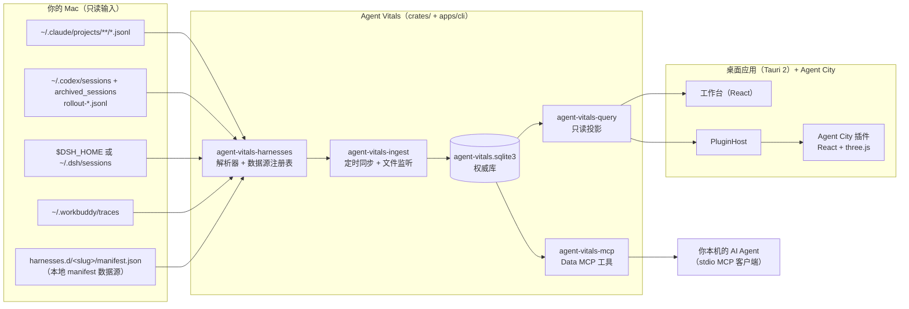

Oh Agent 是一个开源的 AI Agent 行为数据分析平台。Agent 已经成了每个人工作和生活的一部分，Oh Agent 想让你的 Agent 更有价值。Oh Agent 构建在开源的 Agent Vitals 引擎之上，Agent City 是这个引擎上的第一个应用：

- **Agent Vitals（底层）**：本机优先的 Agent 行为数据引擎，作为库嵌在应用里（不是服务器，不开网络端口，不常驻后台进程）。找到各个 Agent 本来就会写的会话日志，解析后把用量事实和行为发现存进本机的 SQLite 数据库，再通过范围很窄的只读接口对外提供数据。
- **Agent City（上层）**：数据可视化开放世界游戏。它读取其中一个接口，把你的会话变成一座可以探索、可以回放的 3D 城市。

所有东西都在你的 Mac 上运行，整条链路不上传数据。

“游戏”目前包括什么：桌面版 City 有自由飞行和穿环挑战，驾驶还在开发中；网页演示隐藏了游戏入口。

<!-- source: README.md（“What you can try today” 表：Flying、Driving、Website gameplay 三行） -->

## 关键事实

- **桌面外壳**：Tauri 2（`tauri = "2"`），应用名 `Oh Agent.app`，标识 `ai.ohagent.desktop`，版本 `1.0.0-beta.3`。
- **工作台界面**：React 19 + Vite + Tailwind 4，在 `apps/desktop/ui-dev/`。
- **Agent City**：React 19 + three.js 0.186 + Vite，TypeScript，在 `apps/agent-city/ui/`。
- **核心**：`crates/` 下分层的 Rust workspace（data、domain、harnesses、query、ingest、billing、trust、MCP）。
- **命令行**：`agent-vitals`（`apps/cli/`），桌面安装包里以 `bin/agent-vitals` 附带。
- **存储**：一个 SQLite 文件 `agent-vitals.sqlite3`，放在数据目录 `~/.agent-vitals/`（可用 `AGENT_VITALS_HOME` 改）。
- **官网**：`website/landing/` 的静态页面，内嵌一份真实的 City 前端，只喂模拟数据。
- **命名**：桌面应用叫 `Oh Agent.app`（`ai.ohagent.desktop`，dev 上 `5c29146` 改名）；crate、命令行、内部可执行文件 `agent-vitals-menubar` 和数据目录仍用 `agent-vitals`。

<!-- source: apps/desktop/src-tauri/Cargo.toml; apps/desktop/src-tauri/tauri.conf.json (identifier, bundle.resources → bin/agent-vitals) -->
<!-- source: apps/desktop/ui-dev/package.json; apps/agent-city/ui/package.json -->
<!-- source: crates/agent-vitals-runtime-core/src/core/home.rs; crates/agent-vitals-data/src/authority.rs; README.md -->

## 两层在代码里分别在哪？

| 层 | 是什么 | 位置 |
| --- | --- | --- |
| **Agent Vitals：数据源与解析** | 各 Agent 的日志解析器和数据源注册表 | `crates/agent-vitals-harnesses/`（注册表是 `src/sources/session_harnesses.rs`） |
| **Agent Vitals：存储与同步** | 同步服务、定时同步、文件监听、SQLite 权威库 | `crates/agent-vitals-ingest/`、`crates/agent-vitals-data/` |
| **Agent Vitals：指标** | 纯规则、费用与计费、诊断 | `crates/agent-vitals-domain/`、`crates/agent-vitals-billing/`、`crates/vitals-core/` |
| **Agent Vitals：数据接口** | 给应用用的只读投影、Data MCP 服务、命令行和导出 | `crates/agent-vitals-query/src/query/`（`app_harnesses.rs`、`app_local.rs`、`export.rs`）、`crates/agent-vitals-mcp/`、`apps/cli/` |
| **宿主桥接** | 检查哪个插件能读哪个投影，再调用查询层 | `apps/desktop/src-tauri/src/plugin_host.rs`、`plugin_projections.rs` |
| **插件协议** | 共享的 TypeScript 类型和传输层 | `packages/agent-vitals-app-sdk/`（`harness-data.ts`、`city-ui-projection.ts`） |
| **Agent City** | 渲染、回放、飞行和驾驶、拍照和视频导出 | `apps/agent-city/ui/`，在 `apps/desktop/plugins.json` 里登记 |

City 只能经过宿主访问 Vitals：`City → SDK plugin_request → PluginHost → plugin_projections → query::app_local → 只读数据库`。City 不会打开数据库，拿不到 SQL，也看不到日志路径。

边界干净吗？部分干净。

- **干净的部分**：City 没有 Rust 代码，也不碰数据库，只能拿到 `plugins.json` 里声明的投影（`city:v2`、`city:v3`、`city-settings:v1`、`harnesses:v1`）。通用接口 `harnesses:v1`（`harnesses.list` / `harnesses.sessions`）不是专门给 City 的。
- **还不干净（待确认）**：City 的主数据 `city:v2` 是 City 专用投影。它的查询（`app_local.rs`）和类型（`CityUiProjectionV2`）都以 City 命名，却放在共享的 Vitals 查询 crate 和 SDK 里，`plugin_projections.rs` 里也写死了 City（`if plugin_id != "city"`），用于会话跳转和新的分页投影 `city:v3`。也就是说在 dev 上，这类特殊处理变多了，而不是变少了。第二个应用没法直接复用 `city:v2`。要不要把它泛化成公开的“Vitals 数据接口 v1”，是一个待决定的设计问题。
- **不是一个独立包**：“Agent Vitals”指整个 Rust workspace，加上命令行、Python 对等实现和桌面工作台。没有哪个 crate 就叫“Vitals”（`vitals-core` 只是诊断核心）。桌面工作台通过 `apps/desktop/src-tauri/src/lib.rs` 里自己的 Tauri IPC 命令读数据，不走插件接口。

<!-- source: docs/CITY_LOCAL_DATA_PROJECTION.md; apps/desktop/src-tauri/src/plugin_projections.rs; crates/agent-vitals-query/src/query/app_local.rs ("Explicit local-presentation projection; never reused by MCP or export"); packages/agent-vitals-app-sdk/src/city-ui-projection.ts ("Official same-host City MVP contract"); docs/APP_PLUGIN_HARNESS_DATA_CONTRACT.md; apps/desktop/src-tauri/src/lib.rs (generate_handler!) -->

## 各部分怎么连起来？

<!-- 待确认：Starlight 默认不渲染 mermaid，需要加 mermaid 插件，或者构建时预渲染成 SVG。无论哪种，都保留下面的文字说明，爬虫读的是文字。 -->

用文字说：磁盘上的 Agent 日志目录（Agent Vitals 的输入）→ 各数据源解析器 → 同步服务 → SQLite 权威库 → 只读查询层 → 桌面界面（工作台和 Agent City 插件），或者本机的 Data MCP 服务。

## Rust 分几层？

核心拆成多个 crate，每个 crate 只能依赖比自己低的层。`agent-vitals-runtime` 只是统一转出这些 crate 的门面。

| 层 | crate | 负责什么 |
| --- | --- | --- |
| L0–L1 | `agent-vitals-runtime-core` | 数据目录、时钟、状态文件、价格表、日志 |
| L2–L3 | `agent-vitals-query` | 数据源注册、会话查找、只读查询和投影（包括 City 用的 `app_local.rs`） |
| L4 | `agent-vitals-billing` | 预算、价格发现、额度提醒 |
| L5 | `agent-vitals-ingest` | 同步服务、5 分钟定时同步、文件监听、行为发现评估、manifest 安装 |
| L5 | `agent-vitals-trust` | Trust / 外发审计 |
| L6 | `agent-vitals-mcp` | Data MCP 工具（对外出口） |
| — | `agent-vitals-harnesses` | 各 Agent 的日志解析（Claude Code、Codex、DSH、WorkBuddy、通用 manifest） |
| — | `agent-vitals-domain`、`agent-vitals-data`、`vitals-core` | 纯规则、SQLite 表结构和写入、诊断核心 |

<!-- source: crates/agent-vitals-runtime/src/lib.rs（L0–L6 分层表）；Cargo.toml [workspace] members -->

## 仓库里每部分在哪？

| 路径 | 用途 |
| --- | --- |
| `apps/desktop/src-tauri/` | Tauri 宿主：托盘、IPC 命令、`plugin_host.rs`、`plugin_projections.rs` |
| `apps/desktop/ui-dev/` | React 工作台（概览、用量、会话、设置等） |
| `apps/desktop/plugins.json` | 官方内置插件注册表（目前只有 City） |
| `apps/agent-city/ui/` | City 渲染、回放、飞行和驾驶、拍照和视频导出 |
| `packages/agent-vitals-app-sdk/` | 插件共享协议和界面传输层 |
| `apps/cli/` | `agent-vitals` 命令行，含 `data-mcp serve` |
| `crates/` | Rust 核心（见上表） |
| `packages/agent-vitals-python/` | Python 兼容实现，用 golden 测试保证逐字节一致 |
| `catalog/` | 官方价格目录，以及（目前为空的）数据源 manifest 索引 |
| `integrations/dsh/` | DeepSeek Harness 的 skill 包 |
| `website/landing/` | ohagent.ai 官网和模拟数据的 City 演示 |

<!-- source: README.md（Repository map）；AGENTS.md；apps/desktop/plugins.json；catalog/README.md -->

## 怎么构建和测试？

- **Rust**：`cargo test --release`；CI 的 lint 门禁是 `cargo clippy --release --all-targets -- -D warnings`。桌面 crate 是独立 workspace，编译命令行不会顺带编译桌面应用。
- **Python 对等**：`python3 tests/golden_runner.py --diff` 逐字节对比 golden 输出，也能拿 Rust 二进制和 Python 对拍。
- **City**：`npm --prefix apps/agent-city/ui run typecheck`，以及 `apps/desktop/ui-dev/package.json` 里的 `verify:city*` 脚本。
- **macOS 应用**：`bash scripts/build-macos-react-app.sh`，然后打开 `.app` 包。不要直接运行裸的菜单栏二进制。
- **CI 工作流**（`.github/workflows/`）：`verify.yml`、`app-contracts.yml`、`desktop-platforms.yml`（Windows/Linux 包）、`release.yml`、`release-desktop.yml`、`pricing-sync.yml`（每天 UTC 03:17，即北京时间 11:17）、`package-clawhub.yml`。

<!-- source: AGENTS.md；README.md；.github/workflows/*.yml -->

## 官网跑的是什么？

ohagent.ai 内嵌的是 `apps/agent-city/ui` 的真实 City 前端，由 `tools/build-city3d.mjs` 构建到 `website/landing/city3d/`。它只拿到模拟会话，不读任何本机日志。

<!-- source: website/landing/README.md；README.md（Web demo 一行） -->

## 值得知道的设计原则

- **只读，不记录**：Oh Agent 不装 hook，也不做遥测，只读 Agent 已经写下的东西。
- **不上传**：联网只用于公开的价格/汇率表、版本检查和你主动选择的官方下载，请求里不带本机数据。
- **原文留在 Agent 自己的日志里**：数据库只存锚点和计数，不存完整对话。
- **数字要诚实**：价格未知就标“未确定”，不当作零。
- **插件不碰数据库**：查询由宿主执行，只返回声明过的投影。

<!-- source: docs/ARCHITECTURE.md §0；AGENTS.md（Data Retention & Serving-Face Policy 第 1–6 条；Billing fallback rule） -->

## Roadmap / 规划中

以下内容在 `dev` 分支 `bf7196a` 的代码里都还没有，列出来是为了不让读者把规划当成已有功能。

- **部分完成**：MCP 可以 get / preview / set / reset 一栋会话楼的模型（`docs/CITY_BUILDING_MCP.md`）。城里的施工播放来自共享 `CityEntityChanged` 事件。成功的 `preview_building` 显示半透明幽灵楼；合规 / 细节回退 / 设计连贯性拒绝会闪一下地块。偏软的设计问题走 `data.warnings`，不拦写入。同一条写入路径还会向小队 IM 频道扇出信封；Agent 用 `im_publish` 发 `chat`/`claim`/`release`（`docs/CITY_SQUAD_IM.md`）。
- **待确认**：增量热更新。每次同步后 City 会自动刷新，但会重新读取完整投影并重建场景；只传变化的会话、只更新单栋楼还没有实现。见[数据管线](/docs/zh/architecture/data-pipeline#有新会话时-agent-city-怎么更新)。
- **待确认**：城市作品廊（UGC）。仓库里没有相关代码。
- **待确认**：签名的公开安装包。GitHub Releases 目前还是空的。

现在实际有哪些集成，见[集成](/docs/zh/integrations)。

## 相关

- [Agent Vitals 引擎：crate、命令行、MCP 工具、App SDK](/docs/zh/vitals/overview)
- [数据管线：从会话日志到数据库](/docs/zh/architecture/data-pipeline)
- [城市模型：会话怎么变成楼](/docs/zh/architecture/city-model)
- [集成与扩展点](/docs/zh/integrations)
- [添加新的数据源](/docs/zh/contributing/adding-a-data-source)
