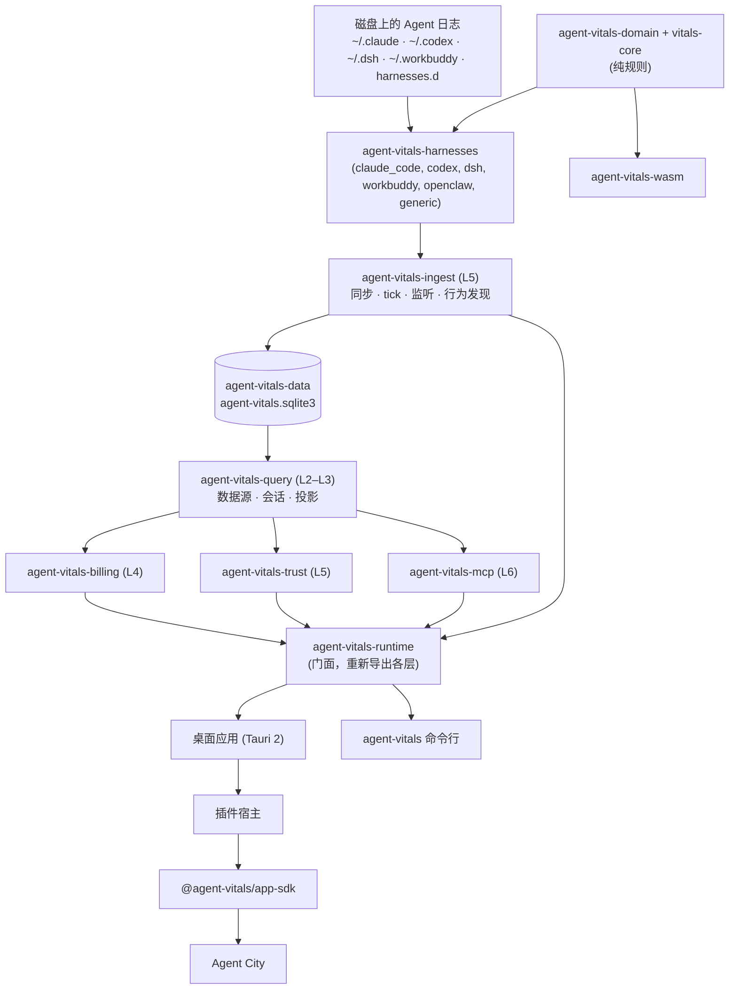

Oh Agent 构建在开源的 **Agent Vitals** 引擎之上，Agent City 是它的第一个应用。Agent Vitals 是一个本地优先的 AI Agent 行为数据引擎。它读取 Claude Code、Codex、DeepSeek Harness 和 WorkBuddy 本来就会写的会话日志，转成用量事实和行为发现，存进嵌入式 SQLite 数据库，再通过只读接口对外提供：命令行、stdio MCP 服务和给应用的投影。它是一组链接进桌面应用和命令行的 Rust 库，不是服务器：不开网络端口，也不跑后台进程。

## 关键事实

- **嵌入式，不是服务**：代码里对数据层的描述是“嵌入式本地数据层，不是独立服务：不开网络端口、不起 daemon”。
- **一个数据库**：`~/.agent-vitals/`（或 `AGENT_VITALS_HOME`）下的 `agent-vitals.sqlite3`。它不会自我修复，文件损坏要用 `data-migrate` 重建。
- **谁来跑**：桌面应用链接这些 crate，在进程内每 5 分钟同步一次；`agent-vitals` 命令行按需运行同一套代码。
- **对外接口**：`agent-vitals` 命令行、Data MCP 工具（只有 stdio）、App SDK 投影，以及 JSONL 导出。
- **两套实现**：Rust 是正式产品；Python 对等实现通过 golden 测试保持逐字节一致。
- **名字**：“Agent Vitals”是项目早期的名字，所以 crate、命令行和数据目录仍叫 `agent-vitals`。

<!-- source: crates/agent-vitals-data/src/lib.rs ("这是一个**嵌入式本地数据层**，不是独立服务：不开网络端口、不起 daemon"; authority "不自愈——损坏需 rm + data-migrate 重建") -->
<!-- source: crates/agent-vitals-ingest/src/ingest/engine.rs ("进程内同步引擎"); scheduler.rs (tick_period 300 s) -->
<!-- source: README.md ("Oh Agent is the public brand … still use agent-vitals") -->

## 这些 crate 是怎么组合的？

<!-- 说明：mermaid 图是简化的数据流；Cargo 依赖以下面的 L0–L6 分层表为准（每个 crate 只依赖更低层）。 -->

用文字说：Agent 日志 → `agent-vitals-harnesses` 解析器 → `agent-vitals-ingest` 同步 → `agent-vitals-data` SQLite 存储 → `agent-vitals-query` 读取层 → 上面是计费、信任和 MCP → `agent-vitals-runtime` 门面 → 桌面应用和命令行。在桌面应用里，插件宿主通过 App SDK 把投影交给 Agent City。`agent-vitals-domain` 和 `vitals-core` 的纯规则被所有部分共用，包括 wasm 构建。

## 每个 crate 做什么？

| 层 | Crate | 作用 |
| --- | --- | --- |
| 纯逻辑 | `vitals-core` | 与具体 Agent 无关的行为审计引擎（事件、信号、检测器、发现），SV601–SV614 规则在这里跑 |
| 纯逻辑 | `agent-vitals-domain` | 共用词汇（用量事实、数据源身份、Agent 能力）和跨 Agent 的计算（行为、费用、用量） |
| 纯逻辑 | `agent-vitals-provider` | 服务商身份和归因，不做 I/O、SQL 或网络访问 |
| 适配器 | `agent-vitals-harnesses` | 各 Agent 的日志解析和会话数据源注册表；文件 I/O 在 `sources` feature 后面 |
| 存储 | `agent-vitals-data` | SQLite 权威库：表结构、迁移、事务、唯一的事实写入器、类型化仓库 |
| L0–L1 | `agent-vitals-runtime-core` | 数据目录、时钟、租约、状态、定价、工具响应信封、事件 outbox |
| L2–L3 | `agent-vitals-query` | 数据源配置、manifest 注册表、监听拓扑、汇总、轨迹、导出、应用投影 |
| L4 | `agent-vitals-billing` | 预算、账单预览和归因、价格发现、额度提醒 |
| L5 | `agent-vitals-ingest` | 同步服务、进程内引擎、tick 调度、监听、行为发现评估、manifest 安装 |
| L5 | `agent-vitals-trust` | 本地信任 / 外发历史审计 |
| L6 | `agent-vitals-mcp` | Data MCP 工具层，也是审查脱敏的对外出口 |
| 门面 | `agent-vitals-runtime` | 自身没有代码，重新导出各层，让 `agent_vitals_runtime::X` 路径保持稳定 |
| 工具 | `agent-vitals-probe` | 桌面“测试”页的执行器（身份探测；凭据只在内存中传递） |
| 浏览器 | `agent-vitals-wasm` | wasm-bindgen 封装：对内存里已有的事件做纯行为审计和费用汇总。用 wasm-pack 构建，不在默认构建里 |

分层是强制的：crate 只能依赖严格更低的层（由 Cargo 保证），`tests/module_layering.rs` 检查 runtime 系列内部的模块分层。

wasm crate 不在默认 workspace 构建里。它的文档提到一个 DSH 审计页，但仓库里目前没有任何 CI 工作流或脚本用 wasm-pack 构建它。

<!-- source: Cargo.toml ([workspace] members; agent-vitals-wasm excluded from default-members) -->
<!-- source: crates/vitals-core/src/lib.rs; crates/agent-vitals-domain/src/lib.rs; crates/agent-vitals-provider/src/lib.rs ("performs no I/O, SQL, network access") -->
<!-- source: crates/agent-vitals-runtime/src/lib.rs (layer table; facade); CLAUDE.md (crate map) -->
<!-- source: crates/agent-vitals-probe/src/lib.rs; crates/agent-vitals-wasm/src/lib.rs ("Browser wasm entry … No I/O here"); no wasm-pack in .github/workflows or scripts -->

## Agent Vitals 不做什么？

- **上传用户数据**：没有经过明确评审的产品决定，就没有遥测、带内容的崩溃报告或云同步。
- **保存凭据**：API key 和 token 绝不写进它管理的任何文件。
- **复制对话**：只存锚点和派生字段，完整文本留在 Agent 自己的日志里。
- **猜费用**：证明不了的线路一律是 `metered_estimate`，并带 `has_unresolved`。

<!-- source: AGENTS.md (Data Retention & Serving-Face Policy, 2026-09-19; Billing fallback rule) -->

## 相关

- [Claude Code 数据源](/docs/zh/data-sources/claude-code)
- [Codex 数据源](/docs/zh/data-sources/codex)
- [DeepSeek Harness 数据源](/docs/zh/data-sources/deepseek-harness)
- [WorkBuddy 数据源](/docs/zh/data-sources/workbuddy)
- [Agent City 里每栋楼代表什么](/docs/zh/city-guide)
- [隐私与数据](/docs/zh/privacy-and-data) · [安装](/docs/zh/install) · [常见问题](https://ohagent.ai/zh/#faq)
